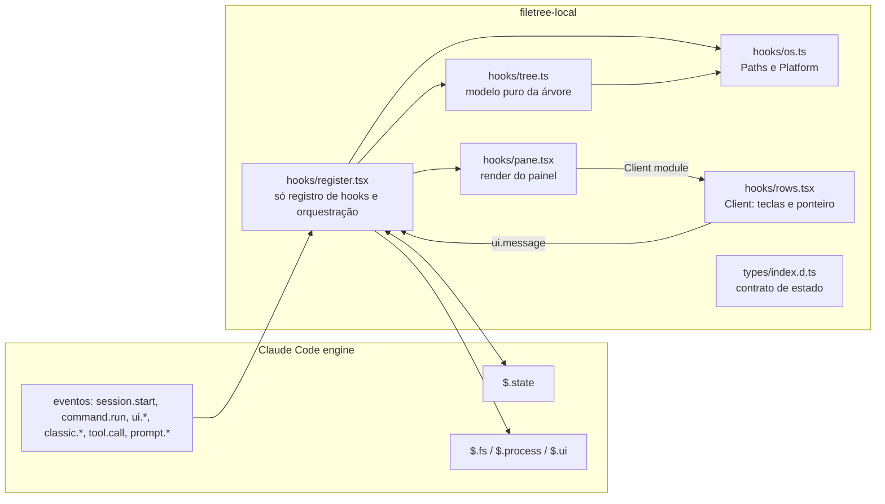

# filetree-local: visão geral, regras globais e roadmap

**Created.** `2026-10-16`

**Sources.**

- `https://github.com/data-goblin/claude-code-filetree` (v0.2.26, commit HEAD em 2026-10-16). Referência de comportamento para a paridade de experiência. Não é código a copiar.

## Goal

Construir um mod local do Claude Code que mostre uma árvore de arquivos no estilo de IDE num painel lateral e que reproduza a experiência do mod `claude-code-filetree`. A motivação é de segurança e de aprendizado. O autor quer rodar só código que entende e controla, sem um canal de atualização de terceiros, e quer aprender a construir mods.

O sucesso tem quatro condições:

1. o mod oferece, no Windows, a mesma experiência do original, fatia por fatia;
2. cada fatia é revisada pelo autor antes da próxima;
3. o mod segue regras de segurança verificáveis que o original não segue (seção R1);
4. o mod é carregado de uma pasta local versionada, sem marketplace e sem atualização automática.

Este documento é o contrato comum a todas as fatias. Cada fatia tem a sua spec (`spec-01` em diante) e depende deste arquivo.

## Current behavior

O projeto ainda não tem código. A referência de comportamento é o mod original (v0.2.26). Os fatos dele que influenciam este desenho:

- **Tamanho e organização.** O original roda ~110 KB de TypeScript em `hooks/`, sem `package.json` e sem dependências, e concentra quase tudo em `hooks/register.tsx` (72 KB).
- **Processos.**
  - Usa `sh -c` em scripts fixos (detecção de fonte, Quick Look, abertura no Linux, tmux).
  - No Windows abre arquivos com `powershell -NoProfile -NonInteractive -Command`, passando o caminho por variável de ambiente.
  - Executa como argv o comando configurado em "Open with" e `$VISUAL`/`$EDITOR`.
- **Tool calls.** Observa `tool.call` e repassa `next(e)` sem alterar a chamada.
- **Prompt.** Em `prompt.submit`, adiciona a `e.context`, sem o usuário ver, o texto `The user has this file selected in the file tree; ...: <caminho absoluto>`.
- **Leitura de arquivos.** O preview lê qualquer arquivo de até 4 MB da árvore. A árvore pode ser enraizada em qualquer pasta, inclusive `C:\`.
- **Caminhos.** Convertidos para `/` e comparados diferenciando maiúsculas. No Windows, `C:\Devs` e `c:\devs` contam como pastas diferentes.
- **Distribuição.** É instalado como marketplace do próprio repositório e recebe as atualizações que o autor publicar.

## Requirements and acceptance

### R1. Regras de segurança globais

Toda fatia deve obedecer a estas regras. Elas são o que diferencia este mod do original e existem para serem verificadas na revisão e por ferramenta.

- R1.1. O mod nunca deve executar um interpretador de comandos. Nenhuma chamada a `$.process.run` ou `$.process.spawn` pode ter como `argv[0]` `sh`, `bash`, `cmd`, `cmd.exe`, `powershell`, `powershell.exe`, `pwsh` ou `pwsh.exe`.
- R1.2. Os únicos executáveis que o mod pode chamar são os listados em [Executáveis permitidos](#executáveis-permitidos). Uma fatia que precise de outro deve emendar esta spec antes de implementar.
- R1.3. Todo hook de `tool.call` deve repassar `next(e)` com o mesmo `e`, nunca devolver `deny` e só ler o resultado.
- R1.4. Todo hook de `prompt.submit`, `prompt.attachment` ou `prompt.compose` deve repassar o evento sem acrescentar ou alterar texto ou contexto que o usuário não veja na tela. O mecanismo visível do contexto de seleção será definido na `spec-09`.
- R1.5. Quando o mod ler o conteúdo de um arquivo (`$.fs.read`), o caminho real do arquivo, com links resolvidos, deve estar dentro do caminho real da raiz permitida, conforme `Paths.inside`. A raiz permitida será definida na `spec-08`.
- R1.6. Onde existir a opção "Open with", ela deve vir desligada por padrão e só aceitar programas de uma lista limitada. A forma da lista será definida na `spec-08`.
- R1.7. O mod não deve escrever em disco (`$.fs.write`) nem usar `$.store` até que uma spec de fatia defina o caso explicitamente.
- R1.8. O mod não deve fazer acesso de rede (`fetch`), chamar modelos (`$.model`, `$.agent`) nem expor capacidades ao modelo (`$.tool.register`).
- R1.9. Toda leitura de variável de ambiente deve usar um nome da lista [Variáveis de ambiente permitidas](#variáveis-de-ambiente-permitidas).

### R2. Camada de SO

As diferenças entre plataformas devem morar num único módulo, para que o resto do código seja independente de plataforma e as comparações de caminho sejam corretas no Windows.

- R2.1. Todo caminho guardado em estado ou usado como id deve estar na forma normalizada definida por `Paths.norm`.
- R2.2. Toda chamada a `$.fs` deve receber o caminho convertido por `Paths.native`.
- R2.3. Todo caminho mostrado ao usuário deve passar por `Paths.pretty`.
- R2.4. No Windows, `Paths.same` e `Paths.inside` não devem diferenciar maiúsculas. Exemplo: `inside('C:/Devs', 'c:/devs/x')` é `true`.
- R2.5. `Paths.inside(root, p)` só deve ser `true` quando `p` é `root` ou fica abaixo dele num limite de segmento. Exemplo: `inside('C:/Dev', 'C:/Devs')` é `false`.
- R2.6. Só `hooks/os.ts` pode testar a plataforma (`Platform`). Os outros módulos recebem um objeto `Paths`.

### R3. Empacotamento e carregamento

- R3.1. O mod deve ser um plugin chamado `filetree-local`, com um único módulo de hooks (`hooks/register.tsx`).
- R3.2. O mod deve carregar a partir da pasta do repositório, através de `CLAUDE_CODE_PLUGIN_DIRS` nas configurações do usuário, sem marketplace e sem cópia instalada.
- R3.3. O repositório não deve ter dependências de runtime. O `package.json` não deve existir, ou, se existir, só pode declarar ferramentas de desenvolvimento.

### R4. Verificação por fatia

- R4.1. Uma fatia só deve ser considerada pronta quando `claude plugin validate`, `tsc -p` e `claude plugin test` passam sem erros.
- R4.2. Todo critério de aceitação de uma fatia deve ter pelo menos um teste em `tests/`, exceto os que a própria spec marcar como verificação manual.
- R4.3. Os testes que desenham o painel devem rodar nas superfícies `terminal` e `desktop`.

## Architecture

O mod é um plugin com um único módulo de entrada. Esse módulo só registra hooks e delega a lógica a módulos puros, que são testáveis sem o engine.



| Módulo | É dono de | Não pode |
|---|---|---|
| `hooks/register.tsx` | registrar hooks, ler e gravar `$.state`, chamar `$.fs`, `$.process` e `$.ui` | conter regras de árvore ou de caminho que possam morar em módulo puro |
| `hooks/os.ts` | `Platform`, `Paths`, lista de executáveis e de variáveis de ambiente | chamar `$`, exceto em `detectPlatform` |
| `hooks/tree.ts` e futuros módulos de domínio (`git.ts`, `activity.ts`...) | funções puras sobre o estado | chamar `$` |
| `hooks/pane.tsx` | transformar estado em árvore de elementos | gravar estado |
| `hooks/rows.tsx` | Client: desenhar as linhas recebidas e devolver `RowsMessage` | qualquer lógica de domínio |

Cada fatia acrescenta as suas próprias chaves de `$.state` (por exemplo `git`, `activity`) em vez de acrescentar campos a `TreeState`. Assim uma fatia não muda o contrato de outra.

## Components and contracts

### Paths (camada de SO)

`hooks/os.ts` (novo). É o contrato comum a todas as fatias.

```ts
export type Platform = 'windows' | 'posix'

export interface Paths {
  readonly platform: Platform
  /** Forma interna: separador '/', drive maiúsculo, sem '/' final (exceto raiz), '.' e '..' resolvidos. */
  norm(input: string): string
  /** Forma para $.fs: no Windows troca '/' por '\'. */
  native(p: string): string
  /** Forma para a tela: native + prefixo da home trocado por '~'. */
  pretty(p: string, home: string): string
  /** Chave de comparação: no Windows, norm(p).toLowerCase(). */
  key(p: string): string
  same(a: string, b: string): boolean
  inside(root: string, p: string): boolean
  /** null na raiz do drive ou em '/'. */
  parent(p: string): string | null
  join(dir: string, name: string): string
  base(p: string): string
  /** Caminho de p relativo a root, na forma norm; '' quando iguais. Pressupõe inside(root, p). */
  relative(root: string, p: string): string
  /** Resolve entrada do usuário contra cwd; '~' vira home. null quando vazia ou ilegível. */
  resolve(cwd: string, input: string, home: string): string | null
  /** true para caminhos UNC ('//servidor/share'). */
  isNetwork(p: string): boolean
}

export function paths(platform: Platform): Paths
export async function detectPlatform($: EngineInterface): Promise<Platform> // $.env.get('OS') === 'Windows_NT'
```

Comportamento exigido no Windows (`paths('windows')`):

| Chamada | Resultado |
|---|---|
| `norm('c:\\Users\\w4rl0ck\\')` | `'C:/Users/w4rl0ck'` |
| `norm('C:')`, `norm('c:\\')` | `'C:/'` |
| `norm('C:\\a\\\\b\\.\\c\\..')` | `'C:/a/b'` |
| `norm('\\\\?\\C:\\a')` | `'C:/a'` |
| `norm('\\\\srv\\share\\x')` | `'//srv/share/x'` (com `isNetwork` = `true`) |
| `native('C:/Users/x')` | `'C:\\Users\\x'` |
| `pretty('C:/Users/w4rl0ck/Devs', 'C:/Users/w4rl0ck')` | `'~\\Devs'` |
| `key('C:/Devs/Foo')` | `'c:/devs/foo'` |
| `inside('C:/Devs', 'c:/devs/a/b')` | `true` |
| `inside('C:/Dev', 'C:/Devs')` | `false` |
| `inside('C:/', 'C:/x')` | `true` |
| `parent('C:/Devs')` | `'C:/'` |
| `parent('C:/')` | `null` |
| `resolve('C:/Devs', '..\\x', home)` | `'C:/x'` |
| `resolve('C:/Devs', '~\\Docs', 'C:/Users/w4rl0ck')` | `'C:/Users/w4rl0ck/Docs'` |
| `resolve('C:/Devs', 'D:', home)` | `'D:/'` |

Em `paths('posix')`, `key` é a identidade, `native` é a identidade e `parent('/')` é `null`. A plataforma `posix` existe para que outras plataformas entrem depois, e as fatias atuais só precisam testá-la em `norm`, `inside` e `parent`.

### Executáveis permitidos

Ficam como constante em `hooks/os.ts`. Uma fatia que precise de outro executável emenda esta tabela.

| Executável | Fatia | Uso |
|---|---|---|
| `git.exe` (Windows) / `git` (posix) | spec-03, spec-04 | só subcomandos de leitura: `rev-parse`, `status`, `diff`, `ls-files` (spec-03) e `diff-tree` (spec-04). Toda chamada leva `--no-optional-locks -c core.fsmonitor=false -C <raiz>`, e `diff`/`diff-tree` levam `--no-ext-diff --no-textconv` (spec-03 R1) |
| `explorer.exe` (Windows) | spec-08 | abrir arquivo ou pasta com o app padrão, com o caminho como único argumento |

A `spec-01` não chama nenhum executável.

### Variáveis de ambiente permitidas

| Nome | Uso |
|---|---|
| `OS` | detectar o Windows (`Windows_NT`) |
| `USERPROFILE`, `HOME` | home, para `~` em `resolve` e `pretty` |
| `WINDIR`, `LOCALAPPDATA` | pastas de fontes do Windows, para o `auto` dos glyphs (spec-07 R4.2) |

## Data models

O contrato de estado fica em `types/index.d.ts`, declarado em `interface PluginState` sob `'filetree-local'`. Cada fatia acrescenta as suas chaves. A `spec-01` define `tree` e `memory`, a `spec-02` define `activity`, a `spec-03` define `git`, a `spec-04` define `chip`, a `spec-06` define `search` e a `spec-07` define `columns`.

## Key decisions

| Decision | Chosen | Rejected alternative | Why, and what it costs |
|---|---|---|---|
| Reescrever ou auditar o original | Reescrever, em fatias revisadas | Auditar e fixar uma versão do original | O objetivo é entender o código e aprender. O custo são várias fatias de trabalho em vez de algumas horas de auditoria |
| Papel do original | Especificação extraída do comportamento, implementação independente | Clean-room; tradução arquivo por arquivo | Aproveita os casos limite já resolvidos sem herdar o monólito de 72 KB |
| Quem escreve | O Claude escreve e o autor revisa cada fatia | O autor escreve o núcleo | Escolha do autor. A aposta é que a revisão por fatia basta para entender o código. O teste é o autor fazer uma mudança sozinho depois da fatia 1 |
| Plataforma | Windows primeiro, com `Paths` isolando o SO | Multiplataforma desde já | Só o que o autor consegue verificar é implementado |
| Shell | Nenhum, nem para abrir arquivos | PowerShell como o original | Elimina injeção por nome de arquivo e a execução de `$PROFILE` |
| Contexto no prompt | Nada invisível | `e.context` oculto como o original | Regra de segurança do autor. O mecanismo visível fica para a spec-09 |
| Forma interna de caminho | `/`, drive maiúsculo, comparação sem diferenciar maiúsculas no Windows | Caminho nativo em todo lugar; `/` diferenciando maiúsculas (original) | O original trata `C:\Devs` e `c:\devs` como pastas diferentes |
| Distribuição | Pasta local via `CLAUDE_CODE_PLUGIN_DIRS`; depois um repositório GitHub sem marketplace | Marketplace próprio | Sem canal de atualização automática |
| Nome | Plugin `filetree-local`, comando `/filetree` | Plugin `filetree` | Evita colisão com o original e mantém o comando conhecido |
| Specs | `spec-00` comum mais uma spec por fatia, escrita quando chegar a vez | Todas as specs de uma vez | Decisões das fatias seguintes são tomadas depois de ver a API funcionando |

## Roadmap e checklist de paridade

| Spec | Fatia | Funcionalidades do original | Regras de R1 em jogo |
|---|---|---|---|
| `spec-01` | Painel, árvore e navegação | painel lateral, `/filetree [caminho]`, opção `start`, árvore preguiçosa e ordenação, ocultos, botões ↑ ⌂ ↻ ◉ ⊟ ⊘, seguir a cwd, coluna de data, teclado e mouse, copiar caminho, rodapé de seleção | R1.7, R1.9 |
| `spec-02` | Atividade do Claude | brilho roxo (leitura por `Read`/`Grep`/`Glob`) e laranja (escrita por `Edit`/`Write`/`NotebookEdit` e varredura de shell), revelação, seguir o Claude, opções `activity` e `follow` | R1.3. Sem parser de comandos: o read-only vem do `isReadOnly` do engine, e as escritas do shell são observadas por `mtimeMs` |
| `spec-03` | Status do git | cores por status, `+N/-N`, contagens por pasta, linha de branch, upstream e ahead/behind, ignorados, opção `hints` | R1.1, R1.2 (`git.exe`) |
| `spec-04` | Atividade de git | chips no rodapé a partir do `gitOperation` do engine e da comparação de status (`committed <sha>`, `pushed`, `staged N`, PR…), verde nos arquivos commitados ou preparados, tom da linha da branch e varredura de escrita via git status, que vê pastas fechadas. Sem parser de comandos | R1.2 (`diff-tree`), R1.3 |
| `spec-05` | Atualização automática | releitura periódica com o painel visível (opção `refresh`) e vigilância de `.git/index` e `HEAD` (`watchPaths` no `classic.SessionStart`), para que várias sessões no mesmo diretório vejam as mudanças umas das outras, em silêncio. Não existe no original | R1.2 (`rev-parse --absolute-git-dir`), R1.4 |
| `spec-06` | Busca | caixa de busca na linha de navegação, índice por `git ls-files` ou varredura com `fs.list`, filtro com revelação, salto com Enter | R1.2 (`ls-files`) |
| `spec-07` | Colunas e visual | tamanhos (`Σ`), idade, opção `column`, glyphs Nerd Font (`glyphs`, com `auto` por listagem das pastas de fontes), dicas de hover nos botões, realce da linha sob o mouse | R1.9 (`WINDIR`, `LOCALAPPDATA`) |
| `spec-08` | Abrir, preview e edição | abrir com app padrão, preview no painel, opções `open` e `edit` | R1.1, R1.2 (`explorer.exe`), R1.5, R1.6 |
| `spec-09` | Contexto da seleção | seleção como contexto do prompt, `@menções` revelam arquivos | R1.4 |

Funcionalidades do original que **não** serão portadas:

| Funcionalidade | Motivo |
|---|---|
| Quick Look (`qlmanage`, `osascript`) | só existe no macOS |
| Editor via tmux (`TMUX_OPEN`) | precisa de tmux, que não existe no Windows nativo |
| Tema Omarchy | só existe no Linux |
| Suporte ao herdr | multiplexador fora do escopo do autor |
| Detecção de Nerd Font via `sh -c` | viola R1.1 e, no Windows, não detecta nada. A spec-07 troca por listagem das pastas de fontes do Windows, sem shell |
| Paletas hex clara e escura | substituídas por ThemeKeys do engine (decisão da spec-01) |

## Affected areas

| Area | Responsibility |
|---|---|
| `.claude-plugin/plugin.json` | manifesto com `name: "filetree-local"`, `types` e `userConfig` acumulado pelas fatias |
| `hooks/hooks.json` | `{ "modules": ["./register.tsx"] }` |
| `hooks/os.ts` | contrato `Paths`, executáveis e variáveis permitidas (R1.2, R1.9, R2) |
| `types/index.d.ts` | contrato `PluginState['filetree-local']` |
| `tests/` | testes de cada fatia, mais `tests/os.test.ts` para a tabela de `Paths` |
| `tsconfig.json` | configuração de `tsc -p`, igual à do cabeçalho do arquivo de tipos do engine |
| `.gitignore` | ignora `.claude-plugin/types/` (gerado pelo engine) |
| Configurações do usuário (`~/.claude/settings.json`) | fora do repositório. O autor inclui `CLAUDE_CODE_PLUGIN_DIRS` manualmente; o mod e o Claude não editam esse arquivo |

## Implementation constraints

- Os módulos só podem usar `import` estático. Um módulo com `import()` não carrega.
- O ambiente do mod não tem Node nem DOM. Timers usam `$.clock`.
- Em `$.state`, `plugin` e `key` das referências devem ser literais de string.
- `$.env.get` só aceita nomes literais, o que torna R1.9 verificável pela saída de `claude plugin validate`.
- Em testes, caminhos Windows dentro de strings TS precisam de `\\`, porque `'\U...'` é erro de sintaxe.
- Toda fatia que acrescentar um hook ou uma chamada de `$` deve conferir R1 na saída de `claude plugin validate`, que lista hooks, chamadas, variáveis de ambiente e estado.

## Verification

Pré-requisitos locais:

- Claude Code 2.1.302 ou mais novo. Hoje está instalada a 2.1.302.
- Node 24 (já instalado).
- O compilador TypeScript, que **não** está instalado. Ele é ferramenta de desenvolvimento, nunca dependência de runtime: `npm install -g typescript`.

Comandos, executados na raiz do repositório:

```powershell
claude plugin validate .
tsc -p .
claude plugin test .
```

| Critério | Verificação |
|---|---|
| R1.1, R1.2, R1.7, R1.8, R1.9 | ler a saída de `claude plugin validate`: as chamadas listadas não podem incluir `fs.write`, `store.*`, `model.*`, `agent.*` ou `tool.register`; `process.run` e `process.spawn` só aparecem nas fatias que os autorizam; as variáveis de ambiente listadas estão na tabela. Na revisão, conferir os `argv` de cada `process.run` contra a tabela de executáveis |
| R1.3, R1.4 | testes da fatia correspondente comparam o evento recebido pelo hook de baixo com o original |
| R1.5, R1.6 | testes da spec-08 |
| R2.1 a R2.6 | `tests/os.test.ts` cobre cada linha da tabela de `Paths`. A revisão confere que nenhum módulo fora de `hooks/os.ts` lê `OS` ou compara caminhos com `===` |
| R3.2 | manual: com `CLAUDE_CODE_PLUGIN_DIRS` configurado, `/plugin` lista `filetree-local` numa sessão nova |
| R4 | os três comandos passam |

Para carregar o mod (passo manual do autor), incluir em `~/.claude/settings.json`:

```json
{
  "env": {
    "CLAUDE_CODE_PLUGIN_DIRS": "C:\\Users\\w4rl0ck\\Documents\\Devs\\claude-filetree"
  }
}
```

## Out of scope

- Detalhar as fatias 2 a 9. Cada uma ganha a sua spec quando chegar a vez.
- Publicar em marketplace.
- Suporte efetivo a Linux e macOS. Só a interface `Paths` fica preparada.
- Persistir estado entre sessões (`$.store`), proibido por R1.7 até uma spec de fatia autorizar.
