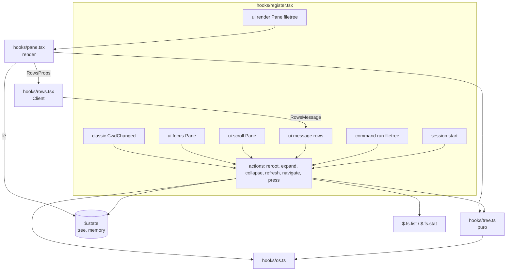

# Fatia 1: painel, árvore e navegação

**Created.** `2026-10-16`

**Depends on.**

- `spec-00-overview.md`. Usa o contrato `Paths` (R2), as regras R1, o layout de módulos e as verificações R4.

**Sources.**

- `https://github.com/data-goblin/claude-code-filetree` v0.2.26. Referência de comportamento: `hooks/register.tsx`, `hooks/tree.ts`, `hooks/rows.tsx`, `types/index.d.ts`.

## Goal

Entregar a primeira fatia útil do `filetree-local`: um painel lateral com a árvore da pasta de trabalho, navegável por teclado e mouse, que segue a cwd e pode ser enraizado em outra pasta com `/filetree`. Esta fatia também estabelece o ciclo completo do mod (registro, comando, painel, render, estado, Client e testes), que as fatias seguintes reutilizam.

A fatia está pronta quando:

- o autor consegue usar o painel no lugar do original para explorar arquivos;
- os critérios abaixo passam nos testes;
- o autor consegue fazer sozinho uma mudança pequena, como esconder uma pasta ou trocar uma tecla. Este é o teste da aposta "revisar basta para entender", da `spec-00`.

## Current behavior

O repositório ainda não tem código. Nesta fatia, o original (v0.2.26) se comporta assim:

- **Abertura.**
  - Abre o painel com `$.ui.open({ id: 'filetree', title: 'Files: <base>' })` no `session.start`, a menos que a opção `start` seja `off`.
  - `/filetree` abre com `focus: true`.
  - Quando o painel é desenhado `inline` no terminal, o mod o fecha (`register.tsx:1366`).
- **`/filetree`** (`register.tsx:1158`).
  - No terminal, recusa abrir fora do fullscreen ou com menos de 110 colunas.
  - Sem argumento, volta para a cwd. Com argumento, fixa a raiz.
  - **Sempre reconstrói a árvore do zero**, então as pastas expandidas se perdem.
  - Um caminho inexistente vira uma árvore vazia, sem erro.
- **Árvore.**
  - Nós planos com id igual ao caminho absoluto (`/`), carregados ao expandir.
  - Ordenação: pastas primeiro, depois `Intl.Collator(undefined, { numeric: true, sensitivity: 'base' })` (`tree.ts:7`).
  - Ocultos são os nomes que começam com `.`. Aparecem por padrão.
  - Links para pastas são seguidos como pastas comuns.
- **Entrada.**
  - Um Client (`rows.tsx`) envia teclas e cliques por `ui.message`. O duplo clique é detectado no hook, com 450 ms.
  - Uma linha de botões `↓ ↑ ← → open` serve de reserva.
  - O mapa de teclas está na tabela [Teclas](#teclas). As teclas `g`, `G` e `Esc` não são tratadas.
- **Rolagem.**
  - No terminal, a rolagem é virtual: o modo automático centraliza o cursor e a roda do mouse passa para o modo manual.
  - No desktop, a rolagem é nativa.
- **Cores.** Paletas hex escura e clara.

Esta fatia muda deliberadamente quatro pontos:

1. o `/filetree` preserva a expansão por raiz;
2. um caminho inválido no `/filetree` gera erro;
3. links e junctions não expandem;
4. as cores vêm das ThemeKeys.

## Requirements and acceptance

### R1. Abertura do painel

O painel deve aparecer na lateral sem esforço e nunca ocupar a área do prompt.

- R1.1. Quando a sessão começar pela primeira vez (sem `tree` em `$.state`) com a opção `start` em `on`, o mod deve chamar `$.ui.open({ id: 'filetree', title })` sem `focus`.
- R1.2. Quando a opção `start` for `off`, o mod não deve abrir o painel no `session.start`.
- R1.3. Quando `session.start` disparar de novo por hot reload (com `tree` já em `$.state`), o mod deve manter o estado da árvore e não deve chamar `$.ui.open`.
- R1.4. O título deve ser `Files: <nome>`, em que `<nome>` é `Paths.base(root)`, ou `Paths.native(root)` quando a raiz é a raiz de um drive (`Files: C:\`).
- R1.5. Se o render do painel chegar com `surface: 'terminal'` e `props.placement: 'inline'`, o mod deve chamar `$.ui.close({ id: 'filetree' })` e devolver um `Box` vazio.

### R2. Comando `/filetree`

O comando abre o painel e escolhe a raiz da árvore.

- R2.1. No `session.start`, o mod deve registrar `{ name: 'filetree', description: 'Show the file tree; args: [path] (no path = follow the cwd)', argumentHint: '[path]' }`.
- R2.2. Se a sessão tiver a superfície `terminal` e `presentation.isFullscreen` for `false`, o comando deve devolver o texto `filetree shows in the sidebar, which needs the fullscreen layout. Run /tui fullscreen, then /filetree.` e não mudar nada.
- R2.3. Se a sessão tiver a superfície `terminal` e `presentation.columns < 110`, o comando deve devolver `filetree needs a terminal at least 110 columns wide. Widen it, then run /filetree.` e não mudar nada.
- R2.4. Quando `/filetree` rodar sem argumento, o mod deve:
  - marcar `follow = true`;
  - re-enraizar na cwd, restaurando a expansão memorizada para ela (R6);
  - abrir o painel com `focus: true`;
  - devolver `File tree on <pretty> (follows the cwd).`
- R2.5. Quando `/filetree <caminho>` apontar para uma pasta existente, o mod deve:
  - marcar `follow = false`;
  - re-enraizar nessa pasta, restaurando a expansão memorizada;
  - abrir o painel com `focus: true`;
  - devolver `File tree on <pretty>.`
- R2.6. O argumento deve ser resolvido com `Paths.resolve(cwd, arg, home)`, depois de remover espaços nas pontas e um par de aspas que envolva o texto inteiro. Assim `/filetree "C:\a b"` e `/filetree C:\a b` dão o mesmo resultado.
- R2.7. Se o caminho não existir, o comando deve devolver `filetree: <pretty> does not exist.` com `exitCode: 1` e manter a árvore como estava.
- R2.8. Se o caminho apontar para um arquivo, o comando deve devolver `filetree: <pretty> is not a folder.` com `exitCode: 1` e manter a árvore.
- R2.9. Se o caminho for de rede (`Paths.isNetwork`), o comando deve devolver `filetree: network paths are not supported (<pretty>).` com `exitCode: 1` e manter a árvore.
- R2.10. Se o `fs.stat` da pasta falhar por outro motivo, o comando deve devolver `filetree: could not open <pretty>: <mensagem>.` com `exitCode: 1` e manter a árvore.

### R3. Conteúdo e ordem da árvore

- R3.1. Ao listar uma pasta, o mod deve mapear cada `FsEntry` para um `FileNode`:
  - `isLink` → `link`;
  - senão `kind: 'dir'` → `dir`;
  - `kind: 'file'` → `file`;
  - o resto → `other`.
- R3.2. Os filhos de uma pasta devem aparecer com os nós `dir` primeiro e o resto depois, cada grupo ordenado por `Intl.Collator(undefined, { numeric: true, sensitivity: 'base' })`. Exemplo: `a2` vem antes de `a10`, e `B` fica entre `a` e `c`.
- R3.3. Um nó deve ser `hidden` quando o nome começa com `.`.
- R3.4. Enquanto `showHidden` for `true` (padrão), nós `hidden` devem aparecer. Enquanto for `false`, eles e os descendentes devem ser omitidos.
- R3.5. Nenhum nome deve ser excluído além dos ocultos. `.git` e `node_modules` aparecem.
- R3.6. Os nós `link` devem mostrar o glyph `↪` e não devem ser expansíveis.
- R3.7. Os filhos de uma pasta só devem ser listados quando ela for expandida pela primeira vez, ou quando a pasta já carregada for recarregada (R7).
- R3.8. Quando a árvore não tiver linhas visíveis, o painel deve mostrar uma única linha `empty` na cor `subtle`.

### R4. Desenho do painel

O layout, de cima para baixo, está em [Layout do painel](#layout-do-painel).

- R4.1. O cabeçalho deve mostrar o nome da raiz (como em R1.4) em negrito e na cor `suggestion`, truncado no início, seguido dos botões de [Botões do cabeçalho](#botões-do-cabeçalho).
- R4.2. Cada linha deve ter:
  - indentação de 2 colunas por nível;
  - o caret (`▸ ` fechado, `▾ ` aberto, `  ` para não pastas);
  - o glyph e um espaço;
  - o nome;
  - à direita, a data de modificação.
- R4.3. A data deve aparecer só em nós `file`, no formato `YYYY-MM-DD HH:MM` em hora local.
- R4.4. Se o espaço do nome ficar menor que 12 colunas, a coluna de data deve ser omitida em todas as linhas. Se ainda assim o nome não couber, ele deve ser truncado no fim com `…`.
- R4.5. A linha do cursor deve ser desenhada com `inverse`, e o nome do arquivo `selected` em negrito.
- R4.6. Uma pasta cuja listagem falhou deve mostrar o sufixo ` (unreadable)` na cor `error`.
- R4.7. O rodapé `selected: <caminho relativo à raiz, nativo>` só deve aparecer enquanto houver um `selected`. Ele usa a cor `subtle` e é truncado no início.
- R4.8. Todas as cores devem vir das ThemeKeys de [Cores](#cores). O código não deve conter nenhuma cor hex.

### R5. Rolagem

- R5.1. No terminal, o Client deve receber só as linhas da janela visível: `room = max(5, scroll.bodyRows - fixas)`, em que `fixas` são as linhas de cabeçalho, de navegação e, quando houver, de rodapé.
- R5.2. Enquanto `scroll` for `null` (modo automático), a janela deve começar em `clamp(cursorIndex - floor(room / 2), 0, max(0, total - room))`.
- R5.3. Quando a roda do mouse disparar `ui.scroll` no terminal, o mod deve passar para o modo manual com `scroll = clamp(from + sign(by) * max(3, |by|), 0, max)`, devolver `{}` sem chamar `next` e redesenhar.
- R5.4. Qualquer navegação por teclado deve voltar `scroll` para `null`.
- R5.5. No terminal, quando o total de linhas passar de `room`, a última coluna de cada linha deve mostrar a barra de rolagem: `┃` (`suggestion`) no polegar e `│` (`subtle`) no trilho.
- R5.6. Quando o usuário clicar ou arrastar na coluna da barra, o Client deve enviar `scrollTo` com `fraction = y / max(1, linhas da janela - 1)`, e o mod deve fixar `scroll = round(fraction * max)`.
- R5.7. No desktop, o mod deve enviar as linhas visíveis até 1500 ou até as `RowSpec` somarem 45.000 caracteres serializados, o que vier primeiro, e repassar `ui.scroll` com `next(e)`. Quando sobrarem linhas, a última linha deve ser `… N more rows, collapse folders` na cor `subtle`.

### R6. Memória de expansão por raiz

Voltar para uma pasta deve restaurar as pastas que estavam abertas nela durante a sessão.

- R6.1. Quando o mod re-enraizar de A para B, ele deve gravar `memory[key(A)] = expanded de A`. Se `expanded` estiver vazio, deve apagar a entrada de A.
- R6.2. Quando o mod re-enraizar em B e existir `memory[key(B)]`, ele deve listar a raiz e cada pasta memorizada em ordem de profundidade. As pastas que não existirem mais, ou cuja pasta-mãe não carregou, devem ser descartadas de `expanded`.
- R6.3. A memória deve guardar no máximo 50 raízes. Ao gravar uma 51ª, a entrada gravada há mais tempo deve ser removida.
- R6.4. A memória deve durar só a sessão, em `$.state`. Ela sobrevive ao hot reload, e o mod não deve gravá-la em disco.
- R6.5. Quando a raiz nova for a mesma da atual (`Paths.same`), o mod não deve reconstruir a árvore. Deve só recarregar as pastas carregadas (R7) e abrir ou focar o painel.

### R7. Recarga e sincronização

- R7.1. Quando o usuário pressionar `↻`, o mod deve listar de novo a raiz e toda pasta em `expanded` que já esteja carregada.
- R7.2. Quando uma recarga mostrar que um nó sumiu, o mod deve:
  - remover o nó e os descendentes dele;
  - removê-los de `expanded`;
  - mover o cursor para o ancestral mais próximo que ainda existe;
  - limpar `selected` se ele sumiu.
- R7.3. Quando uma recarga mostrar que uma pasta ainda existe, ela deve manter `loaded` e os filhos carregados.
- R7.4. Quando o painel receber foco (`ui.focus` com `component: 'Pane'`):
  - se `follow` for `true` e a raiz diferir da cwd, o mod deve re-enraizar na cwd;
  - senão, deve recarregar como em R7.1.

  Isso no máximo uma vez a cada 2000 ms.
- R7.5. Se uma listagem terminar depois de uma mudança de raiz ou de uma listagem mais nova da mesma pasta, o resultado dela deve ser descartado (G1).

### R8. Seguir a cwd

- R8.1. Quando `classic.CwdChanged` disparar e `follow` for `true`, o mod deve re-enraizar em `new_cwd` (com R6) e devolver o resultado de `next(e)` sem alterá-lo.
- R8.2. Enquanto `follow` for `false`, mudanças de cwd não devem alterar a raiz.
- R8.3. O botão `⌂` deve ser desenhado com `dimColor` enquanto `follow` for `false`.

### R9. Entrada: teclado, mouse e botões

- R9.1. Quando o Client enviar `{ kind: 'key' }`, o mod deve aplicar a tabela [Teclas](#teclas) e ignorar as teclas que não estão nela.
- R9.2. Quando o Client enviar um `press` esquerdo sem modificador numa pasta, o mod deve mover o cursor para ela e alternar a expansão.
- R9.3. Quando o Client enviar um `press` esquerdo sem modificador num nó que não é pasta, o mod deve mover o cursor e marcar o nó como `selected`.
- R9.4. Quando dois `press` esquerdos no mesmo id chegarem com até 450 ms de intervalo, num nó `dir`, o mod deve re-enraizar nele com `follow = false`. Num nó que não é pasta, deve se comportar como R9.3. A abertura de arquivos é da spec-08.
- R9.5. Quando chegar um `press` esquerdo com `ctrl` ou `shift` numa pasta, o mod deve re-enraizar nela com `follow = false`.
- R9.6. Quando chegar um `press` direito, o mod deve copiar o caminho relativo à raiz, na forma nativa, com `$.ui.copy`, e mostrar o toast `Copied <caminho>`. Com `shift`, deve copiar o caminho absoluto nativo.
- R9.7. Se `$.ui.copy` falhar, o mod deve mostrar o toast `Could not copy the path`.
- R9.8. Ao receber um `press`, o mod deve fixar `scroll` no início atual da janela antes de aplicar a ação, para que a vista não salte.
- R9.9. Uma única tecla pressionada deve produzir uma única ação, mesmo que o botão de navegação com o mesmo hotkey esteja na tela. Exemplo: `j` move o cursor uma linha, não duas.
- R9.10. Os botões de navegação `↓ ↑ ← → open` (hotkeys `j k h l o`) devem executar as mesmas ações das teclas `down up left right return`. Depois de pressionados, o foco deve voltar para o botão `open`, que tem `autoFocus`.
- R9.11. O mod deve validar cada `RowsMessage`: o `kind` precisa ser conhecido, o `id` precisa existir em `nodes` e `fraction` precisa ser um número entre 0 e 1. Mensagens inválidas devem ser ignoradas.

### R10. Limites de segurança desta fatia

Concretiza a `spec-00` R1 para esta fatia.

- R10.1. O módulo não deve chamar `$.process.*`, `$.fs.read`, `$.fs.write` nem `$.store.*`.
- R10.2. O módulo não deve registrar hooks de `tool.call`, `prompt.submit`, `prompt.attachment` ou `prompt.compose`.
- R10.3. As únicas variáveis de ambiente lidas devem ser `OS`, `USERPROFILE` e `HOME`.

## Architecture



Os hooks só traduzem eventos em ações. As ações ficam em `register.tsx` porque chamam `$`, e toda decisão sobre a árvore é uma função pura de `tree.ts`. O render lê `$.state` e se inscreve nele: uma escrita redesenha o painel sem `invalidate`.

## Components and contracts

### `hooks/register.tsx` (novo)

Hooks registrados nesta fatia, e somente eles:

| Hook | Matcher | Comportamento | Critérios |
|---|---|---|---|
| `session.start` | — | detecta a plataforma; lê `USERPROFILE` ou `HOME`; registra o comando; se `tree.root === ''` (primeira inicialização), grava `emptyTree(cwd, true)` e lista a raiz; abre o painel se for a primeira inicialização e `start` for `on`; devolve `next(e)` | R1.1–R1.3, R2.1 |
| `command.run` | `{ command: 'filetree' }` | algoritmo `runFiletree` | R2 |
| `ui.render` | `{ component: 'Pane', requestId: 'filetree' }` | `renderPane` (em `pane.tsx`) | R1.4, R1.5, R4, R5 |
| `ui.message` | `{ requestId: 'filetree' }` | valida a `RowsMessage` e despacha para `navigate`, `press` ou `scrollTo` | R9 |
| `ui.scroll` | `{ component: 'Pane', requestId: 'filetree' }` | no terminal aplica R5.3 e devolve `{}`; no desktop devolve `next(e)` | R5.3, R5.7 |
| `ui.focus` | `{ component: 'Pane', requestId: 'filetree' }` | `sync()` com limite de 2000 ms; devolve `next(e)` | R7.4 |
| `classic.CwdChanged` | — | se `follow`, `reroot(new_cwd)`; devolve `next(e)` sem alterar | R8 |

Variáveis de módulo (perdidas no hot reload, sem efeito em correção):

- `paths: Paths`;
- `home: string`;
- `lastPress: { id: string; at: number } | null`;
- `lastSync: number`;
- `listSeq: number`;
- `listLatest: Map<string, number>`;
- `unreadableToasted: Set<string>`.

#### Algoritmo `runFiletree`

```ts
async function runFiletree($: EngineInterface, e: CommandRunInput): Promise<CommandRunResult> {
  const terminal = await $.session.surfaces().then(s => s.includes('terminal'), () => true)
  if (terminal && !e.presentation.isFullscreen) return { text: NOT_FULLSCREEN }
  if (terminal && e.presentation.columns < 110) return { text: TOO_NARROW }

  const cwd = paths.norm(await $.session.cwd())
  const arg = unquote(e.args.trim())
  if (arg === '') {
    await reroot($, cwd, { follow: true, focus: true })
    return { text: `File tree on ${paths.pretty(cwd, home)} (follows the cwd).` }
  }

  const target = paths.resolve(cwd, arg, home)
  if (target === null) return fail(`filetree: ${arg} does not exist.`)
  const shown = paths.pretty(target, home)
  if (paths.isNetwork(target)) return fail(`filetree: network paths are not supported (${shown}).`)
  let stat: FsStat
  try {
    stat = await $.fs.stat(paths.native(target))
  } catch (err) {
    if (errno(err) === 'ENOENT') return fail(`filetree: ${shown} does not exist.`)
    return fail(`filetree: could not open ${shown}: ${message(err)}.`)
  }
  if (stat.kind !== 'dir') return fail(`filetree: ${shown} is not a folder.`)

  await reroot($, target, { follow: false, focus: true })
  return { text: `File tree on ${shown}.` }
}
// fail(text) => ({ text, exitCode: 1 }); unquote remove um par de aspas " ou ' que envolva o texto inteiro.
```

#### Algoritmo `reroot`

```ts
async function reroot($: EngineInterface, root: string, opts: { follow: boolean; focus?: boolean }) {
  const current = await read($, treeAtom)
  if (paths.same(current.root, root)) {                       // R6.5
    await update($, treeAtom, t => ({ ...t, follow: opts.follow }))
    await openPane($, opts.focus)
    await refresh($)
    return
  }
  await update($, memoryAtom, m => remember(m, paths.key(current.root), current.expanded)) // R6.1, R6.3
  const remembered = (await read($, memoryAtom))[paths.key(root)] ?? []
  await update($, treeAtom, t => ({
    ...emptyTree(root, t.showHidden),
    follow: opts.follow,
    generation: t.generation + 1,
    expanded: remembered,
  }))
  await openPane($, opts.focus)                                // título novo: Files: <base>
  await loadInDepthOrder($, [root, ...remembered])             // R6.2; descarta o que falhar
}
```

`openPane($, focus)` chama `$.ui.open({ id: 'filetree', title, ...(focus ? { focus: true } : {}) })` e ignora `isPlaced: false`, porque o painel espera até caber.

#### Algoritmo `listDir` (guarda de concorrência, G1)

```ts
async function listDir($: EngineInterface, dir: string) {
  const { generation } = await read($, treeAtom)
  const seq = ++listSeq
  listLatest.set(paths.key(dir), seq)
  let entries: FsEntry[] | null = null
  let error: string | undefined
  try {
    entries = await $.fs.list(paths.native(dir))
  } catch (err) {
    if (errno(err) === 'ENOENT') entries = []                  // pasta sumiu: lista vazia
    else error = message(err)
  }
  await update($, treeAtom, t => {
    if (t.generation !== generation || listLatest.get(paths.key(dir)) !== seq) return t  // descarta
    return error === undefined
      ? replaceChildren(t, dir, toNodes(paths, dir, entries!))
      : markUnreadable(t, dir, error)
  })
  if (error !== undefined && !unreadableToasted.has(paths.key(dir))) {
    unreadableToasted.add(paths.key(dir))
    await $.ui.toast(`could not list ${paths.pretty(dir, home)}: ${error}`)
  }
}
```

### `hooks/tree.ts` (novo, puro)

Funções puras. Recebem `Paths` quando comparam caminhos e nunca chamam `$`.

| Função | Contrato |
|---|---|
| `emptyTree(root, showHidden)` | `TreeState` com `nodes: []`, `expanded: []`, `cursor: ''`, `selected: ''`, `scroll: null`, `follow: true`, `generation: 0` |
| `toNodes(paths, dir, entries)` | mapeia conforme R3.1 e R3.3 e ordena conforme R3.2 |
| `replaceChildren(t, dir, children)` | troca os filhos de `dir`; mantém `loaded` e `error` das pastas que continuam existindo; remove os descendentes das que sumiram e limpa `expanded`, `cursor` e `selected` conforme R7.2; marca `dir` com `loaded: true` e sem `error` |
| `markUnreadable(t, dir, msg)` | `dir` fica com `loaded: true`, `error: msg`, filhos anteriores mantidos |
| `visibleRows(t)` | lista em profundidade a partir da raiz, respeitando `showHidden` (R3.4) e `expanded`; cada `Row` traz `{ id, depth, node, isOpen }` |
| `navigate(t, rows, key, room)` | aplica a tabela [Teclas](#teclas) e devolve `{ tree, effect? }`, em que `effect` é `{ load: string }`, `{ copy: 'relative' \| 'absolute' }` ou `undefined`; sempre zera `scroll` (R5.4) |
| `toggle(t, id)` | alterna `id` em `expanded`; devolve `{ load: id }` quando a pasta abre sem estar carregada |
| `collapseAll(t, paths)` | `expanded: []`; o cursor vai para o ancestral de primeiro nível do cursor atual |
| `remember(memory, key, expanded)` | aplica R6.1 e R6.3; remove a chave e a reinsere no fim para manter a ordem por recência |
| `windowOf(total, cursorIndex, room, scroll)` | `{ from, max }` conforme R5.2 e R5.3 |
| `formatDate(mtimeMs)` | `YYYY-MM-DD HH:MM` local |

#### Teclas

Chaves de `ClientKeyEvent.key`. A coluna "Original" indica paridade.

| Tecla | Ação | Original |
|---|---|---|
| `down`, `j` | cursor +1 | igual |
| `up`, `k` | cursor −1 | igual |
| `pagedown` / `pageup` | cursor ±10 | igual |
| `home` / `end` | primeira / última linha | igual |
| `right`, `l` | expande uma pasta fechada; noutro caso, nada | igual |
| `left`, `h` | recolhe uma pasta aberta; noutro caso, cursor para a pasta-mãe, exceto quando a mãe é a raiz | igual |
| `return`, `space` | pasta: alterna; outro nó: marca `selected` | arquivo: abre (spec-08); `space`: Quick Look no macOS |
| `y` | copia o caminho relativo | igual |
| `Y`, ou `y` com `shift` | copia o caminho absoluto | igual |

Com o cursor vazio (`''`), qualquer tecla de movimento coloca o cursor na primeira linha.

### `hooks/pane.tsx` (novo)

`renderPane($, e)` lê `tree` com `read($, treeAtom)` e devolve a árvore de elementos. Usa `const { Box, Text, Button, Client } = $.ui.resolve(e)`.

#### Layout do painel

```
┌──────────────────────────────────────────────┐
│ Devs                        ↑ ⌂ ↻ ◉ ⊟ ⊘       │  cabeçalho (1 linha)
│ ↓  ↑  ←  →  open                             │  navegação (1 linha)
│ ▾ ■ claude-filetree                        ┃ │  Client "rows" (room linhas)
│   ▸ ■ .workbench                           ┃ │
│     · README.md        2026-10-16 14:02    │ │
│ selected: claude-filetree\README.md          │  rodapé (só com selected)
└──────────────────────────────────────────────┘
```

#### Botões do cabeçalho

Todos são `Button` com `plain`, na ordem abaixo. `key` é o id.

| key | Glyph | Ação | Critérios |
|---|---|---|---|
| `up` | `↑` | `reroot(parent(root), { follow: false })`; nada na raiz do drive | R6 |
| `cwd` | `⌂` | `reroot(cwd, { follow: true })`; `dimColor` quando `!follow` | R8.3 |
| `refresh` | `↻` | `refresh()` | R7.1 |
| `hidden` | `◉` (visíveis) / `○` (ocultos) | alterna `showHidden`; se o cursor ficar oculto, vai para o ancestral visível mais próximo | R3.4 |
| `collapse` | `⊟` | `collapseAll` | — |
| `unselect` | `⊘` | `selected = ''`; só aparece enquanto houver `selected` | R4.7 |

#### Cores

| Elemento | ThemeKey / estilo |
|---|---|
| nome da raiz no cabeçalho | `suggestion`, negrito |
| glyph de pasta `■` | `suggestion` |
| glyph de arquivo `·`, de link `↪` e de outro `◇` | `subtle` |
| caret, data, linha `empty`, rodapé, nomes `hidden` | `subtle` |
| nome comum | `text` |
| sufixo ` (unreadable)` | `error` |
| linha do cursor | `inverse` |
| nome do `selected` | negrito |
| barra de rolagem | polegar `suggestion`, trilho `subtle` |

#### Largura do nome (R4.4)

```ts
// width = props.bodyColumns; bar = 1 se houver barra de rolagem, senão 0
const fixed = depth * 2 + 2 /* caret */ + 2 /* glyph + espaço */ + bar + suffix.length
const withDate = width - fixed - 17          // 1 espaço + 16 da data
const showDate = minNameBudget(rows) >= 12   // calculado uma vez para todas as linhas visíveis
const budget = Math.max(1, showDate && node.kind === 'file' ? withDate : width - fixed)
const name = node.name.length > budget ? node.name.slice(0, budget - 1) + '…' : node.name
```

`renderPane` calcula as `RowSpec` com essas regras e as entrega prontas ao Client. O Client não toma decisões de layout.

### `hooks/rows.tsx` (novo, Client)

Recebe `RowsProps` e devolve `RowsMessage` via `surface.post`. Não tem acesso a `$`.

```ts
// types/index.d.ts — formas compartilhadas entre pane.tsx e rows.tsx
export type ThemeKeyName = 'text' | 'subtle' | 'suggestion' | 'error'
export type Seg = { text: string; color?: ThemeKeyName; bold?: true; dim?: true }
export type RowSpec = { id: string; segs: Seg[]; active: boolean }
export type RowsProps = {
  rows: RowSpec[]                                  // só a janela visível (terminal) ou até 1500 (desktop)
  bar: { thumbFrom: number; thumbSize: number } | null   // em linhas da janela; null sem barra
  empty: string | null                             // 'empty' quando não há linhas
  more: number                                     // linhas omitidas no desktop (R5.7)
}
export type RowsMessage =
  | { kind: 'key'; key: string; ctrl?: true; shift?: true }
  | { kind: 'press'; id: string; button: 'left' | 'right'; ctrl?: true; shift?: true }
  | { kind: 'scrollTo'; fraction: number }
```

Comportamento do Client:

- `onKey(e)` → `post({ kind: 'key', key: e.key, ctrl, shift })`.
- `onPointer` com clique (botão esquerdo ou direito) na linha `y` → `post({ kind: 'press', id: rows[y].id, button, ctrl, shift })`. Uma linha `active` desenha todos os segmentos com `inverse`.
- Com clique ou arrasto na coluna `x === width - 1` e `bar !== null` → `post({ kind: 'scrollTo', fraction: y / max(1, rows.length - 1) })`.

## Data models

`types/index.d.ts` (novo). Além das formas do Client acima:

```ts
export type NodeKind = 'dir' | 'file' | 'link' | 'other'

export type FileNode = {
  id: string          // Paths.norm do caminho absoluto
  parent: string      // id da pasta-mãe; para filhos diretos da raiz, é TreeState.root
  name: string
  kind: NodeKind
  hidden: boolean     // name.startsWith('.')
  mtimeMs: number     // 0 para não-arquivos (FsEntry)
  loaded: boolean     // só pastas: filhos listados
  error?: string      // só pastas: mensagem da última listagem que falhou
}

export type TreeState = {
  root: string        // Paths.norm; a raiz não é um FileNode, seus filhos têm parent === root
  follow: boolean     // raiz acompanha a cwd
  nodes: FileNode[]   // plano; filhos de cada pasta contíguos e ordenados (R3.2)
  expanded: string[]  // ids de pastas abertas
  cursor: string      // id ou ''
  selected: string    // id de não-pasta ou ''
  showHidden: boolean // padrão true
  scroll: number | null // null = automático (R5.2)
  generation: number  // incrementa a cada reroot (G1)
}

/** chave = Paths.key(raiz); valor = expanded daquela raiz. Ordem de inserção = recência. */
export type ExpansionMemory = Record<string, string[]>

declare module 'claude-code' {
  interface PluginState {
    'filetree-local': {
      tree: TreeState
      memory: ExpansionMemory
    }
  }
}
```

Os atoms ficam em `register.tsx`:

```ts
const treeAtom = atom({ plugin: 'filetree-local', key: 'tree' }, emptyTree('', true))
const memoryAtom = atom({ plugin: 'filetree-local', key: 'memory' }, {} as ExpansionMemory)
```

`.claude-plugin/plugin.json` desta fatia:

```json
{
  "name": "filetree-local",
  "version": "0.1.0",
  "description": "IDE-style file tree pane for Claude Code, local build",
  "author": { "name": "w4rl0ck" },
  "types": "./types/index.d.ts",
  "userConfig": {
    "start": {
      "type": "string",
      "title": "Open at start",
      "description": "on: the pane opens when a session starts. off: it stays closed until you run /filetree.",
      "default": "on",
      "options": ["on", "off"]
    }
  }
}
```

## Workflows

### Clique e duplo clique

```mermaid
sequenceDiagram
  participant P as Pessoa
  participant C as rows.tsx (Client)
  participant R as register.tsx
  participant S as $.state
  participant F as $.fs
  P->>C: clique esquerdo na linha y
  C->>R: ui.message {kind:'press', id, button:'left'}
  R->>R: valida (R9.11); fixa scroll = from (R9.8)
  alt mesmo id e agora - lastPress.at <= 450 e node.kind == 'dir'
    R->>R: reroot(id, follow:false)
    R->>S: memory[key(raiz antiga)] = expanded
    R->>S: tree = vazio(id) + expanded memorizado
    R->>F: list(raiz) e pastas memorizadas
  else pasta
    R->>S: cursor = id; alterna expanded
    opt abriu e !loaded
      R->>F: list(id) com guarda G1
      F-->>R: entries
      R->>S: replaceChildren
    end
  else outro nó
    R->>S: cursor = id; selected = id
  end
  S-->>C: redesenho (leitores inscritos)
```

### Ciclo de vida do painel

| Situação | Ação do mod |
|---|---|
| primeira `session.start`, `start: on` | `ui.open` sem foco. Se não couber (`isPlaced: false`), o engine espera até caber |
| primeira `session.start`, `start: off` | nada |
| `session.start` por hot reload | nada além de registrar o comando |
| `/filetree` aceito | `ui.open` com `focus: true` |
| render `inline` no terminal | `ui.close` e `Box` vazio (R1.5); só `/filetree` reabre |
| pessoa fecha o painel | nada; só `/filetree` reabre |

## Guarantees and invariants

### G1. Listagens antigas nunca sobrescrevem estado mais novo

- **Escopo.** Vale para qualquer intercalação de `listDir` concorrentes, `reroot` e `refresh` na mesma sessão.
- **Mecanismo.** Cada `reroot` incrementa `generation` dentro de `update`, e cada listagem guarda `generation` e um `seq` por pasta antes do `await`. A aplicação acontece dentro de `update`, que faz compare-and-set, e só ocorre quando os dois ainda são os mais recentes.
- **Critério.** R7.5.
- **Verificação.** O teste dispara duas listagens da mesma pasta, resolve a primeira depois da segunda e confere que vale o resultado da segunda. Outro teste faz o mesmo com um `reroot` no meio.

### G2. Esta fatia não executa processos, não lê conteúdo e não toca prompts nem tool calls

- **Escopo.** O módulo inteiro, nesta fatia.
- **Mecanismo.** Ausência de chamadas e de hooks.
- **Critérios.** R10.1–R10.3.
- **Verificação.** Saída de `claude plugin validate .`, que lista hooks, chamadas e variáveis de ambiente.

## Error handling

| Situação | Resposta observável | Estado resultante |
|---|---|---|
| `fs.list` de uma pasta falha (exceto `ENOENT`) | sufixo ` (unreadable)` na linha; toast `could not list <pretty>: <msg>` só na primeira vez por pasta na sessão | `loaded: true`, `error` preenchido, filhos anteriores mantidos |
| `fs.list` devolve `ENOENT` | a pasta passa a ter zero filhos; na próxima recarga da mãe, ela some (R7.2) | filhos removidos |
| a raiz deixa de existir | linha `empty` | `nodes` vazio; `follow` e `root` mantidos |
| caminho inválido no `/filetree` | texto R2.7–R2.10, `exitCode: 1` | inalterado |
| `ui.open` devolve `isPlaced: false` | nada; o engine desenha quando couber | inalterado |
| `$.ui.copy` falha | toast `Could not copy the path` | inalterado |
| `RowsMessage` inválida | ignorada | inalterado |
| o Client falha (`ui.fault`) | o engine desmonta o Client. Os botões de navegação continuam funcionando, porque não dependem dele | inalterado |

## Key decisions

| Decision | Chosen | Rejected alternative | Why, and what it costs |
|---|---|---|---|
| Entrada | Client `rows.tsx` mais botões de navegação de reserva | Só `Button` por linha | Paridade de teclado e mouse (j/k/h/l, duplo clique, clique direito). Custa um segundo módulo de execução, sem `$` |
| `/filetree` | Preservar a expansão por raiz e validar o caminho | Reconstruir do zero como o original | "Já que vamos reescrever, vamos fazer direito." Custa o estado `memory` e o algoritmo `loadInDepthOrder` |
| Alcance da memória | Por raiz, durante a sessão, até 50 raízes | Persistir em `$.store`; só a raiz atual | Resolve a perda da árvore ao trocar de pasta sem gravar em disco (spec-00 R1.7) |
| Navegação | Livre; links e junctions não expandem; caminhos de rede recusados | Seguir links como o original; prender à raiz da sessão | Sem ciclos de junction. As restrições de raiz ficam nas fatias que leem conteúdo |
| Escopo da fatia | Q06 opção 1, incluindo botões, data, copiar e rodapé | Versão mínima | Experiência coerente sem nenhum `$.process` |
| Cores | ThemeKeys | Paletas hex do original | Segue o tema sem lógica. Os tons diferem do original |
| Teto do desktop | 1500 linhas ou 45.000 caracteres de `RowSpec`, o que vier primeiro (decidido na implementação) | Rolagem virtual também no desktop; formato de linha compactado | 1500 linhas não cabem no limite de 100.000 caracteres do Client. Igual ao original, que corta por orçamento. Mostra ~230 linhas num painel de 60 colunas; o resto pede recolher pastas |
| Caminhos | `Paths` da spec-00 | — | Base testável da regra "dentro da raiz" |

## Affected areas

| Area | Responsibility |
|---|---|
| `.claude-plugin/plugin.json` | manifesto com a opção `start` |
| `hooks/hooks.json` | `{ "modules": ["./register.tsx"] }` |
| `hooks/register.tsx` | hooks da tabela, atoms, ações (`reroot`, `refresh`, `listDir`, `loadInDepthOrder`, `openPane`, `runFiletree`) |
| `hooks/os.ts` | `Paths` e `detectPlatform`, conforme a spec-00 |
| `hooks/tree.ts` | funções puras da tabela |
| `hooks/pane.tsx` | `renderPane`, cabeçalho, navegação, rodapé e cálculo das `RowSpec` |
| `hooks/rows.tsx` | Client: desenho das linhas e `RowsMessage` |
| `types/index.d.ts` | `FileNode`, `TreeState`, `ExpansionMemory`, `RowsProps`, `RowsMessage` e `PluginState` |
| `tests/os.test.ts` | tabela de `Paths` (spec-00 R2) |
| `tests/tree.test.ts` | funções puras |
| `tests/pane.test.tsx` | comportamento integrado com o engine simulado |
| `tsconfig.json`, `.gitignore` | conforme a spec-00 |

## Implementation constraints

- O módulo do Client é referenciado como `module="./rows.tsx"`, um literal de string relativo a `pane.tsx`.
- Cada chamada do Client tem limite de 1 s, e ele não pode conter lógica de domínio.
- Estado só é gravado em handlers e eventos, nunca durante `ui.render`, porque o engine nega `set` durante o render.
- As props do Client e a árvore que ele desenha precisam, cada uma, ficar abaixo de 100.000 caracteres serializados, senão o engine desmonta o Client. A árvore desenhada mede cerca de 1,5 vez as props, por isso o orçamento do desktop (R5.7) é de 45.000 caracteres de `RowSpec`. Cada linha usa o menor número de segmentos possível: espaços herdam o estilo do segmento a que se juntam.
- Nenhum `import()` dinâmico. Nenhum timer fora de `$.clock`.

## Verification

Comandos da spec-00 (`validate`, `tsc`, `test`). Os testes usam `claude-code/testing`, simulando `session.cwd`, `session.surfaces`, `fs.list`, `fs.stat`, `ui.open`, `ui.close`, `ui.toast` e `ui.copy` com `on(...)`, `mock.env` para `OS`/`USERPROFILE` e `mock.clock` para o duplo clique e o limite de 2000 ms. Os testes de render rodam em `terminal` e `desktop` (spec-00 R4.3).

| Critérios | Teste |
|---|---|
| R1.1–R1.3 | `session.start` com e sem `tree` no estado, com `start` on e off; conferir as chamadas a `ui.open` |
| R1.4, R4.1 | montar o painel com raiz `C:/Users/w4rl0ck/Devs` e com `C:/`; conferir o título e o cabeçalho |
| R1.5 | `ui.mount` com `placement: 'inline'` no terminal; conferir `ui.close` e `Box` vazio |
| R2.2, R2.3 | `$.command.run` com `presentation` fora do fullscreen e com 100 colunas |
| R2.4–R2.10 | `/filetree` sem argumento, com pasta, com `"C:\\a b"`, com caminho inexistente, com arquivo, com `\\\\srv\\x` e com `fs.stat` lançando `EACCES` |
| R3.1–R3.6 | `toNodes` com `FsEntry` de cada tipo e com nomes `a10`, `a2`, `B`, `a`, `c`, `.git` |
| R3.7, R7.5, G1 | listagens concorrentes com resolução fora de ordem |
| R4.2–R4.8 | `ui.drawn` e as `RowSpec` com `bodyColumns` 60 e 30 (a data some), pasta com `error` e `selected` |
| R5.1–R5.7 | 100 linhas com `bodyRows` 20: janela automática, `ui.scroll` com `by: 1`, `scrollTo` 0.5; no desktop, 100 linhas inteiras e 1600 linhas cortadas pelo orçamento, com props e árvore desenhada abaixo de 100.000 caracteres |
| R6.1–R6.5 | expandir em A, re-enraizar em B, voltar para A; 51 raízes; pasta memorizada apagada entre idas |
| R7.1–R7.4 | refresh com nó removido sob o cursor e o `selected`; `ui.focus` duas vezes dentro de 2000 ms |
| R8.1–R8.3 | `$.classic.CwdChanged` com `follow` true e false |
| R9.1–R9.11 | cada linha da tabela de teclas; clique, duplo clique a 400 ms e a 500 ms, ctrl+clique, clique direito com e sem `shift`; `ui.copy` falhando; mensagens com `id` inexistente e `fraction` 2 |
| R10.1–R10.3 | saída de `claude plugin validate .` |

Verificação manual, numa sessão real com o mod carregado via `CLAUDE_CODE_PLUGIN_DIRS`, no Windows Terminal com `/tui fullscreen`:

1. Com o painel focado (ctrl+x tab) e **sem clicar nele**, pressionar `j` e `k`. Confirma a premissa A1 e o R9.9.
2. Enraizar numa pasta do perfil que tenha junction (por exemplo `C:\Users\w4rl0ck`) e conferir que `Application Data` aparece como `↪` e não expande. Confirma a premissa A2.
3. O teste da aposta: o autor, sozinho, muda uma tecla ou esconde `node_modules` e roda os três comandos. **Feito em 2026-10-17.** O autor escondeu `node_modules` em `visibleRows` e os três comandos passaram. A revisão achou que `toggleHidden` não conhecia a regra nova: o cursor podia ficar numa linha oculta. Lição para a revisão: perguntar "quem mais depende disso?". A mudança foi revertida, porque a regra do oculto será repensada (atributos do Windows, gitignore e filtros por categoria).

## Assumptions

- **A1.** O Client recebe teclas quando o painel está focado, sem precisar de clique. **Refutada pela documentação da API** (`ClientSurface.onKey`: "reached while a click has given it the focus"): as teclas cruas só chegam depois de um clique nas linhas. Com o painel focado sem clique, a navegação vem dos botões `↓ ↑ ← → open` (R9.10) e as setas rolam a janela via `ui.scroll`. A verificação manual 1 confirmou na sessão real (2026-10-16): com o painel focado, `j` move o cursor uma única linha (R9.9).
- **A2.** No Windows, `$.fs.list` reporta junctions e symlinks com `isLink: true`. **Confirmada na verificação manual 2** (2026-10-16): `My Music`, `My Pictures` e `My Videos` no perfil aparecem como `↪` e não expandem. Se for falso, junctions viram `dir` expansíveis. Como o carregamento é preguiçoso, isso não causa laço automático, mas viola R3.6. A correção seria usar `fs.stat` com `realPath` para detectar o desvio.
- **A3.** Os textos da interface e as mensagens do comando ficam em inglês, como no original e no Claude Code. **Isso não foi confirmado nas rodadas de decisão.** Se preferir pt-BR, a correção é trocar as strings de R2, R3.8, R4.6, R4.7, R5.7 e R9.6–R9.7.
- **A4.** `Intl.Collator` está disponível no ambiente do mod (o original o usa). Se faltar, a ordem passa a ser por `localeCompare` com comparação numérica manual.

## Out of scope

- Brilho de atividade e seguir o Claude: spec-02. Chips de atividade (só de git): spec-04.
- Status do git e linha de branch: spec-03.
- Atualização automática por mudanças de fora da sessão: spec-05.
- Busca: spec-06.
- Tamanhos, idade, glyphs Nerd Font e dicas de hover nos botões: spec-07.
- Abrir arquivo, preview e edição: spec-08. Aqui, duplo clique e `return` em arquivo só selecionam.
- Contexto da seleção no prompt e `@menções`: spec-09.
- Realce da linha sob o mouse (hover): fica para a spec-07, junto das dicas de hover.
- Persistir a memória de expansão entre sessões (adiado).
