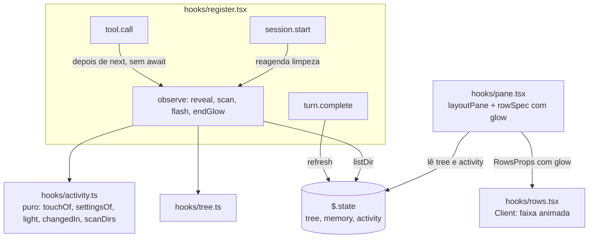

# Fatia 2: atividade do Claude

**Created.** `2026-10-17`

**Depends on.**

- `spec-00-overview.md`. Usa as regras R1 (em especial R1.3), o contrato `Paths` (R2), o layout de módulos e as verificações R4.
- `spec-01-pane-tree-navigation.md`. Usa e estende `TreeState`, `listDir` (com a guarda G1), `refresh`, `visibleRows`, `layoutPane`, `rowSpec`, `windowOf`, `RowsProps`/`Seg` e o Client `rows.tsx`.

**Sources.**

- `https://github.com/data-goblin/claude-code-filetree` v0.2.26. Referência de comportamento: `hooks/register.tsx` (`flash`, `touched`, `afterBash`, `keepTop`, hooks de `tool.call`), `hooks/rows.tsx` (`shimmer`), `.claude-plugin/plugin.json` (opções `activity` e `follow`).

## Goal

Mostrar na árvore, enquanto o Claude trabalha, quais arquivos ele lê e escreve: a linha do arquivo brilha por alguns segundos, as pastas até ele se abrem e, se a pessoa quiser, a janela da árvore rola até lá. É a funcionalidade que dá nome ao original ("shows what Claude is doing and where in files").

A fatia está pronta quando:

- uma leitura (`Read`, `Grep`, `Glob`) acende o arquivo em roxo e uma escrita (`Edit`, `Write`, `NotebookEdit`, ou um comando de shell que mudou arquivos em pastas abertas) acende em laranja;
- nenhuma tool call muda de comportamento por causa do mod (spec-00 R1.3), o que os testes provam por identidade de objeto;
- os critérios abaixo passam nos testes, nas superfícies `terminal` e `desktop`.

## Current behavior

**No repositório (fim da spec-01).**

- `hooks/register.tsx` registra `session.start`, `command.run`, `ui.render`, `ui.message`, `ui.scroll`, `ui.focus` e `classic.CwdChanged`. Não há hook de `tool.call` nem de `turn.*`. A spec-01 R10.2 proibia `tool.call` naquela fatia.
- `$.state` tem `tree` e `memory` (`types/index.d.ts`).
- `layoutPane` (`hooks/pane.tsx`) centraliza a janela automática do terminal no cursor via `windowOf(total, cursorIndex, room, scroll)`. No desktop envia as linhas até o orçamento de 45.000 caracteres.
- `rowSpec` junta o nome e o preenchimento num único segmento (`name + pad`).
- `ThemeKeyName` é `'text' | 'subtle' | 'suggestion' | 'error'`, e `Seg` é `{ text; color?; bold?; dim? }`.
- `rows.tsx` não tem estado local nem timer.
- `listDir` descarta resultados de outra geração ou de listagem mais nova (spec-01 G1). `refresh` relista a raiz e as pastas expandidas já carregadas.

**No original (v0.2.26).**

- **Hooks.**
  - Um `tool.call` geral trata `Edit`, `Write`, `NotebookEdit`, `Bash` e `PowerShell`.
  - Um `tool.call` com matcher trata `Read`, e outro trata `Grep` e `Glob`.
  - Todos chamam `next(e)` com o `e` recebido e devolvem o resultado recebido.
- **Leituras (roxo).**
  - `Read` acende `file_path`.
  - `Grep` e `Glob` acendem até 60 entradas de `filenames`.
  - Leituras feitas pelo shell são detectadas por um parser POSIX (`cat`, `rg`, `grep`, `find`…) mais as linhas de caminho do stdout, até 12.
- **Escritas (laranja).**
  - `Edit`, `Write` e `NotebookEdit` acendem o arquivo e relistam a pasta.
  - Comandos de shell que não são só leitura disparam uma varredura. Com git, ela usa git status. No Windows sem repositório, relista a raiz e as pastas abertas e marca os arquivos com `mtime` maior que o início do comando, até 200.
- **Destaque (`flash`).**
  - Dura 2700 ms.
  - Destaques sobrepostos se juntam e o prazo recomeça.
  - Os ancestrais fechados do arquivo são abertos, ficam abertos depois e brilham fraco.
  - No Client, o nome brilha com uma faixa que anda letra a letra a cada 90 ms, usando paletas hex.
- **Seguir (`follow`).**
  - Com `on`, cada destaque volta a rolagem para automática e centraliza a última linha acesa. Linhas acesas acima da janela ficam fixadas no topo (até 1/3).
  - Quando o destaque acaba, a janela volta para o cursor.
  - Com `off`, a linha do topo fica estável quando pastas se abrem (`keepTop`).
- **Git.** Chips de git (`committing…`, `committed a1b2c3d`), verde em arquivos commitados ou preparados e tom da linha da branch. Ficam para a spec-04, que usa o status do git da spec-03.
- **Segundo plano.** Comandos em segundo plano são acompanhados lendo `<task-notification>` no texto do `prompt.submit` seguinte.

Esta fatia muda deliberadamente quatro pontos:

1. não há parser de comandos de shell;
2. comandos em segundo plano não acendem nada;
3. não há linhas fixadas no topo;
4. ao fim do destaque a janela congela onde está, em vez de voltar ao cursor.

## Requirements and acceptance

### R1. Observação das ferramentas sem interferência

O mod observa as tool calls para saber o que o Claude tocou, sem mudar nenhuma delas. Esta é a regra R1.3 da spec-00 aplicada.

- R1.1. O mod deve registrar exatamente um hook de `tool.call`, sem matcher. Ele deve chamar `next(e)` com o próprio objeto `e` recebido e devolver o próprio objeto que `next(e)` resolveu.
- R1.2. O hook nunca deve devolver `deny`, um `{ result }` próprio ou um objeto diferente do recebido de `next(e)`.
- R1.3. Se `next(e)` lançar um erro, o hook deve deixá-lo propagar sem registrar atividade.
- R1.4. O trabalho de atividade (listagens, destaque, revelação) deve começar depois que `next(e)` resolver e não deve ser aguardado pelo hook. Antes de `next(e)`, o hook só pode ler `$.clock.now()` e o estado `tree`.
- R1.5. Se o trabalho de atividade falhar, a falha deve ser descartada sem toast e sem afetar a tool call. Os toasts de `listDir` da spec-01 (pasta ilegível) continuam valendo.
- R1.6. Tool calls de subagentes (com `agentId`) devem ser tratadas como as da sessão principal.

### R2. O que conta como leitura e escrita

- R2.1. Quando `Read` terminar sem `deny` e sem `isError`, o mod deve tratar `file_path` como **leitura**.
- R2.2. Quando `Grep` ou `Glob` terminarem sem `deny` e sem `isError`, o mod deve tratar como **leitura** as primeiras 60 entradas de `result.filenames`, resolvidas com `Paths.resolve(cwd, f, home)`.
- R2.3. Quando `Edit` ou `Write` terminarem sem `deny` e sem `isError`, o mod deve tratar `file_path` como **escrita**. Para `NotebookEdit`, deve usar `notebook_path`.
- R2.4. Quando `Bash` ou `PowerShell` terminarem sem `deny`, sem `isReadOnly` e sem `result.backgroundTaskId`, o mod deve fazer uma **varredura de escrita** (R6). Isso vale mesmo com `isError`, porque um comando pode escrever antes de falhar.
- R2.5. Quando `Bash` ou `PowerShell` terminarem com `isReadOnly: true`, ou com `result.backgroundTaskId`, o mod não deve fazer nada.
- R2.6. Toda outra ferramenta, incluindo as MCP, não deve gerar atividade.
- R2.7. Um caminho que, depois de `Paths.norm`, não esteja dentro da raiz (`Paths.inside(root, id)` falso) ou seja a própria raiz deve ser ignorado.

### R3. Opções `activity` e `follow`

- R3.1. O `plugin.json` deve declarar as opções `activity` (`reads and writes` padrão, `writes`, `reads`, `none`) e `follow` (`on` padrão, `off`), com o texto de [Manifesto](#manifesto).
- R3.2. Onde `activity` não incluir `reads`, leituras não devem gerar nenhum efeito: nem listagem, nem destaque, nem revelação.
- R3.3. Onde `activity` não incluir `writes`, uma escrita de `Edit`, `Write` ou `NotebookEdit` deve só relistar a pasta-mãe do arquivo, se ela estiver carregada. Uma varredura de shell deve só relistar as pastas varridas. Nos dois casos, sem destaque, sem revelação e sem mudar a janela.
- R3.4. Um valor de opção desconhecido deve ser tratado como o padrão.

### R4. Revelação

- R4.1. Antes de acender um id, o mod deve listar, em ordem de profundidade, cada ancestral entre a raiz e o arquivo que ainda não esteja carregado. Se um ancestral não estiver em `nodes`, deve antes listar a pasta-mãe dele.
- R4.2. Numa escrita de `Edit`, `Write` ou `NotebookEdit`, o mod deve listar de novo a pasta-mãe do arquivo, mesmo que já carregada, para que um arquivo novo e a data nova apareçam.
- R4.3. Depois das listagens, se o id não existir em `nodes`, o mod não deve acendê-lo nem abrir os ancestrais dele.
- R4.4. Os ancestrais do id que não estavam em `expanded` devem ser incluídos em `expanded` e continuar abertos depois do destaque.
- R4.5. Os ancestrais abertos por essa revelação devem brilhar fraco (`faint`) com o mesmo tom. Ancestrais que já estavam abertos não brilham.
- R4.6. Se a raiz mudar durante a revelação (`generation` diferente), o destaque desse lote deve ser descartado.

### R5. Destaque

- R5.1. Um destaque deve durar 2700 ms contados do último lote aceso. Um lote novo durante um destaque ativo deve se juntar a ele: os ids novos ficam `bright` com o seu tom, os anteriores mantêm o seu, e o prazo de todos passa a ser `agora + 2700`.
- R5.2. Se o mesmo id chegar `bright` e `faint`, deve valer `bright`. Se o mesmo id chegar como leitura e como escrita, deve valer o tom do lote mais recente.
- R5.3. O nome de uma linha acesa deve usar a ThemeKey `autoAccept` para leitura e `claude` para escrita. Caret, glyph, data e sufixos mantêm as cores da spec-01.
- R5.4. O Client deve animar o nome aceso com a faixa de [Animação da faixa](#animação-da-faixa), avançando um passo a cada 90 ms.
- R5.5. Enquanto nenhuma linha recebida tiver `glow`, o Client não deve mudar de estado nem redesenhar por causa do timer.
- R5.6. Quando o prazo vencer, o mod deve limpar `activity` (sem `lit`, `focus` vazio, `until: 0`), e as linhas devem voltar ao desenho da spec-01.
- R5.7. O render deve ignorar `activity.lit` quando `agora >= activity.until` ou quando `activity.root` for diferente de `tree.root`.
- R5.8. Quando `session.start` disparar com `activity.until > agora` (hot reload no meio de um destaque), o mod deve agendar a limpeza para o prazo restante. Com `until` vencido e diferente de 0, deve limpar na hora.
- R5.9. O destaque deve funcionar nas superfícies `terminal` e `desktop`.

### R6. Varredura de escrita do shell

- R6.1. Antes de `next(e)` de um `Bash` ou `PowerShell`, o mod deve guardar `since = $.clock.now()` e, para cada pasta da varredura, os nomes dos filhos já carregados.
- R6.2. As pastas da varredura são a raiz mais as pastas abertas e visíveis, isto é, as linhas de `visibleRows(tree)` com `isOpen` e `loaded`, na ordem das linhas e até 100 pastas no total.
- R6.3. Depois da tool call, o mod deve relistar cada pasta da varredura com `listDir` e marcar como escrito:
  - todo filho `file` com `mtimeMs >= since`;
  - todo filho cujo nome não existia no instantâneo daquela pasta.
- R6.4. Uma varredura deve acender no máximo 200 ids, na ordem das pastas e dos filhos.
- R6.5. O trabalho de atividade de tool calls diferentes (revelações e varreduras) deve rodar um de cada vez, na ordem em que as tool calls terminaram. Assim dois lotes simultâneos não perdem um ao outro ao se juntar (R5.1).
- R6.6. Mudanças dentro de pastas fechadas e arquivos apagados não devem gerar destaque. A remoção aparece pela recarga normal da spec-01 R7.2.

### R7. Seguir o Claude e fim de vez

- R7.1. Onde `follow` for `on`, um lote que acenda pelo menos um id deve gravar `tree.scroll = null`. Enquanto o destaque estiver ativo, a janela automática do terminal deve se centralizar em `activity.focus` em vez do cursor. `activity.focus` é o último id `bright` do lote mais recente que esteja entre as linhas visíveis. Sem ele visível, vale o cursor.
- R7.2. Onde `follow` for `on`, quando o destaque vencer com `tree.scroll === null`, o mod deve gravar `tree.scroll` com o início atual da janela. A vista congela até a próxima navegação, que pela spec-01 R5.4 volta ao modo automático no cursor.
- R7.3. Onde `follow` for `off`, quando uma revelação abrir pastas, a linha que estava no topo da janela deve continuar no topo: `tree.scroll` passa a ser o novo índice dela. Se ela não estiver mais visível, `scroll` não muda.
- R7.4. Nenhum destaque deve mover `cursor` nem `selected`.
- R7.5. No desktop, onde a rolagem é nativa, o destaque não deve mudar `tree.scroll`. Só a revelação acontece.
- R7.6. Quando `turn.complete` disparar, o mod deve chamar `refresh` (spec-01 R7.1) sem destaque e devolver o resultado de `next(e)` sem alterá-lo. É assim que escritas de comandos em segundo plano aparecem.

## Architecture



`hooks/activity.ts` (novo) é dono das decisões da fatia: o que conta, o que acende e o que mudou. É puro, como `tree.ts`. `register.tsx` só faz a orquestração: guarda o instantâneo, chama `listDir`, grava o estado e agenda o fim. O estado de atividade fica numa chave própria, `activity`, como manda a spec-00 ("cada fatia acrescenta as suas próprias chaves"). A única escrita desta fatia em `tree` é em `expanded` (revelação) e `scroll` (seguir).

## Components and contracts

### `hooks/activity.ts` (novo, puro)

```ts
export const FLASH_MS = 2700
export const SEARCH_LIMIT = 60
export const SCAN_DIR_LIMIT = 100
export const SCAN_LIT_LIMIT = 200

export type Settings = { reads: boolean; writes: boolean; follow: boolean }

/** O que uma tool call tocou, já filtrado por R2. */
export type Touch =
  | { kind: 'read'; ids: string[] }
  | { kind: 'write'; ids: string[] }
  | { kind: 'scan' }
```

| Função | Contrato | Critérios |
|---|---|---|
| `settingsOf(options)` | `activity`: contém `reads` → `reads`; contém `writes` → `writes`; desconhecido → os dois. `follow`: `'off'` → `false`, senão `true` | R3.1, R3.4 |
| `touchOf(e, result, ctx: { paths, cwd, home, root })` | aplica a [Tabela de classificação](#tabela-de-classificação); normaliza com `paths.norm`, descarta fora da raiz (R2.7) e remove repetidos mantendo a ordem; devolve `null` quando nada conta | R2 |
| `scanDirs(t)` | `[t.root, ...visibleRows(t).filter(r => r.isOpen && r.node.loaded).map(r => r.id)]` cortado em `SCAN_DIR_LIMIT` | R6.2 |
| `changedIn(before: ReadonlySet<string> \| undefined, children, since)` | ids dos filhos `file` com `mtimeMs >= since`, mais os filhos cujo `name` não está em `before`; com `before` `undefined` (pasta não carregada antes), só o critério de `mtimeMs` | R6.3 |
| `ancestorsOf(paths, root, id)` | pastas entre a raiz (exclusive) e `id` (exclusive), da mais rasa à mais funda | R4.1 |
| `light(a, t, paths, ids, tone, now)` | [Algoritmo `light`](#algoritmo-light); devolve `{ activity, expanded }`, com `activity === a` quando nada acendeu | R4.4, R4.5, R5.1, R5.2, R7.1 |
| `keepTop(before, after, from)` | id da linha `visibleRows(before)[before.scroll ?? from]`; devolve o índice dela em `visibleRows(after)`, ou `before.scroll` quando ela sumiu | R7.3 |
| `isLive(a, root, now)` | `a.until > now && a.root === root` | R5.7 |

#### Tabela de classificação

`ok` = sem `deny` e sem `isError`.

| `e.tool` | Condição | `Touch` |
|---|---|---|
| `Read` | `ok` | `read [file_path]` |
| `Grep`, `Glob` | `ok` e `result.filenames` não vazio | `read filenames.slice(0, 60)` resolvidos contra `cwd` |
| `Edit`, `Write` | `ok` | `write [file_path]` |
| `NotebookEdit` | `ok` | `write [notebook_path]` |
| `Bash`, `PowerShell` | sem `deny`, sem `isReadOnly`, sem `result.backgroundTaskId` | `scan` |
| qualquer outra | — | `null` |

Um `read` ou `write` cujos ids ficaram todos fora da raiz vira `null`.

#### Algoritmo `light`

```ts
export function light(a: ActivityState, t: TreeState, paths: Paths, ids: string[], tone: Tone, now: number) {
  const present = new Set(t.nodes.map(n => n.id))
  const open = new Set(t.expanded)
  const live = isLive(a, t.root, now)
  const lit: Record<string, Glow> = live ? { ...a.lit } : {}
  let focus = ''
  for (const id of ids) {
    if (!present.has(id)) continue                                  // R4.3
    for (const dir of ancestorsOf(paths, t.root, id)) {
      if (open.has(dir)) continue
      open.add(dir)                                                 // R4.4
      if (!lit[dir] || lit[dir].faint) lit[dir] = { tone, faint: true }  // R4.5; bright vence (R5.2)
    }
    lit[id] = { tone }                                              // R5.2: bright, tom mais recente
    focus = id
  }
  if (focus === '') return { activity: a, expanded: t.expanded }    // nada aceso: o mesmo objeto, nada muda
  return {
    activity: { root: t.root, lit, focus, until: now + FLASH_MS },  // R5.1
    expanded: [...open],
  }
}
```

### `hooks/register.tsx` (alterado)

Hooks novos:

| Hook | Matcher | Comportamento | Critérios |
|---|---|---|---|
| `tool.call` | — | [Algoritmo do hook `tool.call`](#algoritmo-do-hook-toolcall) | R1, R2, R6.1 |
| `turn.complete` | — | `const r = await next(e); void refresh($).catch(() => {}); return r` | R7.6 |

Hook alterado:

| Hook | Mudança | Critérios |
|---|---|---|
| `session.start` | depois do que já faz, lê `activity`: se `until > agora`, agenda `endGlow` para `until - agora`; se `until` estiver vencido e for diferente de 0, chama `endGlow` na hora | R5.8 |
| `ui.render` | lê `activity` e `$.clock.now()`; passa a `layoutPane` o `glow` vivo (`isLive`) e, se `follow` estiver ligado, o `focus` | R5.7, R7.1 |

Variáveis de módulo novas (perdidas no hot reload; R5.8 cobre o timer):

- `settings: Settings`, de `settingsOf(options)` em `register`;
- `glowTimer: Timer | null` e `glowSeq: number`;
- `queue: Promise<void>`, a fila de R6.5.

Atom novo:

```ts
const activityAtom = atom({ plugin: 'filetree-local', key: 'activity' }, emptyActivity())
// emptyActivity() = { root: '', lit: {}, focus: '', until: 0 }
```

#### Algoritmo do hook `tool.call`

```ts
on('tool.call', async ($, e, next) => {
  const shell = e.tool === 'Bash' || e.tool === 'PowerShell'
  const before = shell ? await snapshot($) : null          // R6.1: { since, root, names: Map<key, Set<name>> }
  const result = await next(e)                              // R1.3: um throw propaga daqui
  queue = queue.then(() => observe($, e, result, before)).catch(() => undefined)  // R1.4, R1.5, R6.5
  return result                                             // R1.1: o mesmo objeto, sem esperar a fila
})

async function observe($, e, result, before) {
  const t = await read($, treeAtom)
  const touch = touchOf(e, result, { paths, cwd: await cwd($), home, root: t.root })
  if (!touch) return
  if (touch.kind === 'read') {
    if (settings.reads) await reveal($, touch.ids, 'read')
  } else if (touch.kind === 'write') {
    if (settings.writes) await reveal($, touch.ids, 'write')
    else await relistParents($, touch.ids)                  // R3.3
  } else if (before) {
    await scan($, before)
  }
}
```

`relistParents($, ids)` chama `listDir` da pasta-mãe de cada id, só para as pastas-mãe já carregadas.

`reveal($, ids, tone)`:

1. Guarda `generation` de `tree`.
2. Para escrita, chama `listDir` da pasta-mãe de cada id (R4.2).
3. Lista os ancestrais que faltam, em ordem de profundidade (R4.1).
4. Chama `flash($, ids, tone, generation)`.

`scan($, before)`:

1. Para cada pasta de `scanDirs` do instantâneo, chama `listDir`.
2. Junta `changedIn(before.names.get(key), filhos atuais, before.since)` até 200 ids (R6.4).
3. Com `writes`, chama `flash` com tom `write`. Sem `writes`, para depois das listagens (R3.3).

As pastas varridas estão abertas e visíveis, então o `flash` de uma varredura não abre nenhuma pasta.

`flash($, ids, tone, generation)`:

```ts
async function flash($: EngineInterface, ids: string[], tone: Tone, generation: number) {
  const now = await $.clock.now()
  const before = await read($, activityAtom)   // seguro: a fila (R6.5) é a única escritora fora de endGlow
  let lit: ActivityState | null = null
  await update($, treeAtom, t => {
    if (t.generation !== generation) return t                       // R4.6
    const r = light(before, t, paths, ids, tone, now)
    if (r.activity === before) return t                             // nada aceso
    lit = r.activity
    const grown = { ...t, expanded: r.expanded }
    if (lastSurface !== 'terminal') return grown                    // R7.5
    if (settings.follow) return { ...grown, scroll: null }          // R7.1
    return { ...grown, scroll: keepTop(t, grown, view.from) }       // R7.3
  })
  if (lit === null) return
  await update($, activityAtom, () => lit!)
  glowTimer?.cancel()
  const seq = ++glowSeq
  glowTimer = $.clock.after(FLASH_MS, () => void endGlow($, seq).catch(() => undefined))
}
```

`endGlow($, seq)`:

1. Se `seq` não for o `glowSeq` atual, não faz nada.
2. Grava `emptyActivity()` (R5.6).
3. Se `follow` estiver on, `lastSurface === 'terminal'` e `tree.scroll === null`, grava `tree.scroll = view.from` (R7.2).

### `hooks/pane.tsx` (alterado)

`layoutPane(t, view, glow)` ganha o terceiro parâmetro:

```ts
type GlowView = { lit: Record<string, Glow>; focus: string | null } | null
// focus é null quando follow está off ou o destaque não está vivo
```

- **Janela (R7.1).** No terminal, com `t.scroll === null` e `glow?.focus` visível, `windowOf` recebe o índice de `glow.focus` no lugar de `cursorIndex`.
- **Linha acesa (R5.3).** Em `rowSpec`, quando `glow.lit[node.id]` existe:
  - o nome vira um segmento só seu, `{ text: name, color: tone === 'read' ? 'autoAccept' : 'claude', glow: faint ? 'faint' : 'bright' }`;
  - o preenchimento vai num segmento separado, sem `glow`;
  - o negrito do `selected` não se aplica ao segmento com `glow`.
- **Linha sem `glow`.** Mantém o formato compacto da spec-01.

#### Cores (acréscimo à tabela da spec-01)

| Elemento | ThemeKey / estilo |
|---|---|
| nome aceso por leitura | `autoAccept`, faixa animada |
| nome aceso por escrita | `claude`, faixa animada |
| ancestral aberto pela revelação | mesma ThemeKey do arquivo, faixa `faint` |

### `hooks/rows.tsx` (alterado)

```ts
type Local = { phase: number; ref: { glowing: boolean } }
const GLOW_TICK_MS = 90
```

- Na primeira chamada (`surface.state === undefined`), grava `{ phase: 0, ref: { glowing: false } }` e inicia uma única vez `surface.every(GLOW_TICK_MS, tick)`. A documentação de `every` pede que ele seja iniciado só uma vez.
- Em toda chamada, `ref.glowing = props.rows.some(r => r.segs.some(s => s.glow))`. É uma mutação do objeto `ref`, sem `setState`.
- `tick` só chama `setState({ ...state, phase: phase + 1 })` quando `ref.glowing` é verdadeiro (R5.5).
- Um segmento com `glow` é desenhado em até três `Text`: antes da faixa, a faixa e depois da faixa.

#### Animação da faixa

```ts
// len = número de caracteres do nome (code points); i = índice do caractere
const center = ((phase * 1.6) % (len + 8)) - 4
const inBand = (i: number) => Math.abs(i - center) < 1.8
```

| `glow` | Faixa | Resto do nome |
|---|---|---|
| `bright` | `color`, negrito | `color`, `dimColor` |
| `faint` | `color` | `color`, `dimColor` |

A linha do cursor continua com `inverse` em todos os segmentos.

## Data models

`types/index.d.ts` (alterado):

```ts
export type Tone = 'read' | 'write'
export type Glow = { tone: Tone; faint?: true }

export type ActivityState = {
  /** tree.root quando o lote acendeu; com outra raiz, lit é ignorado (R5.7). */
  root: string
  /** id do nó → brilho. */
  lit: Record<string, Glow>
  /** Último id bright do lote mais recente; '' sem destaque. */
  focus: string
  /** $.clock.now() em que o destaque acaba; 0 = sem destaque. */
  until: number
}

export type ThemeKeyName = 'text' | 'subtle' | 'suggestion' | 'error' | 'claude' | 'autoAccept'

export type Seg = { text: string; color?: ThemeKeyName; bold?: true; dim?: true; glow?: 'bright' | 'faint' }

declare module 'claude-code' {
  interface PluginState {
    'filetree-local': {
      tree: TreeState
      memory: ExpansionMemory
      activity: ActivityState
    }
  }
}
```

`TreeState`, `RowSpec`, `RowsProps` e `RowsMessage` não mudam.

### Manifesto

`.claude-plugin/plugin.json`, opções acrescentadas a `userConfig` (a opção `start` da spec-01 continua):

```json
{
  "activity": {
    "type": "string",
    "title": "Claude activity",
    "description": "Which of Claude's file activity glows in the tree: files read with Read, Grep or Glob in purple, files written with Edit, Write, NotebookEdit or a shell command in orange.",
    "default": "reads and writes",
    "options": ["reads and writes", "writes", "reads", "none"]
  },
  "follow": {
    "type": "string",
    "title": "Follow Claude",
    "description": "on: the tree scrolls to what Claude reads or writes and stays there. off: the view stays where you put it; highlights still show.",
    "default": "on",
    "options": ["on", "off"]
  }
}
```

A versão do plugin passa a `0.2.0`.

## Workflows

### Uma escrita com `Edit` numa pasta fechada

```mermaid
sequenceDiagram
  participant M as Claude (modelo)
  participant H as hook tool.call
  participant C as core (Edit)
  participant O as observe (sem await)
  participant S as $.state
  participant F as $.fs
  M->>H: tool.call {tool:'Edit', file_path:'C:/p/src/a/x.ts'}
  H->>C: next(e) — o mesmo e
  C-->>H: result
  H-->>M: result — o mesmo objeto
  H-)O: observe(e, result)
  O->>O: touchOf → write [C:/p/src/a/x.ts]
  O->>F: list(C:/p/src/a) (R4.2)
  O->>F: list ancestrais não carregados (R4.1)
  O->>S: tree.expanded += src, src/a; scroll = null (follow on)
  O->>S: activity = {lit: x.ts bright, src e src/a faint, until: agora+2700}
  S-->>O: redesenho: nome de x.ts em claude com faixa
  Note over O: 2700 ms depois (glowSeq atual)
  O->>S: activity vazio; tree.scroll = view.from (R7.2)
```

### Uma varredura de shell

| Momento | Ação |
|---|---|
| antes de `next(e)` | `since = now`; instantâneo dos nomes das pastas de `scanDirs(tree)` |
| `next(e)` resolve | devolve o resultado; se `isReadOnly` ou `backgroundTaskId`, fim |
| na fila de varreduras | `listDir` de cada pasta do instantâneo; `changedIn` em cada uma; até 200 ids |
| com `writes` e algum id | `flash(ids, 'write')` |
| fim da vez (`turn.complete`) | `refresh` silencioso: pega o que um comando em segundo plano escreveu |

## Guarantees and invariants

### G1. O mod nunca altera uma tool call

- **Escopo.** Toda tool call, de qualquer ferramenta, da sessão e de subagentes, inclusive as que lançam erro.
- **Mecanismo.** Um único hook que repassa o `e` recebido, devolve o objeto que `next` resolveu e não aguarda o trabalho de atividade, que tem `catch` próprio.
- **Critérios.** R1.1–R1.5.
- **Verificação.** O hook de fundo do teste guarda o `e` que recebeu e devolve um objeto conhecido. O teste confere `toBe` nos dois sentidos, para `Read`, `Edit`, `PowerShell`, uma ferramenta MCP, um resultado com `deny` e um fundo que lança erro. Também confere que o resultado volta antes de uma listagem pendurada terminar.

### G2. Todo destaque termina

- **Escopo.** Destaques sobrepostos, hot reload no meio de um destaque e troca de raiz.
- **Mecanismo.**
  - Um timer por destaque, com `glowSeq`, de modo que só o mais novo limpa.
  - A checagem de `until` e `root` no render (R5.7).
  - O reagendamento no `session.start` (R5.8).
  - Mesmo sem timer, um destaque vencido não é desenhado no próximo render.
- **Critérios.** R5.1, R5.6–R5.8.
- **Verificação.** Testes com `mock.clock`: dois lotes a 1000 ms de distância acabam juntos em `segundo + 2700`; `session.start` com `until` no futuro limpa no prazo; troca de raiz no meio do destaque não desenha `glow`.

### G3. Revelações antigas não mexem numa raiz nova

- **Escopo.** Uma revelação ou varredura em andamento quando `reroot` acontece.
- **Mecanismo.** `listDir` já descarta listagens de outra geração (spec-01 G1). O `update` que grava a expansão confere `generation` e descarta o lote (R4.6).
- **Critério.** R4.6.
- **Verificação.** Um teste segura a listagem de um ancestral, re-enraiza, solta a listagem e confere que `expanded` e `activity` da raiz nova não mudaram.

## Error handling

| Situação | Resposta observável | Estado resultante |
|---|---|---|
| `next(e)` lança | o erro chega ao chamador sem mudança | inalterado |
| resultado com `deny` ou `isError` (exceto shell) | nada | inalterado |
| shell com `isError` | varredura normal | listagens e destaque do que mudou |
| `listDir` falha durante a revelação | toast da spec-01 na primeira vez por pasta; o id não está em `nodes`, então não acende (R4.3) | pasta com `error` |
| arquivo apagado logo depois de lido | não acende | inalterado |
| exceção no trabalho de atividade | descartada (R1.5) | o que já foi gravado fica |
| hot reload no meio do destaque | o destaque acaba no prazo (R5.8) | `activity` vazio depois do prazo |

## Key decisions

| Decision | Chosen | Rejected alternative | Why, and what it costs |
|---|---|---|---|
| Git na atividade | Chips, verde e tom da branch vão para a spec-04 | Chip genérico por ferramenta; chips só por `gitOperation` | No original, só o git gera chips. O verde precisa de git status. Esta fatia não tem chips |
| Leituras pelo shell | Só `Read`, `Grep` e `Glob` acendem | Parser de Bash e PowerShell; ler só a saída do `rg`/`Select-String` | Elimina o código mais frágil e a exigência da spec-00 de classificar PowerShell. `Get-Content x` não acende |
| Escritas pelo shell | Observar `mtimeMs` e nomes novos nas pastas abertas, pulando `isReadOnly` | Parser de alvos de escrita; nada até a spec-04 | Funciona sem git e sem parser. Não vê mudanças em pastas fechadas |
| Visual | Faixa animada de 2700 ms, `autoAccept`/`claude` com `dimColor` | Cor fixa; cor fixa mais marcador | É a assinatura do original. O custo fica num timer do Client |
| Revelação | Abre os ancestrais e eles ficam abertos | Fechar depois; não abrir | Paridade e simplicidade. ⊟ fecha tudo |
| Limite de busca | 60 arquivos por `Grep`/`Glob` | 12; só os já visíveis | Escolha do autor, igual ao original |
| Seguir | Rolagem automática na última linha acesa, sem linhas fixadas | Paridade completa; rolagem manual sempre vence | As linhas fixadas são a parte mais cara e a menos perceptível |
| Fim do destaque com `follow` on | Congela a janela (`scroll = from`) | Voltar ao cursor, como o original | O "seguir" existe para mostrar o que o Claude mexeu, e voltar desfaz isso. Um `j`/`k` traz o cursor de volta |
| Atividade que conta | Sessão e subagentes, só dentro da raiz | Só a sessão; toast para o que está fora | Paridade |
| Segundo plano | Nada acende; `turn.complete` faz `refresh` silencioso | Destacar no fim da vez; ler `<task-notification>` | Não depende de formato interno, e a árvore não fica desatualizada |
| `activity` sem um tipo | O tipo desligado só atualiza a listagem em silêncio | Ignorar por completo | Desligar o brilho não deve deixar a árvore desatualizada |
| Limite da varredura | 200 ids | 60 | Paridade |

## Affected areas

| Area | Responsibility |
|---|---|
| `.claude-plugin/plugin.json` | opções `activity` e `follow`; versão `0.2.0` |
| `hooks/activity.ts` (novo) | funções puras da tabela; constantes |
| `hooks/register.tsx` | hooks `tool.call` e `turn.complete`; `session.start` reagenda o fim; `activityAtom`; `observe`, `reveal`, `scan`, `flash`, `endGlow`, `snapshot`, `relistParents` |
| `hooks/pane.tsx` | `layoutPane` com `glow`; `rowSpec` com o segmento do nome separado e as cores de tom |
| `hooks/rows.tsx` | estado local, timer único, desenho da faixa |
| `types/index.d.ts` | `Tone`, `Glow`, `ActivityState`, `ThemeKeyName`, `Seg.glow`, `PluginState.activity` |
| `tests/activity.test.ts` (novo) | funções puras |
| `tests/pane.test.tsx` | comportamento integrado: hook, revelação, varredura, seguir, desenho e animação |
| `spec-00-overview.md` | roadmap: a linha da spec-02 sem o classificador PowerShell; a linha da spec-03 com o git da atividade |

## Implementation constraints

- **Emenda à spec-01 R10.2.** A partir desta fatia, o módulo registra `tool.call` e `turn.complete`. Continuam proibidos os hooks de `prompt.submit`, `prompt.attachment` e `prompt.compose`, e as chamadas a `$.process.*`, `$.fs.read`, `$.fs.write` e `$.store.*` (spec-01 R10.1).
- O hook de `turn.complete` deve devolver o objeto de `next(e)`. Mudar `text` muda o que aparece abaixo da resposta.
- Estado só é gravado fora do render. O render lê `activity` e o relógio, e não grava.
- O timer do Client deve ser iniciado uma única vez, por `surface.every`. Os timers do hook usam `$.clock.after`.
- O segmento com `glow` conta para o orçamento de 45.000 caracteres do desktop (spec-01 R5.7) como qualquer outro.
- Nenhuma lógica de domínio no Client. Ele só sabe desenhar `glow`.

## Verification

Comandos da spec-00. Nos testes, `$.tool.call` dispara a cadeia de `tool.call` do mod, e um `on('tool.call')` do próprio teste é o fundo que simula a ferramenta. Depois do `act`, os testes conferem `fs.list`, o estado e o desenho. `mock.clock` controla `$.clock.now`/`after`, e `ui.advance` avança o timer do Client.

| Critérios | Teste |
|---|---|
| R1.1–R1.5, G1 | identidade de `e` e do resultado para `Read`, `Edit`, `PowerShell`, MCP, `deny` e fundo que lança; resultado antes de uma listagem pendurada |
| R1.6 | `Read` com `agentId` acende |
| R2.1–R2.7 | `touchOf` para cada linha da tabela, `isError`, `isReadOnly`, `backgroundTaskId`, `filenames` com 70 entradas relativas e absolutas, caminho fora da raiz e a própria raiz |
| R3.1–R3.4 | `claude plugin validate .` mostra as opções; `settingsOf` com cada valor e um desconhecido; com `reads`, um `Write` lista a pasta-mãe e não acende |
| R4.1–R4.6, G3 | `Read` de `src/a/x.ts` com `src` fechada e não carregada: ordem das listagens, `expanded`, `faint` só nos ancestrais abertos; id inexistente; reroot no meio |
| R5.1–R5.3, R5.6–R5.8, G2 | `RowSpec` com `autoAccept`/`claude` e `glow`; dois lotes com `mock.clock`; limpeza; `session.start` com `until` no futuro e vencido |
| R5.4, R5.5 | `ui.advance(90)`: a faixa anda um passo; sem `glow`, `ui.advance` não muda o desenho |
| R5.9 | os testes de desenho rodam em `terminal` e `desktop` |
| R6.1–R6.6 | `PowerShell` com o fundo alterando um arquivo (`mtimeMs` novo) e criando outro numa pasta aberta e numa fechada; 120 pastas abertas; 250 arquivos novos; duas varreduras concorrentes |
| R7.1–R7.5 | 100 linhas, `bodyRows` 20, cursor no topo, `Read` na linha 80: janela centrada nela; depois do prazo, `scroll = from`; `follow` off mantém a linha do topo; cursor e `selected` intactos; no desktop, `scroll` intacto |
| R7.6 | `turn.complete`: `refresh` acontece e o resultado volta igual |

Verificação manual, numa sessão real com o mod carregado:

1. Pedir ao Claude para ler um arquivo dentro de uma pasta fechada. A pasta deve se abrir, e o nome deve brilhar em roxo com a faixa andando, por cerca de 3 s.
2. Pedir ao Claude para criar um arquivo com PowerShell (`New-Item x.txt`). `x.txt` deve aparecer em laranja. Confirma a premissa A1 para comandos que escrevem.
3. Pedir ao Claude para rodar `Get-ChildItem`. Nada deve acender e não deve haver listagem extra. Confirma a premissa A1 para `isReadOnly` em PowerShell.
4. Conferir no tema do terminal que `autoAccept` e `claude` se distinguem um do outro e do texto comum. Confirma a premissa A2.

## Assumptions

- **A1.** O engine marca `isReadOnly` em comandos PowerShell que só leem, como `Get-ChildItem` e `Get-Content`. A documentação diz que o campo vem "da checagem que as permissões usam". Se não marcar, todo comando PowerShell dispara uma varredura: custa listagens e pode acender arquivos mudados por outro processo no mesmo intervalo, mas não muda nenhuma tool call. A correção seria aceitar esse custo ou desligar a varredura para PowerShell.
- **A2.** No tema escuro padrão, `autoAccept` é roxo e `claude` é laranja, e ambos são distintos de `text`. Se não forem, a correção é trocar as duas ThemeKeys na tabela de cores (`merged` é a alternativa roxa).
- **A3.** `FsEntry.mtimeMs` e `$.clock.now()` usam o mesmo relógio de parede da máquina. A documentação de `$.clock.now` diz "milissegundos desde a época". Se houver defasagem, arquivos escritos no começo do comando podem não acender. A correção seria uma folga de alguns milissegundos em `since`.

## Out of scope

- **Atividade de git (spec-04, sobre o status da spec-03).**
  - Chips `committing…` → `committed <sha>` (e os demais verbos de `git` e `gh`) no rodapé.
  - Verde nos arquivos commitados ou preparados.
  - Tom da linha da branch.
  - Varredura de escrita via git status, que vê mudanças em pastas fechadas.
  - Referência: `hooks/git.ts` (`gitActions`, `GIT_VERBS`, `GH_VERBS`) e `register.tsx` (`startGit`, `finishGit`, `outcomes`) do original.
- Leituras feitas pelo shell (`cat`, `Get-Content`, `rg`…).
- Destaque de comandos em segundo plano.
- Linhas acesas fixadas no topo da janela.
- Rolagem programática no desktop.
