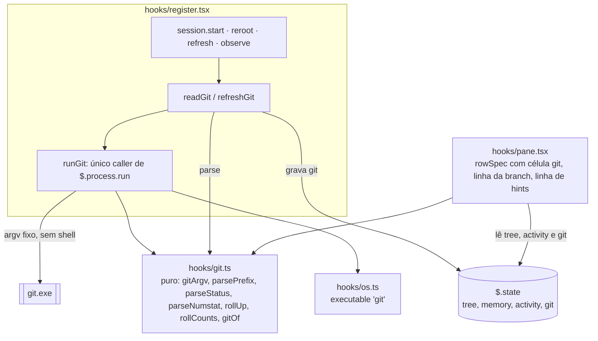
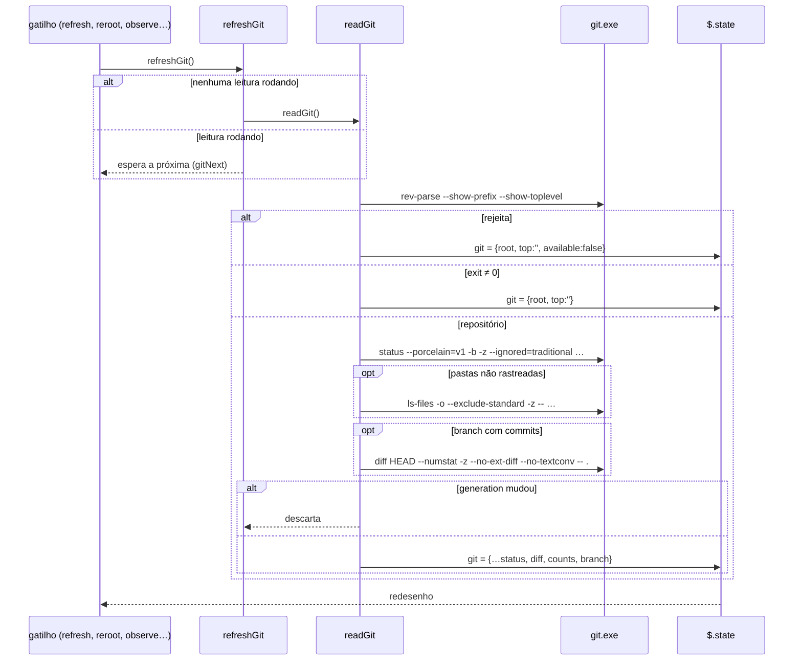

# Fatia 3: status do git

**Created.** `2026-10-17`

**Depends on.**

- `spec-00-overview.md`. Usa as regras R1 (em especial R1.1 e R1.2, que liberam `git` só com subcomandos de leitura), o contrato `Paths` (R2), o layout de módulos e as verificações R4.
- `spec-01-pane-tree-navigation.md`. Usa `TreeState`, `refresh`, `reroot`, `sync`, `layoutPane`, `rowSpec`, `RowSpec`/`Seg`, o cabeçalho e o rodapé de `renderPane`, e a regra de largura do nome (R4.4).
- `spec-02-claude-activity.md`. Usa `observe` (o trabalho de atividade depois de uma escrita ou varredura), o hook `turn.complete` e a precedência do brilho (`Seg.glow`) sobre a cor do nome.

**Sources.**

- `https://github.com/data-goblin/claude-code-filetree` v0.2.26. Referência de comportamento: `hooks/tree.ts` (`parseGit`, `parseBranch`, `parseNumstat`, `rollUp`, `rollCounts`, `mapper`), `hooks/icons.ts` (`GIT_COLOR`, `stronger`), `hooks/register.tsx` (`detectRepo`, `readGit`, `refreshGit`, `rowSpec`, `branchRow`) e a opção `hints` de `.claude-plugin/plugin.json`.

## Goal

Mostrar na árvore o estado do git do repositório que contém a raiz: cada arquivo e pasta na cor do seu status, as linhas acrescentadas e removidas, as contagens por pasta, os ignorados apagados e, abaixo do cabeçalho, a branch com upstream, ahead/behind e os totais. Fora de um repositório, uma linha discreta diz que não há git.

A fatia é a primeira que executa um processo. Por isso o sucesso tem duas partes:

- **Experiência.** As cores, sufixos e a linha da branch do original aparecem no Windows, nas superfícies `terminal` e `desktop`.
- **Segurança.** O único processo é o `git`, sem shell, só com subcomandos de leitura, com argv fixo e com as flags que impedem o repositório de executar programas pelas vias que dá para fechar (spec-00 R1.1, R1.2). A revisão consegue conferir isso lendo uma única função e a saída de `claude plugin validate`.

A atividade de git (chips, verde nos arquivos commitados, brilho da linha da branch e varredura de escrita por git) é da `spec-04-git-activity.md`, que depende desta.

## Current behavior

**No repositório (fim da spec-02, commit `63d3174`).**

- Nenhum módulo chama `$.process`. A spec-01 R10.1 proibiu, e a spec-02 manteve a proibição (Implementation constraints).
- `hooks/os.ts` não tem a lista de executáveis que a spec-00 prevê para ele.
- `$.state` tem `tree`, `memory` e `activity` (`types/index.d.ts`).
- `refresh` (`hooks/register.tsx`) relista a raiz e as pastas expandidas já carregadas. É chamado pelo `↻`, por `sync` (foco do painel, no máximo a cada 2000 ms) e pelo `turn.complete` (spec-02 R7.6). `reroot` chama `loadInDepthOrder` direto, sem `refresh`.
- `observe` (spec-02) termina uma escrita com `reveal` e uma varredura de shell com `scan`.
- `layoutPane(t, view, glow)` (`hooks/pane.tsx`) reserva `2 + (selected ? 1 : 0)` linhas fixas no terminal. `rowSpec` monta indentação, caret, glyph, nome, preenchimento e, à direita, a data (`DATE_WIDTH = 16`). Ela omite a data em todas as linhas quando o menor espaço de nome ficaria abaixo de 12 colunas (`MIN_NAME`).
- `Seg` é `{ text; color?; bold?; dim?; glow? }`, sem riscado. `ThemeKeyName` é `'text' | 'subtle' | 'suggestion' | 'error' | 'claude' | 'autoAccept'`.
- `renderPane` desenha o cabeçalho, a linha de navegação, o Client `rows` e, com `selected`, o rodapé `selected: …`.
- Os testes de `tests/pane.test.tsx` montam um mundo com hooks de fundo para `fs.list`, `tool.call` e `turn.complete`. Não há fundo para `process.run`.

**No engine (Claude Code 2.1.302).**

- `$.process.run(argv, { cwd, env, stdin, timeoutMs })` executa sem shell e resolve `{ exitCode, stdout, stderr, isStdoutTruncated, isStderrTruncated }` para qualquer código de saída. Ele rejeita quando o programa não inicia ou passa do tempo. A saída é cortada em 4 MiB por stream. A documentação diz: "Git runs with repo hooks off."
- `ThemeKey` inclui `success`, `warning`, `error`, `suggestion`, `subtle` e `merged`. `Text` aceita `strikethrough`.
- O kit de testes simula `process.run` com um hook `on('process.run', ...)`, do mesmo jeito que já simula `fs.list`.

**No original (v0.2.26).**

- **Detecção.** `git --no-optional-locks -C <raiz> rev-parse --show-prefix --show-toplevel`. Ela roda no reroot e de novo quando aparece `.git` na raiz.
- **Status.**
  - `status --porcelain=v1 -b -z --ignored=traditional --untracked-files=normal -- .`
  - `diff HEAD --numstat -z -- .`
  - `ls-files -o --exclude-standard -z -- <pastas não rastreadas>`
- **Coalescência.** No máximo uma leitura rodando e uma na fila (`refreshGit`).
- **Cores.** Por letra, com a pasta herdando a letra mais forte (`U > D > M > T > R > C > A > ?`). Arquivo apagado aparece riscado. Ignorados ficam apagados, com `⊘`.
- **Linha de arquivo.** `+a -d` no lugar da data, e a letra à direita. Uma pasta mostra `?:n M:n D:n` no lugar da letra.
- **Linha da branch.** Fica abaixo do cabeçalho: `⑂ main ↑1 ↓2 origin/main`, os totais à direita ou `clean`.
- **Fora de repositório,** com `hints` on: `± no git repo · git status starts after git init`.
- **Diferenças desta fatia:**
  - as cores vêm de ThemeKeys, não de hex;
  - toda chamada leva `-c core.fsmonitor=false`, e o `diff` leva `--no-ext-diff --no-textconv`;
  - os caminhos são comparados sem diferenciar maiúsculas no Windows;
  - a detecção roda a cada leitura;
  - não há `watchPaths` em `.git/index` e `HEAD`;
  - o glyph mantém a cor da spec-01, e só o nome e o sufixo ganham a cor do git.

## Requirements and acceptance

Neste documento, **ler o git** é o procedimento `readGit` de [Algoritmo `readGit`](#algoritmo-readgit). **Raiz** é `tree.root`. **No repositório** significa que o estado `git` vale para a raiz atual e tem `top` não vazio (`gitView` de [Componentes](#hookspanetsx-alterado)).

### R1. Execução do git

O git é o primeiro processo do mod. Toda chamada passa por uma única função, para que a revisão confira o argv num lugar só.

- R1.1. Toda chamada a `$.process.run` deve ter o argv `[executable('git', platform), '--no-optional-locks', '-c', 'core.fsmonitor=false', '-C', paths.native(root), sub, ...args]`. `sub` deve ser um destes: `rev-parse`, `status`, `diff`, `ls-files`. A `spec-04` acrescenta `diff-tree`.
- R1.2. Toda chamada de `diff` deve incluir `--no-ext-diff` e `--no-textconv`.
- R1.3. Um caminho de arquivo ou pasta só pode aparecer no argv depois de um `--`, nunca numa posição em que o git o leia como opção. A raiz entra só como valor de `-C`.
- R1.4. O mod não deve passar `env` nem `stdin` ao git e deve usar os tempos-limite de [Comandos](#comandos).
- R1.5. `executable('git', 'windows')` deve ser `'git.exe'`, e `executable('git', 'posix')`, `'git'`. Só `hooks/os.ts` pode decidir isso (spec-00 R2.6).

### R2. Detecção do repositório

- R2.1. Toda leitura do git deve começar por `rev-parse --show-prefix --show-toplevel`. Com `exitCode` 0, a primeira linha da saída é o `prefix` (relativo ao topo, com `/` final, ou vazio na raiz do repositório) e a segunda é o topo, que o mod guarda como `paths.norm(topo)`.
- R2.2. Se o `rev-parse` terminar com `exitCode` diferente de 0, o mod deve gravar o estado `git` da raiz com `top: ''` e `available: true`, sem rodar mais nenhum comando nessa leitura.
- R2.3. Se o `rev-parse` rejeitar (git ausente ou tempo esgotado), o mod deve gravar `top: ''` e `available: false`, sem toast.
- R2.4. Uma raiz que não está num repositório não deve mostrar status nenhum, mesmo que tenha repositórios em subpastas.
- R2.5. Como a detecção roda em toda leitura, um `git init` na raiz deve aparecer na leitura seguinte, e uma pasta `.git` removida deve sumir na leitura seguinte.

### R3. Leitura do status

- R3.1. No repositório, o mod deve rodar `status` com os argumentos de [Comandos](#comandos) e interpretar a saída por [Interpretação do porcelain](#interpretação-do-porcelain).
- R3.2. Cada caminho do porcelain (relativo ao topo) deve ser convertido em id com `paths.join(root, rel.slice(prefix.length))`, sem `/` final. Caminhos que não começam com `prefix` devem ser descartados.
- R3.3. As tabelas que o render consulta (`status`, `diff` e `counts`) devem usar `Paths.key(id)` como chave. Assim, no Windows, `README.md` no índice casa com `Readme.md` no disco. `changes`, `ignored` e `untracked` guardam ids, porque a `spec-04` e o `ls-files` precisam da grafia.
- R3.4. A letra de cada arquivo deve seguir [Letras](#letras). Toda pasta entre o arquivo e a raiz, inclusive a raiz, deve receber a letra mais forte entre a dela e a do arquivo, na ordem `U > D > M > T > R > C > A > ?`.
- R3.5. Uma entrada `!!` deve entrar em `ignored`. Um nó é ignorado quando ele ou um ancestral até a raiz está em `ignored` e ele não tem letra própria.
- R3.6. Uma entrada `??` terminada em `/` é uma pasta não rastreada. Ela recebe a letra `?` e entra em `untracked`. Os nós abaixo dela, quando carregados, também valem `?`.
- R3.7. Fora de um branch sem commits (`branch.unborn`), o mod deve rodar `diff HEAD --numstat` e somar, por arquivo, as linhas acrescentadas e removidas. Arquivos binários (`-`) contam 0. Arquivos marcados `new` em `changes` devem ser descartados do diff. As somas sobem para cada pasta até a raiz, inclusive.
- R3.8. Com pastas não rastreadas, o mod deve rodar `ls-files -o --exclude-standard` com até 100 delas, relativas à raiz, e marcar como `new` cada arquivo listado.
- R3.9. As contagens de uma pasta (`counts`) devem ser o número de arquivos `new`, `mod` e `del` abaixo dela, a qualquer profundidade, e incluir a raiz.
- R3.10. Se `status` terminar com `exitCode` diferente de 0 ou rejeitar, o mod deve manter o estado `git` anterior quando ele for da mesma raiz. Se `diff` ou `ls-files` falharem, o estado gravado deve ficar sem os dados daquele comando (diff vazio, ou sem os `new` das pastas não rastreadas).

### R4. Quando o git é lido

- R4.1. O mod deve ler o git:
  - depois do `listDir` da raiz no primeiro `session.start`;
  - no fim de cada `reroot`;
  - em cada `refresh`, ou seja, no `↻`, no foco do painel (spec-01 R7.4) e no `turn.complete` (spec-02 R7.6);
  - depois de cada escrita e de cada varredura tratadas por `observe` (spec-02 R2.3, R2.4).
- R4.2. Enquanto uma leitura roda, os pedidos novos devem se juntar numa única leitura seguinte. Cada chamador deve ser resolvido por uma leitura que começou depois do seu pedido.
- R4.3. Uma leitura cujo resultado chega depois de um reroot (`tree.generation` mudou) deve ser descartada.
- R4.4. A leitura disparada por `observe` não deve ser aguardada pela fila de atividade da spec-02 (R6.5). Ela roda em paralelo, e uma falha dela é descartada.
- R4.5. O render nunca deve chamar o git. Ele só lê o estado `git`.

### R5. Cores e sufixos das linhas

- R5.1. No repositório, o nome de um nó com letra deve usar a ThemeKey de [Letras](#letras). Um nó ignorado sem letra deve usar `subtle`. Nos outros, vale a cor da spec-01.
- R5.2. Enquanto o nome estiver aceso pela spec-02 (`glow`), a cor do brilho vence a do git. Os sufixos mantêm a cor do git.
- R5.3. Um arquivo (não pasta) com letra `D` deve ter o nome riscado (`strike`).
- R5.4. No repositório, a última célula de cada linha deve ser:
  - **pasta com contagens:** ` ?:n`, ` M:n` e ` D:n` só para os números maiores que 0, em `success`, `warning` e `error`;
  - **outro nó com letra:** ` X` em negrito, na cor da letra;
  - **nó ignorado:** ` ⊘` em `subtle`;
  - **qualquer outro:** `  ` (dois espaços), para alinhar.
- R5.5. No repositório, um arquivo com diff deve mostrar ` +a` (`success`) e ` -d` (`error`), só os maiores que 0, no lugar da data. Ele mostra isso mesmo quando a coluna de data foi omitida por R4.4 da spec-01.
- R5.6. O espaço do nome deve descontar a célula de R5.4 e o diff de R5.5, além do que a spec-01 R4.4 já desconta. A regra de omitir a data continua valendo e considera a célula de R5.4.
- R5.7. Fora do repositório, as linhas devem ser idênticas às da spec-02.

### R6. Linha da branch

- R6.1. No repositório, com `branch` lido, o painel deve mostrar uma linha entre o cabeçalho e a linha de navegação, conforme [Linha da branch](#linha-da-branch).
- R6.2. A linha deve contar como linha fixa no cálculo de `room` (spec-01 R5.1).
- R6.3. Num HEAD destacado, o nome deve ser `detached`. Num branch sem commits, deve ser o nome do branch, sem ahead/behind.
- R6.4. Sem nenhuma contagem e sem diff na raiz, o lado direito deve mostrar ` clean` em `subtle`.
- R6.5. Quando faltar largura, o upstream deve ser cortado primeiro. O nome da branch e os totais não devem ser cortados.
- R6.6. A linha deve aparecer nas superfícies `terminal` e `desktop`.

### R7. Opção `hints`

- R7.1. O `plugin.json` deve declarar a opção `hints` (`on` padrão, `off`) com o texto de [Manifesto](#manifesto). Um valor desconhecido vale `on`.
- R7.2. Onde `hints` for `on` e o estado `git` da raiz tiver `top: ''`, o painel deve mostrar, no lugar da linha da branch:
  - com `available: true`: `± no git repo · git status starts after git init`;
  - com `available: false`: `± git not found · status colors need git on the PATH`.

  Os dois textos vão em `subtle`, truncados no fim, e a linha conta como fixa.
- R7.3. Onde `hints` for `off`, ou enquanto a primeira leitura da raiz atual não terminou, não deve haver essa linha.

## Architecture



`hooks/git.ts` (novo) é dono das decisões da fatia: o argv, a leitura do porcelain e o status de cada nó. É puro, como `tree.ts` e `activity.ts`. `register.tsx` só executa: chama `runGit`, encadeia os comandos, grava o estado e decide quando ler. O estado fica numa chave própria, `git`, como manda a spec-00.

## Components and contracts

### `hooks/os.ts` (alterado)

```ts
/** Executáveis que o mod pode chamar (spec-00 R1.2). Só este módulo decide pela plataforma. */
export const EXECUTABLES = { git: { windows: 'git.exe', posix: 'git' } } as const

export function executable(name: keyof typeof EXECUTABLES, platform: Platform): string {
  return EXECUTABLES[name][platform]
}
```

### `hooks/git.ts` (novo, puro)

```ts
export const GIT_FLAGS = ['--no-optional-locks', '-c', 'core.fsmonitor=false'] as const
export const UNTRACKED_DIR_LIMIT = 100
export type GitSub = 'rev-parse' | 'status' | 'diff' | 'ls-files'   // a spec-04 acrescenta 'diff-tree'

export function gitArgv(exe: string, paths: Paths, root: string, sub: GitSub, args: readonly string[]): string[] {
  return [exe, ...GIT_FLAGS, '-C', paths.native(root), sub, ...args]
}
```

| Função | Contrato | Critérios |
|---|---|---|
| `gitArgv(exe, paths, root, sub, args)` | o argv de R1.1 | R1.1, R1.3 |
| `parsePrefix(stdout, paths)` | `{ prefix, top }` das duas primeiras linhas, sem `\r` nem espaços nas pontas; `top` passa por `paths.norm`; `null` se a segunda linha estiver vazia | R2.1 |
| `parseStatus(stdout, ctx)` | [Interpretação do porcelain](#interpretação-do-porcelain); devolve `Parsed` | R3.2–R3.6 |
| `parseNumstat(stdout, ctx)` | `Record<key, [add, del]>`, só arquivos; `-` vale 0; num rename, o caminho novo | R3.7 |
| `rollUp(diff, ctx)` | soma cada par em toda pasta entre o arquivo e a raiz, inclusive | R3.7 |
| `rollCounts(changes, ctx)` | `[new, mod, del]` por pasta, incluindo a raiz | R3.9 |
| `gitOf(g, paths, node)` | `NodeGit` do nó: letra própria, ou `?` sob pasta não rastreada; `ignored`; `diff`; `counts` (só pastas) | R3.5, R3.6, R5.1–R5.5 |
| `stronger(a, b)` | a letra mais forte na ordem `U D M T R C A ?` | R3.4 |
| `emptyGit()` | `{ root: '', top: '', prefix: '', available: true, status: {}, diff: {}, counts: {}, changes: {}, ignored: [], untracked: [], branch: null }` | — |

`ctx` é `{ paths, root, prefix }`. As chaves de `status`, `diff` e `counts` são `paths.key(id)`; `changes`, `ignored` e `untracked` usam o id. O id sai de `paths.join(root, rel.slice(prefix.length))`, sem `/` final.

```ts
export type NodeGit = {
  letter?: GitLetter
  ignored: boolean
  diff?: [number, number]
  counts?: [number, number, number]
}

/** O que parseStatus devolve; readGit completa com diff e counts. */
export type Parsed = Pick<GitState, 'status' | 'changes' | 'ignored' | 'untracked' | 'branch'>
```

#### Interpretação do porcelain

A saída de `status -z` é uma sequência de registros separados por `\0`.

| Registro | Ação |
|---|---|
| `## …` | `branch` por [Branch](#branch) |
| `XY caminho` com `X` em `R` ou `C` | usa o caminho, e o registro seguinte (o caminho de origem) é pulado |
| `!! caminho` | `ignored` recebe o id; nada mais |
| `?? caminho/` | `untracked` recebe o id; `status[key]` recebe `?`, propagado até a raiz; não entra em `changes` |
| outro `XY caminho` | `status[key] = stronger(status[key], letra)`, propagado até a raiz (R3.4); `changes[id]` por [Letras](#letras) |
| registro com menos de 4 caracteres | ignorado |

#### Letras

| `XY` | Letra | ThemeKey | `changes` |
|---|---|---|---|
| `??` | `?` | `success` | `new` |
| contém `U`, ou `AA`, ou `DD` | `U` | `error` | `mod` |
| contém `D` | `D` | `error`, riscado em arquivo | `del` |
| contém `M` | `M` | `warning` | `mod` |
| contém `T` | `T` | `warning` | `mod` |
| contém `R` | `R` | `suggestion` | `mod` |
| contém `C` | `C` | `suggestion` | `mod` |
| contém `A` | `A` | `success` | `new` |

A ordem das linhas é a ordem de busca. A primeira que casa decide. Exemplos: `AM` vira `M` e `new`, porque `A` sem `D` vale `new`; `RM` vira `M`.

```ts
// `changes`, na ordem de decisão
const change = xy === '??' || (xy.includes('A') && !xy.includes('D')) ? 'new' : xy.includes('D') && !/U/.test(xy) && xy !== 'DD' ? 'del' : 'mod'
```

#### Branch

| Registro | `Branch` |
|---|---|
| `## main` | `{ head: 'main', upstream: '', ahead: 0, behind: 0, detached: false, unborn: false }` |
| `## main...origin/main [ahead 1, behind 2]` | `{ head: 'main', upstream: 'origin/main', ahead: 1, behind: 2, … }` |
| `## main...origin/main [gone]` | `upstream: 'origin/main'`, ahead e behind 0 |
| `## HEAD (no branch)` | `{ head: 'detached', upstream: '', ahead: 0, behind: 0, detached: true, unborn: false }` |
| `## No commits yet on main` | `{ head: 'main', …, unborn: true }` |

### `hooks/register.tsx` (alterado)

Atom novo:

```ts
const gitAtom = atom({ plugin: 'filetree-local', key: 'git' }, emptyGit())
```

Variáveis de módulo novas, perdidas no hot reload sem efeito na correção:

- `hints: boolean`, de `options.hints !== 'off'` em `register`;
- `gitRun: Promise<void> | null` e `gitNext: Promise<void> | null`, a coalescência de R4.2.

#### Comandos

| Passo | `sub` e args | `timeoutMs` | Condição |
|---|---|---|---|
| detecção | `rev-parse --show-prefix --show-toplevel` | 5 000 | sempre |
| status | `status --porcelain=v1 -b -z --ignored=traditional --untracked-files=normal -- .` | 20 000 | no repositório |
| diff | `diff HEAD --numstat -z --no-ext-diff --no-textconv -- .` | 20 000 | `branch` não `unborn` |
| não rastreados | `ls-files -o --exclude-standard -z -- <rel1> <rel2> …` (até 100, relativos à raiz; a raiz vira `.`) | 10 000 | `untracked` não vazio |

`STATUS_ARGS` e `DIFF_ARGS` (em `hooks/git.ts`) são os args das linhas "status" e "diff" da tabela, depois do subcomando.

```ts
/** O único caller de $.process.run no mod (R1). */
async function runGit($: EngineInterface, root: string, sub: GitSub, args: readonly string[], timeoutMs: number) {
  return $.process.run(gitArgv(executable('git', paths.platform), paths, root, sub, args), { timeoutMs })
}
```

#### Algoritmo `readGit`

```ts
async function readGit($: EngineInterface) {
  const { root, generation } = await read($, treeAtom)
  if (root === '') return
  const save = (next: (g: GitState) => GitState) =>
    update($, gitAtom, g => next(g))   // só chamado depois de conferir generation (R4.3)
  const current = async () => (await read($, treeAtom)).generation === generation

  let probe: ProcessRunResult
  try {
    probe = await runGit($, root, 'rev-parse', ['--show-prefix', '--show-toplevel'], 5_000)
  } catch {
    if (await current()) await save(() => ({ ...emptyGit(), root, available: false }))   // R2.3
    return
  }
  const found = probe.exitCode === 0 ? parsePrefix(probe.stdout, paths) : null
  if (found === null) {
    if (await current()) await save(() => ({ ...emptyGit(), root }))                       // R2.2
    return
  }

  let status: ProcessRunResult
  try {
    status = await runGit($, root, 'status', STATUS_ARGS, 20_000)
  } catch {
    return                                                                                 // R3.10: mantém o anterior
  }
  if (status.exitCode !== 0) return
  const ctx = { paths, root, prefix: found.prefix }
  const parsed = parseStatus(status.stdout, ctx)

  const changes = { ...parsed.changes }
  if (parsed.untracked.length > 0) {                                                       // R3.8
    const rels = parsed.untracked.slice(0, UNTRACKED_DIR_LIMIT).map(id => paths.relative(root, id) || '.')
    const others = await runGit($, root, 'ls-files', ['-o', '--exclude-standard', '-z', '--', ...rels], 10_000).catch(() => null)
    if (others?.exitCode === 0) for (const rel of others.stdout.split('\0').filter(Boolean)) changes[paths.join(root, rel)] = 'new'
  }
  let diff: Record<string, [number, number]> = {}
  if (!parsed.branch?.unborn) {                                                            // R3.7
    const run = await runGit($, root, 'diff', DIFF_ARGS, 20_000).catch(() => null)
    if (run?.exitCode === 0) diff = parseNumstat(run.stdout, ctx)
  }
  const fresh = new Set(Object.keys(changes).filter(id => changes[id] === 'new').map(id => paths.key(id)))
  for (const k of Object.keys(diff)) if (fresh.has(k)) delete diff[k]

  if (!(await current())) return                                                           // R4.3
  await save(() => ({
    root,
    top: found.top,
    prefix: found.prefix,
    available: true,
    status: parsed.status,
    changes,
    ignored: parsed.ignored,
    untracked: parsed.untracked,
    branch: parsed.branch,
    diff: rollUp(diff, ctx),
    counts: rollCounts(changes, ctx),
  }))
}
```

`untracked` guarda ids, e não chaves, justamente para que o `ls-files` receba a grafia original (ver [Data models](#data-models)). `paths.relative` devolve a forma com `/`, que o git aceita no Windows.

#### Coalescência `refreshGit` (R4.2)

```ts
function refreshGit($: EngineInterface): Promise<void> {
  if (gitRun === null) {
    gitRun = readGit($).catch(() => undefined).finally(() => { gitRun = null })
    return gitRun
  }
  // Um pedido durante uma leitura espera a próxima, que começa depois dele.
  gitNext ??= gitRun.then(() => { gitNext = null; return refreshGit($) })
  return gitNext
}
```

#### Pontos de chamada (R4.1)

| Onde | Mudança |
|---|---|
| `session.start` | depois do `listDir(root)` da primeira vez, `await refreshGit($)` |
| `reroot` | no fim, depois de `loadInDepthOrder`, `await refreshGit($)`. Com a mesma raiz (spec-01 R6.5), o `refresh` já cobre |
| `refresh` | depois de `loadInDepthOrder`, `await refreshGit($)`. Cobre `↻`, `sync` e `turn.complete` |
| `observe` | depois de `reveal` com tom `write` (ou `relistParents`) e depois de `scan`: `void refreshGit($).catch(() => undefined)` (R4.4) |
| `ui.render` | lê `gitAtom` e passa `gitView` a `layoutPane` e `renderPane` |

### `hooks/pane.tsx` (alterado)

```ts
/** O que o render sabe do git; null antes da primeira leitura da raiz atual (R7.3). */
export type GitView = { state: GitState; hints: boolean } | null
// gitView = g.root === t.root ? { state: g, hints } : null
// "no repositório" = gitView !== null && gitView.state.top !== ''
```

- `layoutPane(t, view, glow, git: GitView)` ganha o quarto parâmetro. As linhas fixas passam a ser `2 + extra + (rodapé ? 1 : 0)`, em que `extra` é 1 quando há linha da branch (R6.1) ou linha de hints (R7.2), senão 0.
- `renderPane` recebe `git` e desenha a linha extra logo abaixo do cabeçalho.

#### Célula do git em `rowSpec` (R5.4–R5.6)

```ts
function gitCells(row: Row, g: NodeGit | null): { loc: Seg[]; cell: Seg[]; width: number } {
  if (g === null) return { loc: [], cell: [], width: 0 }                       // fora do repositório: spec-02 intacta
  const loc: Seg[] = []
  if (row.node.kind === 'file' && g.diff) {
    if (g.diff[0] > 0) loc.push({ text: ` +${g.diff[0]}`, color: 'success' })
    if (g.diff[1] > 0) loc.push({ text: ` -${g.diff[1]}`, color: 'error' })
  }
  let cell: Seg[]
  const c = row.node.kind === 'dir' ? g.counts : undefined
  if (c && c.some(n => n > 0)) {
    cell = [
      ...(c[0] > 0 ? [{ text: ` ?:${c[0]}`, color: 'success' as const }] : []),
      ...(c[1] > 0 ? [{ text: ` M:${c[1]}`, color: 'warning' as const }] : []),
      ...(c[2] > 0 ? [{ text: ` D:${c[2]}`, color: 'error' as const }] : []),
    ]
  } else if (g.letter) cell = [{ text: ` ${g.letter}`, color: LETTER_COLOR[g.letter], bold: true }]
  else if (g.ignored) cell = [{ text: ' ⊘', color: 'subtle' }]
  else cell = [{ text: '  ' }]
  const width = [...loc, ...cell].reduce((n, s) => n + s.text.length, 0)
  return { loc, cell, width }
}
```

Na montagem da linha:

1. `fixed` da spec-01 soma `width` de `gitCells`.
2. Um arquivo com `loc` não vazio usa `loc` no lugar da data e não desconta `DATE_WIDTH`. O cálculo de `showDate` (spec-01 R4.4) usa o `fixed` novo.
3. A ordem dos segmentos é: indentação/caret/glyph, nome (com a cor de R5.1, `glow` da spec-02 quando aceso, `strike` em arquivo `D`), preenchimento, data ou `loc`, `cell`.
4. A largura total da linha continua igual a `width - bar`.

Cores acrescentadas à tabela da spec-01:

| Elemento | ThemeKey / estilo |
|---|---|
| nome com letra | a ThemeKey de [Letras](#letras) |
| nome de arquivo `D` | `error`, riscado |
| nome ignorado sem letra | `subtle` |
| letra à direita | cor da letra, negrito |
| `⊘` | `subtle` |
| `+a` / `-d` | `success` / `error` |
| `?:n` / `M:n` / `D:n` | `success` / `warning` / `error` |

#### Linha da branch

```
⑂ main ↑1 ↓2 origin/main ………………… +40 -3 ?:2 M:1 D:1
```

| Parte | Desenho | Corte |
|---|---|---|
| `⑂ ` | `suggestion` | não corta |
| nome (`head`) | `text`, negrito | não corta |
| ` ↑n` / ` ↓n` | `suggestion`, só os maiores que 0 | não corta |
| ` upstream` | `subtle` | `truncate-end`, corta primeiro (R6.5) |
| espaço flexível | `flexGrow` | — |
| ` +A` ` -D` | `success` / `error`, de `diff[key(root)]` | não corta |
| ` ?:n` ` M:n` ` D:n` | de `counts[key(root)]`, como R5.4 | não corta |
| ` clean` | `subtle`, quando os dois anteriores estão vazios | não corta |

O desenho usa `Box` e `Text` de `$.ui.resolve(e)`, fora do Client, e é igual no terminal e no desktop.

#### Linha de hints

Um `Text` em `subtle` com `wrap="truncate-end"`, com o texto de R7.2.

### `hooks/rows.tsx` (alterado)

`plain` passa a repassar `strike` como `strikethrough`. Nada mais muda no Client.

## Data models

`types/index.d.ts` (alterado):

```ts
export type GitLetter = 'U' | 'D' | 'M' | 'T' | 'R' | 'C' | 'A' | '?'
export type Change = 'new' | 'mod' | 'del'

export type Branch = {
  /** Nome do branch; 'detached' sem branch. */
  head: string
  /** '' sem upstream. */
  upstream: string
  ahead: number
  behind: number
  detached: boolean
  /** "No commits yet": não há HEAD para o diff. */
  unborn: boolean
}

export type GitState = {
  /** tree.root da leitura; com outra raiz, nada é desenhado. '' antes da primeira leitura. */
  root: string
  /** Paths.norm do topo do repositório; '' fora de repositório. */
  top: string
  /** Caminho da raiz relativo ao topo, com '/' final; '' quando a raiz é o topo. */
  prefix: string
  /** false quando o git não pôde ser executado. */
  available: boolean
  /** Paths.key → letra; arquivos, pastas e a raiz (R3.4). */
  status: Record<string, GitLetter>
  /** Id (Paths.norm, grafia do git) → mudança; só arquivos (R3.7–R3.9). */
  changes: Record<string, Change>
  /** Paths.key → [+, -]; arquivos, pastas e a raiz. */
  diff: Record<string, [number, number]>
  /** Paths.key → [new, mod, del]; pastas e a raiz. */
  counts: Record<string, [number, number, number]>
  /** Ids (Paths.norm) ignorados; a pertinência compara por Paths.key. */
  ignored: string[]
  /** Ids (Paths.norm) das pastas não rastreadas. */
  untracked: string[]
  branch: Branch | null
}

export type Seg = {
  text: string
  color?: ThemeKeyName
  bold?: true
  dim?: true
  strike?: true
  glow?: 'bright' | 'faint'
}

export type ThemeKeyName = 'text' | 'subtle' | 'suggestion' | 'error' | 'claude' | 'autoAccept' | 'success' | 'warning'

declare module 'claude-code' {
  interface PluginState {
    'filetree-local': {
      tree: TreeState
      memory: ExpansionMemory
      activity: ActivityState
      git: GitState
    }
  }
}
```

`ignored` e `untracked` guardam ids, e não chaves, porque `ls-files` (R3.8) e a herança (R3.5, R3.6) precisam do caminho com a grafia original. `gitOf` monta os conjuntos de chaves na hora.

### Manifesto

`.claude-plugin/plugin.json`: versão `0.3.0` e a opção acrescentada a `userConfig`:

```json
{
  "hints": {
    "type": "string",
    "title": "Hints",
    "description": "on: outside a git repo, a line under the header says git status starts after git init. off: the line is hidden and the tree gets the row.",
    "default": "on",
    "options": ["on", "off"]
  }
}
```

## Workflows

### Uma leitura do git



### Estados que o painel desenha

| `gitView` | `state.top` | `hints` | Linha extra | Linhas |
|---|---|---|---|---|
| `null` (primeira leitura pendente ou raiz diferente) | — | — | nenhuma | spec-02 |
| não nulo | `''`, `available` | on | `± no git repo …` | spec-02 |
| não nulo | `''`, não `available` | on | `± git not found …` | spec-02 |
| não nulo | `''` | off | nenhuma | spec-02 |
| não nulo | topo | — | branch (se `branch !== null`) | cores e células do git |

## Guarantees and invariants

### G1. O git só é chamado com argv fixo e de leitura

- **Escopo.** Toda chamada a `$.process.*` do mod, em qualquer caminho de código, inclusive falhas e hot reload.
- **Mecanismo.**
  - `runGit` é o único caller de `$.process.run`, e `gitArgv` monta o argv com as flags fixas.
  - `GitSub` limita o subcomando por tipo.
  - Caminhos só entram depois de `--` ou como valor de `-C`.
  - `--no-optional-locks` impede o `status` de regravar o índice.
- **Critérios.** R1.1–R1.5.
- **Verificação.**
  - Na revisão: `claude plugin validate .` lista `process.run` e nenhum `process.spawn`, e uma busca por `$.process` acha uma ocorrência só, em `runGit`.
  - Nos testes, o fundo `process.run` registra todo argv, e cada teste de git confere:
    - `argv[0] === 'git.exe'`;
    - `argv.slice(1, 6)` igual às flags e a `-C`;
    - `argv[6]` dentro do conjunto permitido;
    - `--no-ext-diff` e `--no-textconv` em todo `diff`.

### G2. Leituras antigas não sobrescrevem a raiz nova

- **Escopo.** Uma leitura em andamento quando `reroot` acontece, e duas leituras seguidas.
- **Mecanismo.**
  - `readGit` confere `tree.generation` antes de gravar (R4.3), e o estado guarda `root`.
  - O render só usa o estado quando `git.root === tree.root`.
  - A coalescência garante uma leitura de cada vez, de modo que a última gravação é a da leitura mais nova.
- **Critérios.** R4.2, R4.3, R7.3.
- **Verificação.** Um teste segura o `status` (fundo com atraso), re-enraiza, solta e confere que o estado `git` não ganhou os dados da raiz antiga. Outro dispara três `refreshGit` durante uma leitura e confere que rodam exatamente duas leituras.

### G3. O render não espera o git

- **Escopo.** Todo `ui.render`.
- **Mecanismo.** O render lê `gitAtom` e nunca chama `runGit` (R4.5).
- **Verificação.** Com o fundo de `process.run` pendurado, o painel desenha a árvore sem linha extra.

## Error handling

| Situação | Resposta observável | Estado resultante |
|---|---|---|
| git não instalado ou sem permissão para iniciar | linha `± git not found …` (com `hints` on); árvore sem cores | `git = { root, top: '', available: false }` |
| raiz fora de repositório; repositório recusado por `safe.directory` (exit 128) | linha `± no git repo …` | `top: ''` |
| `rev-parse` ou `status` passam do tempo | nada novo; continuam as cores da última leitura da mesma raiz | inalterado |
| `status` com exit ≠ 0 | igual ao anterior | inalterado |
| `diff` falha, ou branch sem commits | sem `+a -d` | `diff: {}` |
| `ls-files` falha | pastas não rastreadas sem contagem dos arquivos internos | sem esses `new` |
| saída cortada em 4 MiB (`isStdoutTruncated`) | o que foi lido é usado; o último registro, possivelmente parcial, é descartado pelo parse | parcial |
| reroot durante a leitura | descartada (G2) | da raiz nova |

Nenhuma falha de git gera toast. A linha de hints é o único aviso.

## Key decisions

| Decision | Chosen | Rejected alternative | Why, and what it costs |
|---|---|---|---|
| Recorte | Status do git nesta fatia; a atividade de git na `spec-04` | Uma fatia com as duas coisas | O status se sustenta sozinho e é pré-requisito da atividade. As fatias de busca, abrir e contexto viram 05, 06 e 07 |
| Endurecimento | `--no-optional-locks -c core.fsmonitor=false` em toda chamada, e `--no-ext-diff --no-textconv` no `diff` | Git só no repositório da cwd; nada além do engine | Fecha os vetores que dá para fechar por flag sem perder funcionalidade. Os filtros `clean` de `.gitattributes` continuam possíveis (ver [Implementation constraints](#implementation-constraints)) |
| Quando ler | Session start, reroot, `refresh` (↻, foco, `turn.complete`) e depois de escritas e varreduras, com coalescência | Vigiar `.git/index` e `HEAD` com `watchPaths` | Menos superfície e nenhum hook novo. Uma mudança feita fora do Claude aparece no próximo foco do painel ou no próximo evento |
| Visual | Paridade adaptada a ThemeKeys: cores por letra, letra e contagens à direita, `+a -d` no lugar da data, linha da branch, `⊘` nos ignorados | Só cor e letra | Paridade. Se a linha ficar apertada em 30–40 colunas, a saída é esconder `loc` primeiro |
| Raiz com vários repositórios | Sem git, com a linha de hints | Status por sub-repositório aberto | Paridade e uma leitura por raiz |
| Chaves | `Paths.key` em todas as tabelas | Ids do porcelain como estão | No Windows o índice pode ter outra grafia de maiúsculas que o disco |
| Detecção | `rev-parse` em toda leitura | Só no reroot, mais a presença de `.git` | Custa um processo curto por leitura e cobre `git init` e `.git` removido sem regra especial |
| Glyph | Mantém a cor da spec-01 | Glyph também na cor do git, como o original | Um ponto de cor a menos para revisar; o nome e a célula já mostram o status |

## Affected areas

| Area | Responsibility |
|---|---|
| `hooks/os.ts` | `EXECUTABLES` e `executable` (R1.5) |
| `hooks/git.ts` (novo) | `gitArgv`, `parsePrefix`, `parseStatus`, `parseNumstat`, `rollUp`, `rollCounts`, `gitOf`, `stronger`, `emptyGit`, constantes |
| `hooks/register.tsx` | `gitAtom`, `runGit`, `readGit`, `refreshGit`, a opção `hints`; chamadas em `session.start`, `reroot`, `refresh` e `observe`; `gitView` no `ui.render` |
| `hooks/pane.tsx` | `GitView`; `layoutPane` com a linha extra no cálculo de `room`; `rowSpec` com cor, riscado, `loc` e célula; `renderPane` com a linha da branch ou de hints |
| `hooks/rows.tsx` | `strike` → `strikethrough` |
| `types/index.d.ts` | `GitLetter`, `Change`, `Branch`, `GitState`, `Seg.strike`, `ThemeKeyName` com `success` e `warning`, `PluginState.git` |
| `.claude-plugin/plugin.json` | opção `hints`; versão `0.3.0` |
| `tests/git.test.ts` (novo) | funções puras com amostras de porcelain e numstat |
| `tests/pane.test.tsx` | fundo `process.run` no mundo de teste, que por padrão responde o `rev-parse` com exit 128; testes integrados de leitura, coalescência, desenho e hints. Os testes das spec-01/02 que dependem da altura da janela passam a declarar `{ options: { hints: 'off' } }`, para que a linha de hints não mude as expectativas deles |
| `spec-00-overview.md` | a tabela de executáveis cita as flags fixas e as spec-03/04; roadmap renumerado |

## Implementation constraints

- **Emenda à spec-01 R10.1 e à restrição da spec-02.** A partir desta fatia, o módulo pode chamar `$.process.run`, só dentro de `runGit`. Continuam proibidos `$.process.spawn`, `$.fs.read`, `$.fs.write`, `$.store.*`, e os hooks de `prompt.submit`, `prompt.attachment` e `prompt.compose`.
- **Risco residual aceito.** Um repositório cuja configuração local (`.git/config`) define `filter.<nome>.clean`, usado por `.gitattributes`, pode fazer o `git status` executar esse filtro. Não há flag que desligue filtros por nome. Uma pasta clonada não traz `.git/config`, mas uma pasta extraída de um arquivo compactado traz. O próprio Claude Code já executa git na cwd. O risco novo é enraizar a árvore, com `/filetree caminho`, num repositório de origem desconhecida. Esta fatia documenta o risco e não o mitiga.
- `GitSub` é o mecanismo de tipo da lista de subcomandos. Acrescentar um subcomando exige emendar a spec-00 (R1.2).
- O render não grava estado e não chama processos.
- Os textos de linha e de hints são fixos, em inglês, como os do restante do painel.

## Verification

Comandos da spec-00. Nos testes, um `on('process.run')` do próprio mundo é o fundo que simula o git. Ele responde por subcomando (`argv[6]`) com `{ exitCode, stdout, stderr: '', isStdoutTruncated: false, isStderrTruncated: false }`, registra cada argv em `log.runs`, pode atrasar com `clock.sleep` e pode rejeitar.

| Critérios | Teste |
|---|---|
| R1.1–R1.5, G1 | toda leitura confere o argv de cada chamada registrada (prefixo, subcomando, `--` antes dos caminhos, flags do `diff`); `executable` em `windows` e `posix` |
| R2.1–R2.5 | `rev-parse` com exit 0 (prefixo vazio e `src/`), exit 128 e rejeição: estado gravado e quais comandos rodaram; `git init` simulado entre duas leituras |
| R3.1–R3.6 | `parseStatus` com uma amostra `-z` que tem `## main...origin/main [ahead 1, behind 2]`, `M `, ` M`, `A `, `AM`, `D `, `R  novo\0velho`, `UU`, `?? dir/`, `!! dist/` e um caminho fora do prefixo: letras, propagação para pastas e raiz, `changes`, `ignored`, `untracked`; chave em minúsculas no Windows |
| R3.7–R3.9 | `parseNumstat` com binário e rename; `rollUp` e `rollCounts` até a raiz; o diff de um arquivo `new` descartado; `ls-files` chamado com os caminhos relativos e `.` para a raiz |
| R3.10 | `status` com exit 1 depois de uma leitura boa: estado inalterado; `diff` rejeitado: `diff` vazio |
| R4.1–R4.5, G2, G3 | gatilhos: `session.start`, `reroot`, `↻`, foco, `turn.complete`, um `Write` e um `PowerShell` geram leitura; três pedidos durante uma leitura geram exatamente mais uma; reroot no meio descarta; render com `process.run` pendurado |
| R5.1–R5.7 | `RowSpec` de uma árvore no repositório: cor por letra, riscado em `D`, célula de letra, `⊘`, contagens na pasta, `loc` no lugar da data, largura total igual a `width - bar`, `glow` vencendo a cor; fora do repositório, `RowSpec` igual à da spec-02 |
| R6.1–R6.6 | linha da branch com ahead/behind/upstream, `detached`, `unborn`, `clean`; `room` com uma linha a menos; terminal e desktop |
| R7.1–R7.3 | `claude plugin validate .` mostra a opção; as duas linhas de hints; `hints: 'off'`; nenhuma linha antes da primeira leitura |

Verificação manual, numa sessão real com o mod carregado:

1. Abrir a árvore em `claude-filetree`, mudar um arquivo e criar outro. A linha da branch deve mostrar `⑂ master` e os totais. O arquivo mudado deve ficar em `warning` com ` M`, e o novo em `success` com ` ?`. Confirma a premissa A1.
2. Abrir a árvore com `/filetree C:\Users\w4rl0ck\Documents\Devs`. Deve aparecer `± no git repo · git status starts after git init` e nenhuma cor de git.
3. Conferir no tema do terminal que `success` e `warning` se distinguem de `text` e entre si. Confirma a premissa A2.

## Assumptions

- **A1.** `$.process.run(['git.exe', …])` acha o `git.exe` pelo `PATH` no Windows. Hoje o `PATH` tem `C:\Program Files\Git\cmd\git.exe`. Se não achar, a linha diz `git not found`. A correção é mudar `EXECUTABLES.git.windows` para `'git'` e repetir a checagem manual 1.
- **A2.** No tema escuro padrão, `success` é verde e `warning` é amarelo, distintos de `text`. Se não forem, a correção é trocar as ThemeKeys na tabela de [Letras](#letras).

## Out of scope

- Atividade de git (chips, verde, brilho da linha da branch, varredura de escrita por git): `spec-04-git-activity.md`.
- Status de sub-repositórios e submódulos dentro da raiz.
- Vigiar `.git/index` e `HEAD` (`watchPaths`): `spec-05-auto-refresh.md`, junto da releitura periódica.
- Glyph colorido pelo status e glyphs Nerd Font (spec-06).
- Mitigar filtros `clean` de `.gitattributes`.
