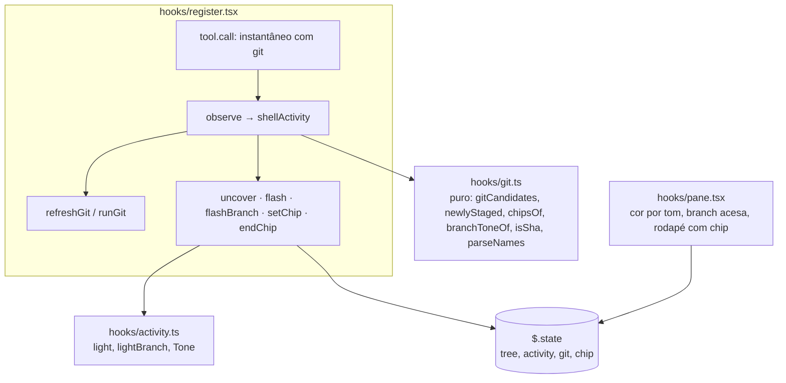
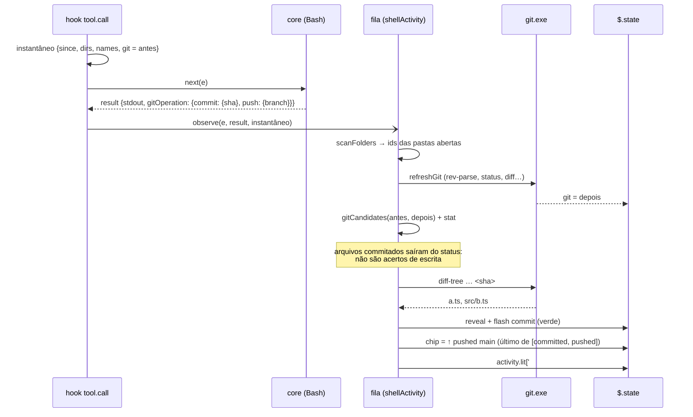

# Fatia 4: atividade de git

**Created.** `2026-10-17`

**Depends on.**

- `spec-02-claude-activity.md`. Usa e estende:
  - o hook `tool.call` e o instantâneo (`Snapshot`, R6.1);
  - a fila de atividade (R6.5);
  - `observe`, `scan`, `uncover`, `reveal`, `flash` e `endGlow`;
  - `ActivityState`, `Tone`, `Glow` e `light`;
  - as opções `activity` e `follow` (R3);
  - os limites `FLASH_MS = 2700` e `SCAN_LIT_LIMIT = 200`.
- `spec-03-git-status.md`. Usa:
  - `GitState` (em especial `root`, `top`, `prefix`, `changes`, `branch`) e `gitAtom`;
  - `refreshGit`, com a regra de que cada chamador é resolvido por uma leitura que começou depois do seu pedido (R4.2);
  - `runGit`, `gitArgv`, `GitSub` e as flags fixas (R1);
  - `parseStatus` e a linha da branch.

**Sources.**

- `https://github.com/data-goblin/claude-code-filetree` v0.2.26. Referência de comportamento: `hooks/git.ts` (`GIT_VERBS`, `GH_VERBS`, ícones) e `hooks/register.tsx` (`startGit`, `outcomes`, `finishGit`, `afterBash`, `changedInRepo`, `newer`, `gitPaths`, `chip`, `branchRow`).

## Goal

Mostrar o que o Claude fez no git e completar a varredura de escrita da spec-02 dentro de um repositório:

- **Varredura por git.** Um comando de shell que escreveu dentro de uma pasta fechada passa a acender o arquivo, abrindo as pastas até ele. É o caso que a spec-02 deixou de fora (R6.6) e que apareceu no teste com Bash.
- **Chip.** Um chip no rodapé diz o que aconteceu: `● committed a1b2c3d`, `↑ pushed main`, `⇄ opened PR #12`, `± staged 3`.
- **Verde.** Os arquivos commitados ou recém-preparados brilham em verde.
- **Linha da branch.** A linha da branch muda de cor no tom da ação.

Tudo isso **sem ler o texto do comando**. A fonte é o que o engine já informa (`gitOperation` no resultado de `Bash` e `PowerShell`) e a comparação do status do git antes e depois. Não há estado "rodando…", porque sem ler o comando não se sabe o que vai rodar.

A fatia está pronta quando os critérios abaixo passam nos testes, nenhuma tool call muda de comportamento (spec-00 R1.3) e a revisão confirma que o único subcomando novo do git é `diff-tree`, chamado com um sha validado.

## Current behavior

**No repositório (fim da spec-03).**

- O hook `tool.call` lê, antes de `next(e)`, só o relógio e o estado `tree` (spec-02 R1.4). Para `Bash` e `PowerShell`, ele guarda um `Snapshot { since, generation, dirs, names }`.
- `observe` trata `kind: 'scan'` chamando `scan($, before)`. Essa função:
  1. relista as pastas do instantâneo;
  2. junta `changedIn` até 200 ids;
  3. chama `flash(ids, 'write')`.

  Em seguida, `observe` dispara `void refreshGit($)` (spec-03 R4.4).
- `flash` só acende ids que existem em `tree.nodes` (`light`, spec-02 R4.3). A varredura da spec-02 não abre pastas.
- `Tone` é `'read' | 'write'`. `rowSpec` mapeia `read` para `autoAccept` e `write` para `claude`.
- `GitState.changes` guarda, por id (grafia do git), `new | mod | del` dos arquivos sujos. `parseStatus` não guarda quais arquivos estão preparados (coluna `X` do porcelain).
- `renderPane` desenha a linha da branch em `Text` fora do Client. O rodapé (`selected: …`) só existe com `selected`.
- O resultado de `Bash` e de `PowerShell` tem o campo opcional `gitOperation` (`claude-code-tools`):

  ```ts
  gitOperation?: {
    commit?: { sha: string; kind: 'committed' | 'amended' | 'cherry-picked'; branch?: string }
    push?: { branch: string }
    branch?: { ref: string; action: 'merged' | 'rebased' }
    pr?: { number: number; url?: string; action: 'created' | 'edited' | 'merged' | 'commented' | 'closed' | 'reopened' | 'ready' | 'draft' | 'auto-merge-enabled' | 'auto-merge-disabled' }
  }
  ```

**No original (v0.2.26).**

- **Chips.**
  - Um tokenizador POSIX acha `git <verbo>` e `gh <nome> <verbo>` no comando e mostra o chip `committing…` antes da execução.
  - Depois da execução, o chip vira `committed <sha>`, `pushed`, `<verbo> failed` ou `ran <verbo>`, cruzando o código de saída com `gitOperation`.
  - O chip fica 45 s.
- **Verde.** Depois de `commit`, ele lê `diff-tree --root --no-commit-id --name-only -r -z HEAD`. Depois de `add`, lê `diff --cached --name-only`. Revela até 12 arquivos em verde.
- **Linha da branch.** Brilha no tom do primeiro verbo de push/pull/fetch/checkout/switch/branch/merge/rebase/tag ou `gh`. Sem nenhum deles, brilha em verde num commit.
- **Varredura no Windows dentro de um repositório.** Faz `stat` de até 4.000 arquivos sujos e acende os com `mtime` maior que o início do comando. Os arquivos que saíram do status são relistados.

## Requirements and acceptance

Neste documento:

- **comando de shell observado**: um `Bash` ou `PowerShell` que a spec-02 R2.4 manda varrer, isto é, sem `deny`, sem `isReadOnly` e sem `backgroundTaskId`, mesmo com `isError`;
- **antes**: o estado `git` guardado no instantâneo;
- **depois**: o estado `git` depois da leitura de R1.3;
- **mesmo repositório**: `antes.root === depois.root === tree.root`, os dois `top` não vazios e iguais.

### R1. Observação

- R1.1. Antes de `next(e)` de um `Bash` ou `PowerShell`, o hook deve guardar no instantâneo, além do que a spec-02 R6.1 guarda, o estado `git` atual. Isso emenda a spec-02 R1.4: antes de `next(e)`, o hook pode ler o relógio e os estados `tree` e `git`.
- R1.2. Todo o trabalho desta fatia deve rodar na fila de atividade da spec-02 (R6.5), depois de `next(e)` resolver, sem ser aguardado pelo hook. Uma falha deve ser descartada sem toast (spec-02 R1.5).
- R1.3. Para um comando de shell observado, depois de relistar as pastas da varredura da spec-02, o mod deve aguardar `refreshGit` (spec-03 R4.2), de modo que **depois** venha de uma leitura que começou depois do comando. Isso substitui, nesse caminho, o `void refreshGit` da spec-03 R4.4.
- R1.4. Se `tree.generation` mudar entre o instantâneo e qualquer passo desta fatia, os passos restantes devem ser descartados.
- R1.5. Nenhuma outra ferramenta, incluindo `Edit`, `Write` e as MCP, deve gerar atividade de git.

### R2. Varredura de escrita por git

- R2.1. No mesmo repositório, os **acertos de git** são, na ordem de `depois.changes`, os ids com mudança diferente de `del` que:
  - não estavam em `antes.changes` (comparando por `Paths.key`), ou estavam como `del`; ou
  - estavam em `antes.changes` e têm `mtimeMs >= since` segundo `$.fs.stat`.
- R2.2. O mod deve fazer `$.fs.stat` só dos ids da segunda condição de R2.1, no máximo 4.000 por comando, em lotes de até 50 simultâneos. Um `stat` que falha conta como não acerto.
- R2.3. Os ids da varredura da spec-02 vêm primeiro, seguidos dos acertos de git que ainda não estão na lista (por `Paths.key`). O total fica em no máximo 200 ids (spec-02 R6.4).
- R2.4. Onde `activity` incluir `writes`, cada acerto de git deve ser revelado como uma escrita da spec-02 (R4.1, R4.2: ancestrais listados em ordem de profundidade, pasta-mãe relistada). Depois, o mod deve acender a lista de R2.3 num único `flash` com tom `write`. Os ancestrais abertos dessa forma brilham fraco e continuam abertos (spec-02 R4.4, R4.5).
- R2.5. Onde `activity` não incluir `writes`, a varredura deve só relistar as pastas, sem revelar nem acender (spec-02 R3.3). A leitura do git de R1.3 continua acontecendo.
- R2.6. Fora do mesmo repositório (raiz sem git, primeira leitura pendente, troca de repositório), só vale a varredura da spec-02.

### R3. Verde nos arquivos do commit e nos recém-preparados

- R3.1. Quando o resultado tiver `gitOperation.commit` e o `sha` casar com `/^[0-9a-f]{7,64}$/i`, o mod deve rodar `diff-tree --root --no-commit-id --name-only -r -z --no-ext-diff --no-textconv <sha>` (tempo-limite de 5 000 ms) e converter os caminhos como na spec-03 R3.2, descartando os de fora da raiz.
- R3.2. Um `sha` que não casa deve ser ignorado, sem chamar o git.
- R3.3. Sem `gitOperation.commit`, no mesmo repositório, os **recém-preparados** são os ids de `depois.staged` cuja chave não está em `antes.staged`.
- R3.4. Onde `activity` incluir `writes`, os ids de R3.1, ou de R3.3 quando não houver commit, devem ser revelados e acesos com o tom `commit`. O limite é de 12 ids, na ordem recebida. O verde é aceso depois do `flash` de R2.4, de modo que um arquivo nas duas listas fica verde (spec-02 R5.2).
- R3.5. Se `diff-tree` falhar, rejeitar ou não devolver nenhum id dentro da raiz, não deve haver verde. O chip de R4 continua valendo.

### R4. Chip de git

- R4.1. O mod deve montar a lista de chips do comando nesta ordem, cada item só quando a sua condição valer:

  | # | Condição | Chip |
  |---|---|---|
  | 1 | sem `gitOperation.commit`, no mesmo repositório, recém-preparados não vazios (R3.3) | `± staged N` |
  | 2 | `gitOperation.commit` | `● committed <sha7>`, `● amended <sha7>` ou `⑃ cherry-picked <sha7>`, conforme `kind` |
  | 3 | `gitOperation.branch` | `⑃ merged <ref>` ou `⑃ rebased <ref>` |
  | 4 | `gitOperation.push` | `↑ pushed <branch>` |
  | 5 | `gitOperation.pr` | [Textos de PR](#textos-de-pr) |
  | 6 | no mesmo repositório, `antes.branch.head !== depois.branch.head`, e nenhum dos dois `null` | `⑂ switched to <depois.head>` |

- R4.2. O mod deve mostrar só o **último** chip da lista. Uma lista vazia não muda o chip atual.
- R4.3. O chip deve durar 45 000 ms a partir do momento em que foi gravado. Um chip novo substitui o anterior e reinicia o prazo.
- R4.4. O render deve ignorar o chip quando `agora - at >= 45 000` ou quando `chip.root !== tree.root`.
- R4.5. Quando o prazo vencer, o mod deve limpar o chip, mas só se ele ainda for o mesmo (`at` igual). Quando `session.start` disparar com um chip ainda válido (hot reload), o mod deve agendar a limpeza para o tempo restante. Com o prazo já vencido, deve limpar na hora.
- R4.6. Os chips aparecem com qualquer valor de `activity`, inclusive `none`.
- R4.7. Um comando com `isError` e sem `gitOperation` não gera chip de `gitOperation`. Os chips 1 e 6 valem mesmo com `isError`, porque descrevem o estado do repositório.

### R5. Rodapé

- R5.1. O rodapé deve aparecer quando houver `selected` ou um chip válido (R4.4). Ele conta como linha fixa no cálculo de `room` (spec-01 R5.1).
- R5.2. Com `selected`, o lado esquerdo deve ser o `selected: …` da spec-01 R4.7, encolhendo e truncado no início. O chip fica à direita, a 2 colunas do texto, sem encolher.
- R5.3. O chip deve ser desenhado como `ícone + espaço + texto` na ThemeKey do tom ([Tons](#tons)), seguido de ` <detalhe>` em `subtle` quando houver detalhe.
- R5.4. O rodapé deve aparecer nas superfícies `terminal` e `desktop`.

### R6. Brilho da linha da branch

- R6.1. O tom da linha da branch deve ser o tom do último chip de R4.1. Sem chip, no mesmo repositório, deve ser `sync` quando `ahead` ou `behind` mudarem com o mesmo `head`. Sem nenhum dos dois, a linha não brilha.
- R6.2. Onde `activity` incluir `writes` e houver tom, o mod deve gravar `activity.lit['#branch'] = { tone }` pela regra de junção da spec-02 R5.1: o lote se junta a um destaque ativo, e o prazo de todos passa a `agora + 2700`. O mesmo timer e o mesmo `endGlow` da spec-02 encerram o brilho.
- R6.3. O brilho da linha da branch não deve mudar `activity.focus`, `tree.scroll`, `cursor` nem `selected`.
- R6.4. Enquanto `activity.lit['#branch']` estiver vivo (spec-02 R5.7), o `⑂` e o nome da branch devem ser desenhados na ThemeKey do tom, em negrito, sem faixa animada. A linha está fora do Client, que é o único que anima.

### R7. Execução do git nesta fatia

- R7.1. `diff-tree` passa a fazer parte de `GitSub` e deve ser chamado só por R3.1, por `runGit`, com o argv da spec-03 R1.1.
- R7.2. O `sha` é o único argumento vindo de fora (do `gitOperation`) e só entra no argv depois da validação de R3.1. Um valor que casa com `/^[0-9a-f]{7,64}$/i` não começa com `-`, portanto não é lido como opção.

## Architecture



As decisões ficam em funções puras de `hooks/git.ts`: o que conta como acerto, quem foi preparado, quais chips e qual tom. `register.tsx` executa e grava. O chip fica numa chave nova de `$.state`, `chip`, porque tem prazo e dono próprios. O brilho da linha da branch reaproveita `activity` com um id reservado, `'#branch'`, que não colide com nenhum id de nó, porque ids de nó são caminhos absolutos.

## Components and contracts

### `hooks/git.ts` (alterado)

```ts
export type GitSub = 'rev-parse' | 'status' | 'diff' | 'ls-files' | 'diff-tree'
export const STAT_LIMIT = 4000
export const STAT_BATCH = 50
export const GREEN_LIMIT = 12
export const CHIP_MS = 45_000
export const BRANCH_ID = '#branch'

export type GitOperation = NonNullable<BuiltinToolResults['Bash']['gitOperation']>
```

| Função | Contrato | Critérios |
|---|---|---|
| `parseStatus` (alterada) | também devolve `staged`: ids cujo `X` está em `M A D R C T`, fora de `??`, `!!` e dos registros que viram a letra `U` ([Letras](spec-03-git-status.md#letras) da spec-03) | R3.3 |
| `sameRepo(before, after, root)` | `before.root === after.root === root && before.top !== '' && before.top === after.top` | R2.6 |
| `gitCandidates(before, after, paths)` | `{ fresh: string[]; touched: string[] }` em que `fresh` são os ids da primeira condição de R2.1 e `touched` os da segunda, na ordem de `after.changes`, sem `del` | R2.1 |
| `newlyStaged(before, after, paths)` | ids de `after.staged` cuja chave não está em `before.staged` | R3.3 |
| `isSha(s)` | `/^[0-9a-f]{7,64}$/i.test(s)` | R3.1, R3.2, R7.2 |
| `parseNames(stdout, ctx)` | caminhos `-z` do `diff-tree` convertidos em id (spec-03 R3.2), só dentro da raiz | R3.1 |
| `chipsOf(op, staged, before, after, repo)` | lista de `ChipSpec` na ordem da tabela de R4.1 | R4.1, R4.7 |
| `branchToneOf(chips, before, after, repo)` | o tom de R6.1, ou `null` | R6.1 |
| `gitOperationOf(result)` | `result.result.gitOperation` quando `result.result` é objeto e o campo é objeto; senão `undefined`. Lê defensivamente, como `touchOf` | R4.1 |

```ts
export type ChipSpec = { icon: string; text: string; detail: string; tone: Tone }
```

#### Textos de PR

| `pr.action` | `text` |
|---|---|
| `created` | `opened PR #n` |
| `merged` | `merged PR #n` |
| `commented` | `commented on PR #n` |
| `closed` | `closed PR #n` |
| `reopened` | `reopened PR #n` |
| outro | `PR #n <action com '-' trocado por ' '>` (ex.: `PR #12 auto merge enabled`) |

O ícone é `⇄`, o tom é `merge` e não há detalhe.

#### Tons

| `Tone` | ThemeKey | Usado por |
|---|---|---|
| `read` | `autoAccept` | spec-02 |
| `write` | `claude` | spec-02 e varredura por git |
| `commit` | `success` | verde, chips `staged`/`committed`/`amended`, linha da branch |
| `sync` | `suggestion` | chips `pushed`/`switched to`, linha da branch com ahead/behind |
| `merge` | `merged` | chips `merged`/`rebased`/`cherry-picked`/PR, linha da branch |

### `hooks/activity.ts` (alterado)

```ts
/** Junta o brilho da linha da branch a um destaque ativo, como light faz com nós (R6.2). */
export function lightBranch(a: ActivityState, root: string, tone: Tone, now: number): ActivityState {
  const lit = isLive(a, root, now) ? { ...a.lit } : {}
  lit[BRANCH_ID] = { tone }
  return { root, lit, focus: isLive(a, root, now) ? a.focus : '', until: now + FLASH_MS }
}
```

`light` não muda. `BRANCH_ID` não está em `tree.nodes`, então nenhum lote de nós o acende, e `ancestorsOf` nunca o recebe.

### `hooks/register.tsx` (alterado)

`Snapshot` ganha `git: GitState` (R1.1):

```ts
type Snapshot = { since: number; generation: number; dirs: string[]; names: Map<string, Set<string>>; git: GitState }
```

Atom novo e variável de módulo nova:

```ts
const chipAtom = atom({ plugin: 'filetree-local', key: 'chip' }, null as GitChip | null)
let chipTimer: Timer | null = null
```

`observe` passa a chamar `shellActivity($, before, result)` no lugar de `scan($, before)` mais `void refreshGit($)`.

#### Algoritmo `shellActivity`

```ts
async function shellActivity($: EngineInterface, before: Snapshot, result: ToolCallResult) {
  const gen = before.generation
  const alive = async () => (await read($, treeAtom)).generation === gen          // R1.4

  const folderIds = await scanFolders($, before)            // spec-02 R6.2, R6.3: lista e devolve os ids, sem flash
  await refreshGit($)                                       // R1.3
  if (!(await alive())) return
  const { root } = await read($, treeAtom)
  const after = await read($, gitAtom)
  const repo = sameRepo(before.git, after, root)

  // R2: acertos de git, depois a união com a varredura da spec-02
  let gitIds: string[] = []
  if (repo) {
    const { fresh, touched } = gitCandidates(before.git, after, paths)
    gitIds = [...fresh, ...(await newerThan($, touched.slice(0, STAT_LIMIT), before.since))]
  }
  const seen = new Set(folderIds.map(id => paths.key(id)))
  const ids = [...folderIds, ...gitIds.filter(id => !seen.has(paths.key(id)))].slice(0, SCAN_LIT_LIMIT)
  if (settings.writes && ids.length > 0) {
    const listed = new Set<string>()
    for (const id of gitIds) if (ids.includes(id) && !(await uncover($, id, gen, true, listed))) return   // R2.4
    await flash($, ids, 'write', gen)
  }

  // R3: verde
  const op = gitOperationOf(result)
  const staged = repo && !op?.commit ? newlyStaged(before.git, after, paths) : []
  if (settings.writes) {
    const green = op?.commit ? await committedIds($, op.commit.sha, after) : staged
    if (green.length > 0) await reveal($, green.slice(0, GREEN_LIMIT), 'commit')
  }

  // R4, R6: chip e linha da branch
  const chips = chipsOf(op, staged, before.git, after, repo)
  const last = chips.at(-1)
  if (last) await setChip($, last, root)
  const tone = branchToneOf(chips, before.git, after, repo)
  if (settings.writes && tone !== null && after.branch !== null && (await alive())) await flashBranch($, tone)
}
```

- `scanFolders($, before)` é a parte de listagem do `scan` da spec-02. Ela relista as pastas do instantâneo e devolve os ids de `changedIn` até 200, sem acender. O `scan` antigo deixa de existir.
- `newerThan($, ids, since)` faz `$.fs.stat(paths.native(id))` em lotes de `STAT_BATCH` e devolve, na ordem de entrada, os ids com `mtimeMs >= since` (R2.2).
- `committedIds($, sha, g)`:
  - devolve `[]` se `!isSha(sha)` ou `g.top === ''`;
  - senão roda `runGit($, root, 'diff-tree', ['--root', '--no-commit-id', '--name-only', '-r', '-z', '--no-ext-diff', '--no-textconv', sha], 5_000)`;
  - com exit 0, devolve `parseNames(stdout, ctx)`; com falha ou rejeição, `[]` (R3.5).
- `flashBranch($, tone)` grava `lightBranch(...)` em `activity` e reagenda `glowTimer`/`glowSeq` exatamente como o fim de `flash`. Ele não toca `tree`.
- `setChip($, spec, root)`:
  1. grava `{ ...spec, root, at: now }` em `chip`;
  2. cancela `chipTimer`;
  3. agenda `$.clock.after(CHIP_MS, () => endChip($, at))`.
- `endChip($, at)` grava `null` em `chip` se `chip?.at === at` (R4.5).
- `session.start`, depois do que já faz: lê `chip`. Com `at + CHIP_MS > agora`, agenda `endChip` para o restante. Com o prazo vencido e chip não nulo, chama `endChip` na hora.

### `hooks/pane.tsx` (alterado)

- **Tom.** `rowSpec` passa a usar `TONE_COLOR[lit.tone]`, conforme [Tons](#tons), no lugar do ternário `read`/`write`.
- **Linha da branch.** `renderPane` recebe o `glow` (o mesmo `GlowView` de `layoutPane`). Com `glow?.lit['#branch']`, desenha `⑂ ` e o nome em `TONE_COLOR[tone]`, negrito. O resto da linha não muda (R6.4).
- **Rodapé.** `layoutPane` e `renderPane` recebem `chip: GitChip | null`, já filtrado por R4.4 no `ui.render`. As linhas fixas passam a ser `2 + extra + (selected !== '' || chip !== null ? 1 : 0)`.

```tsx
{(t.selected !== '' || chip !== null) && (
  <Box flexDirection="row">
    <Box flexGrow={1} flexShrink={1} overflow="hidden">
      {t.selected !== '' && (
        <Text color="subtle" wrap="truncate-start">selected: {paths.native(paths.relative(t.root, t.selected))}</Text>
      )}
    </Box>
    {chip !== null && (
      <Box flexDirection="row" flexShrink={0} marginLeft={2}>
        <Text color={TONE_COLOR[chip.tone]}>{`${chip.icon} ${chip.text}`}</Text>
        {chip.detail !== '' && <Text color="subtle">{` ${chip.detail}`}</Text>}
      </Box>
    )}
  </Box>
)}
```

## Data models

`types/index.d.ts` (alterado):

```ts
export type Tone = 'read' | 'write' | 'commit' | 'sync' | 'merge'

export type ThemeKeyName = 'text' | 'subtle' | 'suggestion' | 'error' | 'claude' | 'autoAccept' | 'success' | 'warning' | 'merged'

export type GitState = {
  // … campos da spec-03 …
  /** Ids (grafia do git) com mudança preparada no índice (coluna X do porcelain). */
  staged: string[]
}

export type GitChip = {
  /** tree.root quando o chip foi gravado; com outra raiz, não é desenhado (R4.4). */
  root: string
  /** '●' '⑃' '↑' '⇄' '±' '⑂' */
  icon: string
  text: string
  /** sha7, nome do branch ou ref; '' sem detalhe. */
  detail: string
  tone: Tone
  /** $.clock.now() quando foi gravado. */
  at: number
}

declare module 'claude-code' {
  interface PluginState {
    'filetree-local': {
      tree: TreeState
      memory: ExpansionMemory
      activity: ActivityState
      git: GitState
      chip: GitChip | null
    }
  }
}
```

`ActivityState.lit` passa a aceitar a chave reservada `'#branch'`. `emptyGit()` ganha `staged: []`.

`.claude-plugin/plugin.json`: versão `0.4.0`. Nenhuma opção nova. O texto da opção `activity` passa a mencionar o verde:

```json
"description": "Which of Claude's file activity glows in the tree: files read with Read, Grep or Glob in purple; files written with Edit, Write, NotebookEdit or a shell command in orange; files Claude committed or staged in green."
```

## Workflows

### Um `git add -A && git commit -m x && git push` pelo Bash



### Decisão por comando

| Comando | `gitOperation` | Comparação | Laranja | Verde | Chip | Linha da branch |
|---|---|---|---|---|---|---|
| `echo x > a/b/novo.txt` (pasta `a` fechada) | — | `novo.txt` novo em `changes` | `novo.txt`, abre `a` e `a/b` | — | — | — |
| `git add src` | — | `staged` ganhou 3 | arquivos que mudaram de data (normalmente nenhum) | os 3 | `± staged 3` | `commit` |
| `git commit -m x` | `commit {sha}` | — | — | arquivos do commit | `● committed a1b2c3d` | `commit` |
| `git push` | `push {branch}` | ahead 1 → 0 | — | — | `↑ pushed main` | `sync` |
| `git pull` | — | behind 2 → 0 | arquivos com data nova nas pastas abertas (varredura da spec-02); os que o pull trouxe limpos não entram no status | — | — | `sync` |
| `git switch -c x` | — | `head` main → x | — | — | `⑂ switched to x` | `sync` |
| `gh pr create …` | `pr {created, 12}` | — | — | — | `⇄ opened PR #12` | `merge` |
| `npm test` (sem escrita) | — | nada mudou | — | — | — | — |
| `git commit` com erro de hook | — (`isError`) | — | — | — | — | — |

## Guarantees and invariants

### G1. O mod continua sem alterar tool calls

- **Escopo.** Toda tool call, com a leitura extra do estado `git` antes de `next(e)`.
- **Mecanismo.** O hook continua o mesmo da spec-02 (G1). A única mudança antes de `next(e)` é um `read` de `gitAtom`, que não tem efeito externo. Todo o resto roda na fila.
- **Critérios.** R1.1, R1.2.
- **Verificação.** Os testes de identidade da spec-02 G1 continuam passando. Um teste confere que, com o fundo de `process.run` pendurado, o resultado do `Bash` volta antes da leitura do git terminar.

### G2. Nada de fora entra no argv como opção

- **Escopo.** Toda chamada de `diff-tree`.
- **Mecanismo.** `isSha` antes de `runGit`, e o argv fixo da spec-03 (R7.2).
- **Critérios.** R3.1, R3.2, R7.1, R7.2.
- **Verificação.** Um teste com `gitOperation.commit.sha = '--output=x'` confere que nenhum `diff-tree` foi chamado. Um com sha válido confere o argv completo.

### G3. Todo brilho e todo chip terminam

- **Escopo.** Chips seguidos, hot reload e troca de raiz.
- **Mecanismo.**
  - O brilho da linha da branch usa o timer e o `glowSeq` da spec-02 (G2 da spec-02).
  - O chip tem prazo (`at + CHIP_MS`), timer com a guarda `at` e reagendamento no `session.start`.
  - O render filtra por prazo e por raiz (R4.4).
- **Critérios.** R4.3–R4.5, R6.2.
- **Verificação.** Com `mock.clock`:
  - dois chips a 10 s de distância: o primeiro não é limpo pelo timer antigo, e o segundo some aos 45 s;
  - `session.start` com chip no meio do prazo limpa no prazo;
  - re-enraizar esconde o chip.

## Error handling

| Situação | Resposta observável | Estado resultante |
|---|---|---|
| `refreshGit` falha (git ausente, tempo) | só a varredura da spec-02; chip só por `gitOperation` | `git` como estava |
| `stat` de um arquivo falha | o arquivo não acende | inalterado |
| `diff-tree` falha ou rejeita | sem verde; chip normal | inalterado |
| `sha` inválido | sem `diff-tree`, sem verde; chip com o texto do `sha` cortado em 7 | inalterado |
| reroot durante a fila | passos restantes descartados (R1.4) | da raiz nova |
| `antes` velho (mudança externa entre duas leituras) | a mudança externa pode acender ou gerar `staged N`, atribuída ao comando | só visual |
| mais de 4.000 arquivos sujos já sujos antes | só os 4.000 primeiros são conferidos por data | parcial |

## Key decisions

| Decision | Chosen | Rejected alternative | Why, and what it costs |
|---|---|---|---|
| Fonte da atividade de git | `gitOperation` do engine mais a comparação do status antes e depois | Parser de `git`/`gh` em POSIX e PowerShell; nenhum chip | Mantém a linha da spec-02: o engine classifica e o mod observa. Sem "rodando…" e sem chip para `pull`, `fetch`, `stash`, `reset` e `restore`. Esses aparecem só como cores e brilho |
| Varredura no repositório | União: varredura de pastas abertas da spec-02 mais acertos de git | Git substitui a varredura; git só atualiza cores | Pega arquivos em pastas fechadas e ainda pega arquivos ignorados escritos em pastas abertas |
| O "antes" | Estado `git` em cache, lido antes de `next(e)` | `git status` antes de cada comando de shell | Nenhum atraso na tool call. Uma mudança externa recente pode ser atribuída ao comando, só no visual |
| Tons | `commit` em `success`, `sync` em `suggestion`, `merge` em `merged` | Hex do original | ThemeKeys, como na spec-01. `autoAccept` e `claude` já são leitura e escrita |
| Chip | Um só, o último do comando, à direita do rodapé por 45 s | Linha própria; vários chips | Paridade com o original, que mostra o mais recente. O rodapé só aparece com seleção ou chip |
| Limite do verde | 12 ids | 60 (o limite de busca da spec-02) | Paridade com o original (`READ_REVEAL_LIMIT`). O verde abre pastas, e 12 evita abrir meia árvore num commit grande |
| Commit de onde | `diff-tree <sha do gitOperation>` | `diff-tree HEAD` | O sha é o do commit que o comando fez, mesmo que outro commit tenha vindo depois. Exige validar o sha |
| Linha da branch | Cor fixa em negrito durante o brilho, sem faixa | Mover a linha para dentro do Client para animar | A animação só existe no Client. Uma linha a mais no Client mudaria o contrato de `RowsProps` por pouco ganho |

## Affected areas

| Area | Responsibility |
|---|---|
| `hooks/git.ts` | `GitSub` com `diff-tree`; `staged` em `parseStatus`; `sameRepo`, `gitCandidates`, `newlyStaged`, `isSha`, `parseNames`, `chipsOf`, `branchToneOf`, `gitOperationOf`; constantes |
| `hooks/activity.ts` | `lightBranch`; `Tone` com os tons novos |
| `hooks/register.tsx` | `Snapshot.git`; `shellActivity`, `scanFolders` (no lugar de `scan`), `newerThan`, `committedIds`, `flashBranch`, `setChip`, `endChip`; `chipAtom`, `chipTimer`; reagendamento do chip no `session.start`; `chip` e `glow` passados ao render |
| `hooks/pane.tsx` | `TONE_COLOR`; linha da branch acesa; rodapé com chip; rodapé no cálculo de `room` |
| `types/index.d.ts` | `Tone`, `ThemeKeyName` com `merged`, `GitState.staged`, `GitChip`, `PluginState.chip` |
| `.claude-plugin/plugin.json` | versão `0.4.0`; descrição de `activity` |
| `tests/git.test.ts` | funções puras novas |
| `tests/activity.test.ts` | `lightBranch` |
| `tests/pane.test.tsx` | fundo `process.run` com status mutável entre antes e depois; fundo `fs.stat` com datas; os casos de [Decisão por comando](#decisão-por-comando); chip, rodapé e linha da branch |
| `spec-02-claude-activity.md` | só as referências à fatia de git passam de spec-03 para spec-04. As emendas a R1.4 e R6.6 e a troca de `scan` por `scanFolders` ficam registradas aqui, em [Implementation constraints](#implementation-constraints) |

## Implementation constraints

- **Emenda à spec-02 R1.4.** Antes de `next(e)`, o hook pode ler o relógio e os estados `tree` e `git`.
- **Emenda à spec-02 R6.6.** Dentro do mesmo repositório, mudanças em pastas fechadas passam a acender por R2. Fora dele, R6.6 continua valendo.
- **Emenda à spec-03 R4.4.** No caminho de um comando de shell observado, a leitura do git é aguardada pela fila (R1.3). Nos outros pontos de `observe` (escritas de `Edit`, `Write`, `NotebookEdit`), continua sem espera.
- **Emenda à spec-00 R1.2.** `diff-tree` só é chamado por esta fatia (já estava na lista de subcomandos permitidos).
- A fila da spec-02 fica mais lenta depois de um comando de shell num repositório, porque espera a leitura do git. Leituras (`Read`) que terminam logo depois acendem com esse atraso. Isso é aceito.
- O render continua sem gravar estado e sem chamar processos.

## Verification

Comandos da spec-00. O mundo de teste da spec-03 ganha:

- uma saída de `status` mutável, que o próprio fundo de `tool.call` troca quando simula o comando;
- um fundo `fs.stat` com `mtimeMs` por caminho;
- `gitOperation` no resultado do fundo de `tool.call`.

| Critérios | Teste |
|---|---|
| R1.1, R1.2, G1 | o instantâneo guarda o `git`; identidade da tool call; resultado antes da leitura do git com `process.run` pendurado |
| R1.3, R1.4 | o `status` usado vem da leitura depois do comando (a saída muda no fundo de `tool.call`); reroot no meio descarta os passos |
| R2.1–R2.6 | `echo` num arquivo de pasta fechada: `uncover` abre as pastas e o arquivo acende em laranja; arquivo já sujo com data nova acende e com data antiga não; 4.001 sujos fazem 4.000 `stat`; união com a varredura da spec-02 sem repetição; `activity: reads` só relista; raiz sem git usa só a spec-02 |
| R3.1–R3.5, G2 | commit com sha: argv do `diff-tree` e verde em até 12; sha inválido não chama o git; `diff-tree` com exit 128 não acende; `git add` sem commit acende os recém-preparados; arquivo nas duas listas termina verde |
| R4.1–R4.7, G3 | cada linha de [Decisão por comando](#decisão-por-comando); último chip vence; prazo de 45 s com `mock.clock`; dois chips seguidos; `session.start` reagenda; outra raiz esconde; `activity: none` ainda mostra chip; `isError` sem `gitOperation` não gera chip |
| R5.1–R5.4 | rodapé só com chip, só com seleção e com os dois; `room` com uma linha a menos; terminal e desktop |
| R6.1–R6.4 | tom pelo último chip; `sync` por ahead/behind; nenhum tom sem chip e sem mudança; `#branch` não muda `focus`, `scroll`, `cursor` nem `selected`; desenho em negrito na cor do tom; o brilho acaba com o `endGlow` |

Verificação manual, numa sessão real com o mod carregado:

1. Pedir ao Claude para criar, pelo Bash, um arquivo dentro de uma pasta fechada do repositório (o caso que falhou na spec-02). A pasta deve se abrir e o arquivo deve brilhar em laranja.
2. Pedir ao Claude um `git add` desse arquivo e depois um `git commit`. Primeiro deve aparecer `± staged 1` com o arquivo em verde, depois `● committed <sha>`, e a linha da branch deve brilhar em verde.
3. Fazer um commit no seu terminal e depois pedir ao Claude um comando qualquer que escreva. Observar se o commit externo aparece atribuído ao comando (o risco aceito da decisão "antes").

## Out of scope

- Estado "rodando…" de um comando de git (exige ler o comando).
- Chips para `pull`, `fetch`, `stash`, `reset`, `restore`, `tag`, `init` e `clone`.
- Atividade de git de comandos em segundo plano (`backgroundTaskId`). O status é atualizado no `turn.complete` (spec-02 R7.6).
- Animar a linha da branch.
- Atividade de git vinda de `Edit`/`Write` ou de ferramentas MCP.
