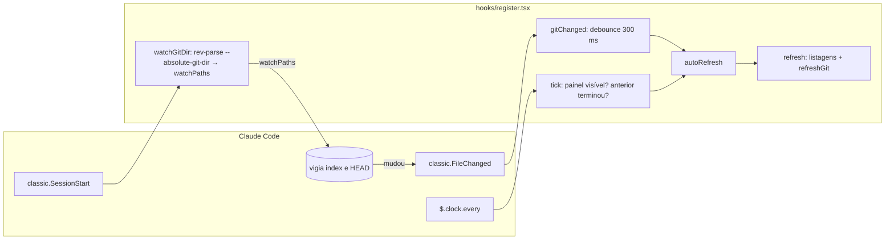

# Fatia 5: atualização automática

**Created.** `2026-10-17`

**Depends on.**

- `spec-00-overview.md`. Usa as regras R1: git só pelo argv fixo, e nenhum texto ou contexto invisível acrescentado a eventos.
- `spec-01-pane-tree-navigation.md`. Usa `refresh` (R7.1, R7.2), a guarda de listagens (G1), o painel `filetree` e a regra de toast de pasta ilegível.
- `spec-03-git-status.md`. Usa `runGit` e o argv fixo (R1.1), a coalescência de `refreshGit` (R4.2) e o fato de o `refresh` já ler o git (R4.1).

## Goal

Fazer cada sessão enxergar sozinha o que mudou no disco e no git, sem foco no painel e sem ↻.

O caso que motiva a fatia: três sessões abertas no mesmo diretório. O Claude da sessão 1 cria e altera arquivos. Ao trocar para a sessão 2, a árvore dela já deve mostrar:
- os arquivos novos e os apagados;
- as cores e sufixos do git (` M`, ` ?`, `+a -d`, contagens, linha da branch).

O mesmo vale para mudanças feitas no editor, em outro terminal ou em outra sessão do Claude, inclusive commits e staging.

A fatia está pronta quando:
- uma mudança externa aparece em até um intervalo da opção `refresh`;
- um commit ou staging no repositório da sessão aparece em menos de 1 s;
- nada disso brilha. O brilho continua significando "o Claude desta sessão mexeu aqui".

## Current behavior

**No repositório (fim da spec-04, versão 0.4.0).**

A árvore e o estado `git` só são relidos:
- no foco do painel (`ui.focus` → `sync`, no máximo a cada 2000 ms; spec-01 R7.4);
- no `↻` (spec-01 R7.1);
- no fim de cada vez do Claude desta sessão (`turn.complete`; spec-02 R7.6);
- depois das ferramentas do Claude desta sessão (`observe`; spec-02, spec-03 R4.1, spec-04 R1.3);
- no reroot e no primeiro `session.start` (spec-03 R4.1).

`refresh($)` (`hooks/register.tsx`) relista a raiz e as pastas expandidas já carregadas e depois aguarda `refreshGit($)`.

- **Concorrência.** `listDir` descarta listagens velhas (spec-01 G1). `refreshGit` mantém no máximo uma leitura rodando e uma na fila (spec-03 R4.2).
- **Hooks clássicos.** O módulo registra `classic.CwdChanged` e nenhum outro hook clássico.
- **Toda execução do git passa por `runGit`.** Os subcomandos permitidos são `rev-parse`, `status`, `diff`, `ls-files` e `diff-tree`, com o argv `git.exe --no-optional-locks -c core.fsmonitor=false -C <raiz> …` (spec-03 R1, spec-04 R7).
- O `git status` do mod não regrava o índice (`--no-optional-locks`).

**No engine (Claude Code 2.1.302).**

- **Vigilância de arquivos.**
  - `watchPaths` só pode ser pedido no resultado de `classic.SessionStart` (`ClassicResultFields.SessionStart`), que dispara com `source` igual a `startup`, `resume`, `clear` ou `compact`. Nenhum outro evento atualiza a lista.
  - Para os caminhos vigiados, o engine emite `classic.FileChanged { file_path, event: 'change' | 'add' | 'unlink' }`.
  - A entrada de `classic.SessionStart` traz `cwd`.
- **Relógio.** `$.clock.every(ms, fn)` chama `fn` a cada `ms` até `cancel()`. `$.clock.after(ms, fn)` chama uma vez.
- **Painéis.** `$.ui.panes()` lista os painéis do plugin com `isShown`, `isFocused` e `isPlaced`. `isPlaced` é falso enquanto o painel espera, sem desenho, num terminal estreito.
- **Avisos do `validate`.** O `claude plugin validate` avisa que hooks `classic.*` não rodam num plugin instalado por uma pessoa quando uma organização gerencia o Claude Code. Este mod é carregado de pasta local por uma pessoa.

**No original (v0.2.26).** O hook `classic.SessionStart` acrescenta `<gitdir>/index` e `<gitdir>/HEAD` a `watchPaths`, achando o `gitdir` com `$.fs.stat` e `$.fs.read` do arquivo `.git`. O `classic.FileChanged` dispara um `sync` forçado 300 ms depois. Não há releitura periódica.

## Requirements and acceptance

Neste documento:
- **painel visível** é um item de `$.ui.panes()` com `id === 'filetree'` e `isPlaced === true`;
- **releitura** é o `refresh($)` da spec-01 R7.1, que já inclui a leitura do git da spec-03.

### R1. Releitura periódica

- R1.1. O `plugin.json` deve declarar a opção `refresh` com os valores `off`, `2s`, `5s` e `10s` (padrão `5s`) e o texto de [Manifesto](#manifesto). Um valor desconhecido vale `5s`.
- R1.2. Onde `refresh` não for `off`, o mod deve manter um único intervalo `$.clock.every(ms)` com o período da opção, iniciado no `session.start`. Um novo `session.start` do mesmo módulo cancela o intervalo anterior antes de iniciar outro.
- R1.3. Onde `refresh` for `off`, o mod não deve iniciar nenhum intervalo.
- R1.4. A cada tique, se o painel não estiver visível, o mod não deve listar pastas nem chamar o git.
- R1.5. A cada tique, se a releitura iniciada por um tique anterior ainda não terminou, o mod deve pular o tique.
- R1.6. Nos outros casos, o mod deve fazer uma releitura.
- R1.7. O tique não deve re-enraizar a árvore, mesmo com `follow` ligado. Seguir a cwd continua com `classic.CwdChanged` e com o foco (spec-01 R7.4, R8).

### R2. Vigilância do git da sessão

- R2.1. Quando `classic.SessionStart` disparar, o mod deve chamar `next(e)` e depois rodar `rev-parse --absolute-git-dir` com `-C <e.cwd>`, pelo argv da spec-03 R1.1, com tempo-limite de 5000 ms.
- R2.2. Com `exitCode` 0 e saída não vazia, o hook deve devolver o resultado de `next(e)` com `watchPaths` igual à lista que já estava lá, mais `<gitdir>/index` e `<gitdir>/HEAD`, na forma de `Paths.native`. Nenhum outro campo do resultado pode mudar.
- R2.3. Se o `rev-parse` terminar com `exitCode` diferente de 0, ou rejeitar, o hook deve devolver o próprio objeto que `next(e)` resolveu.
- R2.4. Quando `classic.FileChanged` disparar com um `file_path` que `isGitWatch` aceita, o mod deve chamar `next(e)` e agendar uma releitura para 300 ms depois. Um novo aviso dentro desse prazo cancela o agendamento e começa outro prazo de 300 ms.
- R2.5. A releitura agendada por R2.4 deve rodar só se o painel estiver visível. Ela não é pulada por R1.5: uma releitura em andamento pode ter lido o git antes do commit.
- R2.6. O hook de `classic.FileChanged` deve devolver o próprio objeto que `next(e)` resolveu, para qualquer `file_path`. Um `file_path` que `isGitWatch` não aceita não gera nenhum efeito.
- R2.7. A vigilância vale para o repositório da cwd no último `classic.SessionStart`. Um reroot para outro repositório não muda os caminhos vigiados. Nesse caso só R1 atualiza.

### R3. Silêncio

- R3.1. Uma releitura de R1 ou R2 não deve gravar `activity` nem `chip`, nem mudar `cursor`, `selected`, `scroll` ou `follow`. `expanded` só muda pela regra de nó sumido da spec-01 R7.2.
- R3.2. Uma pasta que passe a falhar na listagem durante uma releitura gera o toast da spec-01 só na primeira vez por pasta. Uma falha do git numa releitura não gera toast (spec-03).

### R4. Limites de segurança

- R4.1. O hook de `classic.SessionStart` não deve acrescentar nem alterar `additionalContext`, `initialUserMessage`, `sessionTitle` ou `reloadSkills` (spec-00 R1.4, por analogia: nada invisível ao usuário).
- R4.2. O único argumento novo do git é `--absolute-git-dir`, do subcomando `rev-parse`, que já é permitido. O caminho da cwd entra só como valor de `-C`.
- R4.3. O mod não deve ler arquivos de dentro de `.git` (`$.fs.read` continua proibido pela spec-01 R10.1).

## Architecture



Esta fatia não traz módulo puro novo: `isGitWatch` e `refreshMsOf` entram em `hooks/git.ts` e `hooks/activity.ts`, junto das funções do mesmo assunto. Também não traz estado novo em `$.state`. Só há variáveis de módulo, perdidas no hot reload e recriadas pelo `session.start`.

## Components and contracts

### `hooks/activity.ts` (alterado)

```ts
const REFRESH: Record<string, number | null> = { off: null, '2s': 2_000, '5s': 5_000, '10s': 10_000 }

/** The period of the `refresh` option; unknown values are the default (R1.1). */
export function refreshMsOf(options: PluginOptions): number | null {
  const v = typeof options.refresh === 'string' && options.refresh in REFRESH ? options.refresh : '5s'
  return REFRESH[v] ?? null
}
```

`refreshMsOf` mora em `activity.ts` ao lado de `settingsOf`, que já interpreta as outras opções.

### `hooks/git.ts` (alterado)

```ts
/** `<gitdir>/index` or `<gitdir>/HEAD`, including a worktree's gitdir under `.git/worktrees/<name>/` (R2.4). */
export function isGitWatch(p: string): boolean {
  return /[\\/]\.git(?:[\\/]worktrees[\\/][^\\/]+)?[\\/](?:index|HEAD)$/i.test(p)
}
```

O teste é pelo formato do caminho, e não por uma lista guardada em variável de módulo. Num hot reload, o engine continua vigiando os mesmos caminhos, mas o módulo novo perde as variáveis. O padrão continua valendo.

Um `--separate-git-dir` fora de uma pasta `.git` não casa e fica coberto só por R1 (ver [Out of scope](#out-of-scope)).

### `hooks/register.tsx` (alterado)

Variáveis de módulo novas:

- `refreshMs: number | null`, de `refreshMsOf(options)` em `register`;
- `ticker: Timer | null`, o intervalo de R1.2;
- `ticking: boolean`, verdadeiro enquanto a releitura de um tique roda (R1.5);
- `gitWatch: Timer | null`, o agendamento de R2.4.

```ts
/** Whether the pane draws now (R1.4, R2.5). */
async function paneVisible($: EngineInterface): Promise<boolean> {
  return (await $.ui.panes()).some(p => p.id === PANE && p.isPlaced)
}

/** One tick: nothing while the pane waits undrawn or the last tick's read still runs (R1.4–R1.6). */
async function tick($: EngineInterface) {
  if (ticking || !(await paneVisible($))) return
  ticking = true
  try {
    await refresh($)
  } finally {
    ticking = false
  }
}

/** The gitdir of `cwd`, or '' outside a repository or when git cannot run (R2.1, R2.3). */
async function gitDirOf($: EngineInterface, cwd: string): Promise<string> {
  const run = await runGit($, cwd, 'rev-parse', ['--absolute-git-dir'], 5_000).catch(() => null)
  const dir = run?.exitCode === 0 ? run.stdout.trim() : ''
  return dir === '' ? '' : paths.norm(dir)
}
```

Pontos de chamada:

| Hook | Mudança | Critérios |
|---|---|---|
| `session.start` | Depois do que já faz: `ticker?.cancel()`. Se `refreshMs !== null`, `ticker = $.clock.every(refreshMs, () => void tick($).catch(() => undefined))` | R1.2, R1.3 |
| `classic.SessionStart` (novo) | [Algoritmo `watchGitDir`](#algoritmo-watchgitdir) | R2.1–R2.3, R4.1 |
| `classic.FileChanged` (novo) | `const r = await next(e)`. Se `isGitWatch(e.file_path)`: `gitWatch?.cancel()` e `gitWatch = $.clock.after(300, () => void gitChanged($).catch(() => undefined))`. `return r` | R2.4, R2.6 |

`gitChanged($)` faz `if (await paneVisible($)) await refresh($)`. Ela não consulta nem altera `ticking` (R2.5).

#### Algoritmo `watchGitDir`

```ts
on('classic.SessionStart', async ($, e, next) => {
  const result = await next(e)
  // This hook may run before session.start has set the platform.
  const platform = await detectPlatform($)
  if (paths.platform !== platform) paths = makePaths(platform)
  const dir = await gitDirOf($, paths.norm(e.cwd))
  if (dir === '') return result                                                    // R2.3: o mesmo objeto
  const watch = [paths.native(paths.join(dir, 'index')), paths.native(paths.join(dir, 'HEAD'))]
  return { ...result, watchPaths: [...(result.watchPaths ?? []), ...watch] }       // R2.2, R4.1
})
```

A detecção de plataforma é a mesma do `session.start` (`detectPlatform`, que lê só `OS`). O engine não garante a ordem entre `classic.SessionStart` e `session.start`, por isso o hook não depende dela.

## Data models

Nenhum estado novo em `$.state` e nenhum tipo novo em `types/index.d.ts`.

### Manifesto

`.claude-plugin/plugin.json`: versão `0.5.0` e a opção acrescentada a `userConfig`:

```json
{
  "refresh": {
    "type": "string",
    "title": "Auto refresh",
    "description": "How often the tree and git status are read again while the pane shows, so changes made outside this session appear (another session, an editor, a terminal). off: only on focus, ↻ and Claude's own work. Commits and staging in the session's repository show within a second either way.",
    "default": "5s",
    "options": ["off", "2s", "5s", "10s"]
  }
}
```

## Workflows

### Três sessões no mesmo diretório

```mermaid
sequenceDiagram
  participant S1 as Sessão 1 (Claude)
  participant D as disco e .git
  participant E as engine da sessão 2
  participant M as mod na sessão 2
  S1->>D: cria a.ts, altera b.md
  Note over M: tique de 5 s
  E->>M: clock.every
  M->>M: painel visível? tique anterior terminou?
  M->>D: listagens + git status
  M-->>M: a.ts aparece; b.md em ` M` (sem brilho)
  S1->>D: git commit (escreve .git/index e HEAD)
  E->>M: classic.FileChanged(.git/index)
  E->>M: classic.FileChanged(.git/HEAD)
  Note over M: 300 ms sem novos avisos
  M->>D: listagens + git status
  M-->>M: b.md sem cor; linha da branch atualizada
```

### Decisão por evento

| Evento | Painel visível | Tique anterior rodando | Ação |
|---|---|---|---|
| tique | não | — | nada |
| tique | sim | sim | nada (pula) |
| tique | sim | não | releitura |
| aviso do git (depois de 300 ms de calma) | não | — | nada |
| aviso do git | sim | qualquer | releitura |
| `FileChanged` de outro caminho | — | — | nada |

## Guarantees and invariants

### G1. Os hooks clássicos não mudam o que o engine faz

- **Escopo.** Todo `classic.SessionStart` e todo `classic.FileChanged`, em qualquer `source` e para qualquer caminho.
- **Mecanismo.**
  - Os dois hooks chamam `next(e)` com o `e` recebido.
  - O de `FileChanged` devolve o objeto recebido.
  - O de `SessionStart` devolve o mesmo objeto, ou uma cópia que só acrescenta itens a `watchPaths`.
  - O trabalho do `FileChanged` é agendado, não aguardado.
- **Critérios.** R2.2, R2.3, R2.6, R4.1.
- **Verificação.**
  - Testes com um `classic.SessionStart` de fundo que devolve `{ additionalContext: 'x', watchPaths: ['a'] }`: com repositório, o resultado é `{ additionalContext: 'x', watchPaths: ['a', '<gitdir>\\index', '<gitdir>\\HEAD'] }`; sem repositório, é o mesmo objeto (`toBe`).
  - O `FileChanged` devolve o objeto do fundo.

### G2. No máximo uma releitura de tique por vez

- **Escopo.** Tiques seguidos com releituras lentas.
- **Mecanismo.** A variável `ticking`, ligada antes da releitura e desligada no `finally`.
- **Critérios.** R1.5.
- **Verificação.** Com o `status` segurando 12 s e intervalo de 5 s, dois tiques depois do primeiro não iniciam leitura nova. Depois que a leitura termina, o tique seguinte inicia uma.

### G3. Releitura não brilha

- **Escopo.** Toda releitura de R1 e R2.
- **Mecanismo.** `refresh` só chama `listDir` e `refreshGit`, que não gravam `activity` nem `chip`.
- **Critérios.** R3.1.
- **Verificação.** Um arquivo novo e um `M` novo aparecem depois de um tique, e o desenho não tem nenhum segmento com `glow` nem chip.

## Error handling

| Situação | Resposta observável | Estado resultante |
|---|---|---|
| git ausente ou cwd fora de repositório no `SessionStart` | sem vigilância; a releitura periódica continua | resultado do `SessionStart` intacto |
| `rev-parse --absolute-git-dir` passa do tempo | igual ao anterior | igual |
| o engine não aceita `watchPaths` de plugin (premissa A1) | commits de fora aparecem em até um intervalo | igual |
| pasta ilegível durante um tique | toast da spec-01 só na primeira vez | pasta com `error` |
| `status` falha durante um tique | cores da última leitura boa (spec-03 R3.10) | inalterado |
| painel fechado | nenhum tique trabalha; reabrir com `/filetree` já relê (spec-01 R6.5) | — |

## Key decisions

| Decision | Chosen | Rejected alternative | Why, and what it costs |
|---|---|---|---|
| Mecanismos | Releitura periódica mais vigilância de `.git/index` e `HEAD` | Só uma das duas | A releitura cobre arquivos de qualquer origem, e a vigilância deixa commits e staging instantâneos. Custa dois hooks clássicos |
| O que um aviso dispara | A mesma releitura completa, depois de 300 ms de calma | Só reler o git | Um `git checkout` também troca arquivos. Um caminho só de atualização |
| Como achar o `.git` | `rev-parse --absolute-git-dir` com o argv fixo | `$.fs.stat` e `$.fs.read` do arquivo `.git`, como o original | `$.fs.read` é proibido (spec-01 R10.1), e o git resolve worktrees |
| Intervalo | `off`, `2s`, `5s`, `10s`, padrão `5s` | `1s`/`3s`/`10s`; texto livre | Equilíbrio entre atraso e custo com várias sessões |
| Quando roda | Só com o painel colocado, pulando tique se o anterior roda | Pausar durante a vez do Claude; sempre | Custo só para o que se vê. A coalescência da spec-03 absorve a sobreposição com a fila de atividade |
| Mudança externa | Atualiza em silêncio | Brilho próprio discreto; laranja | As cores do git já contam o que mudou, e o brilho continua sendo "o Claude daqui" |
| Filtro do `FileChanged` | Padrão do caminho (`isGitWatch`) | Lista guardada em variável de módulo | Sobrevive ao hot reload, quando o engine segue vigiando e o módulo perde as variáveis |

## Affected areas

| Area | Responsibility |
|---|---|
| `hooks/activity.ts` | `refreshMsOf` |
| `hooks/git.ts` | `isGitWatch` |
| `hooks/register.tsx` | `refreshMs`, `ticker`, `ticking`, `gitWatch`; `paneVisible`, `tick`, `gitDirOf`, `gitChanged`; intervalo no `session.start`; hooks `classic.SessionStart` e `classic.FileChanged` |
| `.claude-plugin/plugin.json` | opção `refresh`; versão `0.5.0` |
| `tests/activity.test.ts` | `refreshMsOf` |
| `tests/git.test.ts` | `isGitWatch` |
| `tests/pane.test.tsx` | tiques com `mock.clock`, painel colocado ou não, salto de tique, `SessionStart` com e sem repositório, `FileChanged` com debounce, silêncio. Os testes que avançam o relógio além de 5 s e contam listagens ou leituras do git passam a declarar `{ options: { refresh: 'off' } }`, para os tiques não mudarem as contagens deles |
| `spec-00-overview.md` | roadmap com a spec-05; busca, abrir e contexto viram spec-06, 07 e 08 |
| `spec-01`, `spec-03`, `spec-04` | referências cruzadas renumeradas; o "fora de escopo" de `watchPaths` da spec-03 aponta para esta spec |

## Implementation constraints

- **Emenda à spec-03 (Key decisions, "Quando ler"; Out of scope, `watchPaths`).** A vigilância de `.git/index` e `HEAD` passa a existir, por esta fatia.
- **Emenda à spec-01 R10.2 e às restrições seguintes.** O módulo passa a registrar `classic.SessionStart` e `classic.FileChanged`. Continuam proibidos os hooks de `prompt.submit`, `prompt.attachment` e `prompt.compose`.
- O intervalo é iniciado só no `session.start`, nunca no render ou num handler de UI.
- O render continua sem gravar estado e sem chamar processos.

## Verification

Comandos da spec-00. Nos testes:

- `mock.clock` controla `$.clock.every` e `$.clock.after`.
- O fundo `ui.panes` do mundo de teste ganha um campo para marcar o painel como não colocado.
- `$.classic.SessionStart(...)` e `$.classic.FileChanged(...)` disparam os hooks clássicos, com um fundo próprio de cada teste que devolve um objeto conhecido.

| Critérios | Teste |
|---|---|
| R1.1 | `refreshMsOf` com cada valor e um desconhecido; `claude plugin validate .` mostra a opção |
| R1.2, R1.3 | com `5s`, avançar 15 s gera 3 releituras; com `off`, nenhuma; dois `session.start` não duplicam o intervalo |
| R1.4 | painel com `isPlaced: false` ou fechado: nenhum `fs.list` nem `process.run` num tique |
| R1.5, G2 | `status` segurando 12 s: os tiques de 10 s e 15 s não iniciam leitura |
| R1.6, R3.1, G3 | arquivo novo no disco e status com ` M` passam a aparecer depois de um tique, sem `glow` e sem chip; `cursor`, `selected` e `scroll` iguais |
| R1.7 | com `follow` ligado e a cwd mudada no fundo de `session.cwd`, um tique não re-enraíza |
| R2.1–R2.3, R4.1, R4.2, G1 | `SessionStart` com repositório: argv do `rev-parse --absolute-git-dir`, `watchPaths` acrescentado, demais campos iguais; sem repositório e com git ausente: o mesmo objeto |
| R2.4–R2.6, G1 | três `FileChanged` de `.git/index` a 100 ms um do outro geram uma releitura 300 ms depois do último; com painel não colocado, nenhuma; `FileChanged` de `src/a.ts`, nenhuma; com um tique rodando, a releitura do aviso acontece mesmo assim; o resultado volta igual |
| `isGitWatch` | aceita `C:\p\.git\index`, `C:/p/.git/HEAD` e `C:\p\.git\worktrees\w\index`; recusa `C:\p\index`, `C:\p\.git\config` e `C:\p\.git\refs\heads\main` |

Verificação manual, com o mod na versão 0.5.0 em duas sessões abertas no mesmo repositório:

1. Na sessão 1, pedir ao Claude para criar um arquivo e alterar outro. Na sessão 2, sem tocar no painel, o arquivo novo e o ` M` devem aparecer em até 5 s, sem brilho.
2. Num terminal, rodar `git add` e `git commit` no mesmo repositório. As duas sessões devem atualizar as cores em menos de 1 s. Confirma a premissa A1.
3. Com `refresh: off`, repetir o passo 1. A sessão 2 só deve atualizar no foco do painel ou no ↻. O passo 2 continua imediato.

## Assumptions

- **A1.** O engine aceita o `watchPaths` que o hook de um plugin devolve em `classic.SessionStart` e emite `classic.FileChanged` para esses caminhos. O original depende disso. Se não aceitar, a checagem manual 2 falha: os commits aparecem em até um intervalo, e a correção é remover os dois hooks clássicos desta fatia.
- **A2.** Um intervalo de `$.clock.every` termina quando o módulo é descarregado (hot reload), como os filhos de `$.process.spawn`. Se não terminar, um hot reload deixa tiques do módulo antigo rodando junto com os novos. O efeito seriam releituras a mais, coalescidas pela spec-03. A correção seria guardar o cancelamento em `$.state`.

## Out of scope

- Brilho de mudanças externas.
- Repassar a atividade (brilho, chip) de uma sessão para outra, que exigiria `$.store` (spec-00 R1.7).
- Vigiar outro repositório depois de um reroot, ou um `gitdir` fora de uma pasta `.git` (`--separate-git-dir`).
- Vigiar arquivos de trabalho (fora de `.git`) por evento. Eles ficam com a releitura periódica.
