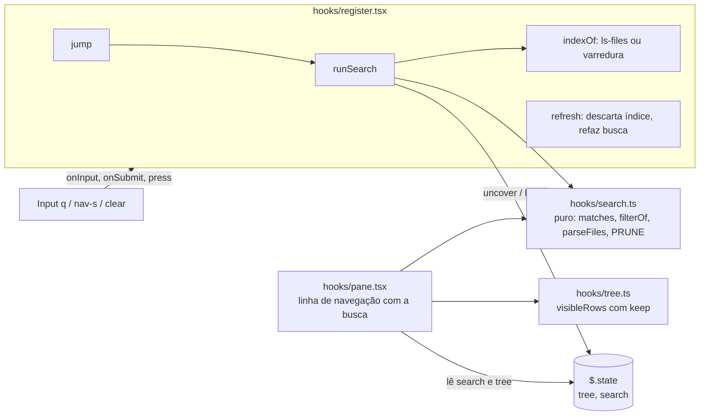

# Fatia 6: busca

**Created.** `2026-10-17`

**Depends on.**

- `spec-01-pane-tree-navigation.md`. Usa `TreeState`, `visibleRows`, `navigate`, `listDir` (com a guarda G1), `refresh`, `reroot`, a linha de navegação de `renderPane` e o foco em `nav-o`.
- `spec-02-claude-activity.md`. Usa `uncover` (revelação em ordem de profundidade, R4.1) e os pontos de `observe` que tratam escritas e varreduras.
- `spec-03-git-status.md`. Usa `runGit` com o argv fixo (R1), o estado `git` (`root`, `top`) e o subcomando permitido `ls-files`.
- `spec-05-auto-refresh.md`. Os tiques e os avisos do git chamam `refresh`, que passa a invalidar o índice.

**Sources.**

- `https://github.com/data-goblin/claude-code-filetree` v0.2.26. Referência de comportamento: `hooks/register.tsx` (`listAll`, `walk`, `indexPaths`, `search`, `jump`, o `Input` de chave `q`) e `hooks/tree.ts` (`visibleRows` com `query`).

## Goal

Achar um arquivo pelo nome sem abrir pasta por pasta. Você digita um trecho, e a árvore passa a mostrar só os caminhos que o contêm, com as pastas até eles abertas, inclusive as que estavam fechadas. O Enter leva o cursor ao primeiro resultado e devolve a árvore ao normal, com o caminho até ele aberto.

A fatia está pronta quando:
- a busca acha arquivos em pastas fechadas e ainda não listadas;
- o filtro, o salto e a limpeza se comportam como abaixo nas superfícies `terminal` e `desktop`;
- a única execução nova é `git ls-files`, pelo argv fixo da spec-03.

## Current behavior

**No repositório (fim da spec-05, versão 0.5.0).**

- `visibleRows(t)` (`hooks/tree.ts`) percorre `nodes` a partir da raiz e desce em pastas abertas (`expanded`) e carregadas. Ela esconde nós `hidden` sem `showHidden`.
- `visibleRows` é usada por `layoutPane` (`hooks/pane.tsx`), por `key` e `navigate` (teclado), por `scanDirs` e `keepTop` (`hooks/activity.ts`, spec-02).
- `renderPane` desenha, nesta ordem:
  1. o cabeçalho;
  2. a linha da branch ou de hints (spec-03);
  3. a linha de navegação, com os `Button` `nav-j`, `nav-k`, `nav-h`, `nav-l` e `nav-o`, em `gap={2}`;
  4. o Client `rows`;
  5. o rodapé.

  A linha de navegação usa cerca de 20 colunas.
- `refresh($)` (`hooks/register.tsx`) relista a raiz e as pastas expandidas e lê o git. É chamada:
  - pelo `↻`;
  - pelo foco do painel;
  - pelo `turn.complete`;
  - pelos tiques e pelos avisos do git (spec-05).
- `uncover($, id, generation, write, listed)` lista os ancestrais que faltam de um id, em ordem de profundidade (spec-02 R4.1).
- `runGit($, root, sub, args, timeoutMs)` é o único caller de `$.process.run`, e `ls-files` é um subcomando permitido (spec-00 R1.2, spec-03 R1.1).
- O `Input` do engine tem `key`, `label`, `placeholder`, `value`, `submitLabel`, `onInput` e `onSubmit`. Enquanto tem o foco, recebe as teclas, e o Esc devolve o foco. `$.ui.focus({ requestId, key })` move o foco para um elemento.
- Não há busca nem estado de busca.

## Requirements and acceptance

Neste documento:
- **texto** é `search.query`;
- **termo** é o texto sem espaços nas pontas e em minúsculas;
- **busca ativa** é um termo não vazio;
- **resultado** é um id do índice cujo caminho relativo à raiz, com `/`, em minúsculas, contém o termo.

### R1. Entrada

- R1.1. A linha de navegação deve ter, à direita dos botões da spec-01:
  - um `Button` `nav-s` com o rótulo `/`, `plain`, `dimColor` e `hotkey="s"`;
  - um `Input` de chave `q` com `placeholder="search"`, `submitLabel="jump"` e `value` igual ao texto. O `Input` ocupa o espaço que sobra e encolhe primeiro.
- R1.2. Quando o usuário pressionar `nav-s`, ou a tecla `s` com o painel focado, o mod deve mover o foco para o `Input` `q` (`$.ui.focus({ requestId: 'filetree', key: 'q' })`).
- R1.3. Enquanto houver busca ativa, a linha deve mostrar um `Button` `clear` com o rótulo `×`, `plain` e `dimColor`, depois do `Input`.
- R1.4. A caixa de busca não deve acrescentar linha ao painel: o cálculo de `room` da spec-01 R5.1 não muda.
- R1.5. Quando o `Input` mudar (`onInput`), o mod deve gravar o texto novo e depois fazer a busca de R3.
- R1.6. Quando o usuário pressionar `clear`, o mod deve gravar o texto vazio, sem salto.
- R1.7. O texto deve sobreviver a um reroot. A busca ativa continua valendo na raiz nova, com o índice dela (R2.5).

### R2. Índice

- R2.1. O índice de uma raiz é a lista dos arquivos dela. O mod deve montá-lo na primeira busca ativa sobre aquela raiz e reaproveitá-lo enquanto não for invalidado.
- R2.2. Quando o estado `git` valer para a raiz e tiver `top` não vazio (spec-03), o mod deve montar o índice com `ls-files -co --exclude-standard -z`, via `runGit`, na raiz, com tempo-limite de 10 000 ms.
  - Cada caminho da saída é relativo à raiz e vira id com `paths.norm(paths.join(root, rel))`.
  - Com `isStdoutTruncated`, o último caminho é descartado.
- R2.3. Nos outros casos, o mod deve montar o índice percorrendo a raiz em largura com `$.fs.list`:
  - até 6 níveis abaixo da raiz;
  - pulando pastas cujo nome esteja em `PRUNE` (sem diferenciar maiúsculas) e entradas com `isLink`;
  - só arquivos (`kind: 'file'`) entram no índice;
  - para ao atingir 20 000 arquivos.

  Uma pasta que falhe na listagem é pulada, sem toast.
- R2.4. Se o `ls-files` terminar com `exitCode` diferente de 0, ou rejeitar, a busca não deve ter resultados, e o índice deve ser descartado para que a próxima busca tente de novo.
- R2.5. O índice deve ser descartado:
  - em cada `refresh` (↻, foco, fim de vez, tiques e avisos da spec-05);
  - depois de cada escrita ou varredura tratada por `observe` (spec-02, spec-04);
  - quando a raiz mudar.
- R2.6. Quando o índice for descartado por `refresh` com busca ativa, o `refresh` deve, no fim, fazer a busca de R3 de novo.
- R2.7. O índice nunca é gravado em `$.state`. Ele vive numa variável de módulo e se perde no hot reload.

### R3. Busca e filtro

- R3.1. Com busca ativa, as linhas visíveis devem ser só os nós em `nodes` cujo caminho relativo contém o termo, mais os ancestrais deles até a raiz. A revelação de R3.4 é o que traz os resultados de pastas fechadas para `nodes`. A regra de ocultos da spec-01 continua valendo.
- R3.2. Sob o filtro, uma pasta deve ser desenhada aberta (`▾`) quando tem pelo menos um filho visível, independente de `expanded`, e fechada (`▸`) nos outros casos.
- R3.3. Sem busca ativa, as linhas devem ser as da spec-05, sem nenhuma diferença.
- R3.4. A cada busca ativa, o mod deve revelar os 60 primeiros resultados, na ordem do índice:
  - listar os ancestrais que faltam, como a spec-02 R4.1;
  - quando a pasta-mãe de um resultado já estiver carregada mas o resultado não estiver em `nodes`, listar essa pasta uma vez.
- R3.5. A revelação não deve mudar `expanded`, `cursor`, `selected`, `scroll`, `activity` nem `chip`.
- R3.6. Se o texto mudar enquanto a busca espera o índice, essa busca deve ser descartada, sem listar nada.
- R3.7. As teclas de navegação, o mouse, a janela automática e a barra de rolagem devem operar sobre as linhas filtradas. Abrir ou fechar uma pasta sob o filtro só muda `expanded`, que volta a valer quando a busca termina.
- R3.8. A varredura de pastas abertas da spec-02 (`scanDirs`) e o `keepTop` continuam usando as linhas sem filtro.

### R4. Salto (Enter)

- R4.1. Quando o usuário pressionar Enter no `Input` com o termo vazio, o mod deve só gravar o texto vazio.
- R4.2. Quando o usuário pressionar Enter com busca ativa, o mod deve:
  1. fazer a busca de R3;
  2. tomar os 10 primeiros resultados que estão em `nodes`;
  3. acrescentar a `expanded` os ancestrais deles;
  4. pôr o cursor no primeiro, com `scroll = null`;
  5. gravar o texto vazio;
  6. devolver o foco para `nav-o`.
- R4.3. Sem resultados em `nodes`, o Enter deve só gravar o texto vazio e devolver o foco, sem mover o cursor.
- R4.4. O salto não deve mudar `selected`.

### R5. Limites de segurança

- R5.1. A única execução nova é `ls-files`, pelo `runGit`. Nenhum caminho entra no argv: o `ls-files` roda sobre a raiz inteira, com a raiz só como valor de `-C`.
- R5.2. A varredura de R2.3 só usa `$.fs.list`. Ela não lê conteúdo e não segue links.

## Architecture



`hooks/search.ts` (novo) decide o que casa e o que fica visível. É puro, como `tree.ts`. `register.tsx` monta o índice, revela, salta e grava. O texto fica numa chave própria, `search`. O índice fica fora de `$.state`, porque pode ter 20 000 caminhos e é refeito sob demanda.

## Components and contracts

### `hooks/search.ts` (novo, puro)

```ts
export const PRUNE = ['.git', 'node_modules', 'target', '.venv', '__pycache__', 'dist', '.next']
export const WALK_DEPTH = 6
export const WALK_LIMIT = 20_000
export const REVEAL_LIMIT = 60
export const JUMP_LIMIT = 10

/** The trimmed, lower-cased query; '' when there is no search. */
export function termOf(query: string): string

/** Index ids whose path relative to the root contains the term, in index order (R3). */
export function matches(paths: Paths, root: string, index: readonly string[], term: string): string[]

/** Ids the filter keeps: nodes whose relative path contains the term, and their ancestors; null without a term (R3.1, R3.3). */
export function filterOf(paths: Paths, t: TreeState, term: string): ReadonlySet<string> | null

/** `ls-files -z`: ids under the root; a cut last path is dropped (R2.2). */
export function parseFiles(paths: Paths, root: string, stdout: string, truncated: boolean): string[]
```

O caminho relativo usado na comparação é `paths.relative(root, id).toLowerCase()`, sempre com `/`. Exemplo: com o termo `lib/x`, `C:/p/src/lib/x.ts` casa (`src/lib/x.ts`), e `C:/p/lib.md` não casa.

### `hooks/tree.ts` (alterado)

```ts
/** The rows the person sees; with `keep`, only those ids, folders open when a kept child shows (spec-06 R3.2). */
export function visibleRows(t: TreeState, keep: ReadonlySet<string> | null = null): Row[] {
  const byParent = /* … como hoje … */
  const open = new Set(t.expanded)
  const rows: Row[] = []
  const walk = (parent: string, depth: number) => {
    for (const node of byParent.get(parent) ?? []) {
      if (node.hidden && !t.showHidden) continue
      if (keep && !keep.has(node.id)) continue
      const kids = (byParent.get(node.id) ?? []).filter(k => (!k.hidden || t.showHidden) && (!keep || keep.has(k.id)))
      const isOpen = node.kind === 'dir' && (keep ? node.loaded && kids.length > 0 : open.has(node.id))
      rows.push({ id: node.id, depth, node, isOpen })
      if (isOpen && node.loaded) walk(node.id, depth + 1)
    }
  }
  walk(t.root, 0)
  return rows
}
```

Sem `keep`, o resultado é idêntico ao de hoje (R3.3).

### `hooks/register.tsx` (alterado)

Atom novo:

```ts
const searchAtom = atom({ plugin: 'filetree-local', key: 'search' }, { query: '' } as SearchState)
```

Variável de módulo nova: `index: { root: string; ids: Promise<string[] | null> } | null`, que guarda o índice da raiz.

| Função | Contrato | Critérios |
|---|---|---|
| `indexOf($)` | devolve o índice da raiz atual, montando-o se `index` for `null` ou de outra raiz. Escolhe `ls-files` ou a varredura por R2.2/R2.3. Um índice que resolve `null` (falha do `ls-files`) é descartado de `index` e vale `[]` | R2.1–R2.4 |
| `walkFiles($, root)` | varredura de R2.3, só com `$.fs.list(paths.native(dir))` | R2.3, R5.2 |
| `runSearch($, query)` | [Algoritmo `runSearch`](#algoritmo-runsearch); devolve os resultados | R3.4–R3.6 |
| `jump($, query)` | [Algoritmo `jump`](#algoritmo-jump) | R4 |
| `dropIndex()` | `index = null` | R2.5 |

Pontos de chamada:

| Onde | Mudança | Critérios |
|---|---|---|
| `refresh` | `dropIndex()` antes de relistar. No fim, se houver busca ativa, `await runSearch($, query)` | R2.5, R2.6 |
| `observe` | `dropIndex()` nos ramos de escrita e de varredura | R2.5 |
| `reroot` | `dropIndex()`. Se houver busca ativa, `await runSearch($, query)` no fim | R1.7, R2.5 |
| `ui.render` | lê `search`, calcula `keep = filterOf(paths, t, termOf(query))` e passa a `layoutPane` | R3.1 |
| `key` (teclado) | `navigate(t, visibleRows(t, keep), input)` | R3.7 |
| `ui.message` de `rows` | tecla `s` → `$.ui.focus({ requestId: PANE, key: 'q' })` antes de `navigate` | R1.2 |

#### Algoritmo `runSearch`

```ts
async function runSearch($: EngineInterface, query: string): Promise<string[]> {
  const term = termOf(query)
  if (term === '') return []
  const { root, generation } = await read($, treeAtom)
  const ids = await indexOf($)
  if ((await read($, searchAtom)).query !== query) return []                       // R3.6
  const hits = matches(paths, root, ids, term)
  const listed = new Set<string>()
  for (const id of hits.slice(0, REVEAL_LIMIT)) {                                     // R3.4
    if (!(await uncover($, id, generation, false, listed))) return hits
    const t = await read($, treeAtom)
    const parent = paths.parent(id)
    const loaded = parent !== null && (paths.same(parent, root) || t.nodes.some(n => n.id === parent && n.loaded))
    if (loaded && !t.nodes.some(n => n.id === id) && !listed.has(parent)) {
      listed.add(parent)
      await listDir($, parent)
    }
  }
  return hits
}
```

`uncover` com `write: false` só lista ancestrais que faltam e não mexe em `expanded` (spec-02 R4.1). A revelação não chama `flash` (R3.5).

#### Algoritmo `jump`

```ts
async function jump($: EngineInterface, query: string) {
  const hits = termOf(query) === '' ? [] : await runSearch($, query)
  await update($, treeAtom, t => {
    const present = new Set(t.nodes.map(n => n.id))
    const first = hits.filter(id => present.has(id)).slice(0, JUMP_LIMIT)      // R4.2
    if (first.length === 0) return t                                             // R4.3
    const open = new Set(t.expanded)
    for (const id of first) for (const dir of ancestorsOf(paths, t.root, id)) open.add(dir)
    return { ...t, expanded: [...open], cursor: first[0]!, scroll: null }
  })
  await update($, searchAtom, () => ({ query: '' }))
  await $.ui.focus({ requestId: PANE, key: 'nav-o' }).catch(() => undefined)
}
```

### `hooks/pane.tsx` (alterado)

- `layoutPane(t, view, glow, git, paths, chip, keep)` ganha `keep` e usa `visibleRows(t, keep)`.
- `renderPane` recebe `query` e ações novas (`search(value)`, `jump(value)`, `clear()`, `focusSearch()`). A linha de navegação passa a ser:

```tsx
<Box flexDirection="row" gap={2}>
  <Button key="nav-j" … />  <Button key="nav-k" … />  <Button key="nav-h" … />  <Button key="nav-l" … />
  <Button key="nav-o" … />
  <Box flexDirection="row" flexGrow={1} flexShrink={1} overflow="hidden">
    <Button key="nav-s" plain dimColor hotkey="s" onPress={actions.focusSearch}>/</Button>
    <Box flexGrow={1} flexShrink={1}>
      <Input key="q" placeholder="search" submitLabel="jump" value={query} onInput={actions.search} onSubmit={actions.jump} />
    </Box>
    {termOf(query) !== '' && <Button key="clear" plain dimColor onPress={actions.clear}>×</Button>}
  </Box>
</Box>
```

## Data models

`types/index.d.ts` (alterado):

```ts
export type SearchState = {
  /** What the search box holds, as typed; survives a reroot (spec-06 R1.7). */
  query: string
}

declare module 'claude-code' {
  interface PluginState {
    'filetree-local': {
      // … chaves das spec-01 a 05 …
      search: SearchState
    }
  }
}
```

`.claude-plugin/plugin.json`: versão `0.6.0`. Nenhuma opção nova.

## Workflows

### Buscar e saltar

```mermaid
sequenceDiagram
  participant P as pessoa
  participant I as Input q
  participant M as mod
  participant G as git / fs
  participant S as $.state
  P->>I: digita "parse"
  I->>M: onInput("parse")
  M->>S: search.query = "parse"
  M->>G: ls-files -co --exclude-standard -z (primeira vez nesta raiz)
  G-->>M: índice
  M->>G: lista ancestrais que faltam dos 60 primeiros
  M->>S: tree.nodes cresce (sem mudar expanded)
  S-->>P: árvore filtrada: só resultados e ancestrais
  P->>I: Enter
  I->>M: onSubmit("parse")
  M->>S: expanded += ancestrais dos 10 primeiros; cursor = primeiro; scroll = null
  M->>S: search.query = ""
  M->>P: foco em nav-o; árvore normal com o caminho aberto
```

### Estados do filtro

| Texto | Linhas | `clear` | Índice |
|---|---|---|---|
| vazio ou só espaços | spec-05 | não | intocado |
| termo não vazio | resultados e ancestrais carregados | sim | montado se faltar |
| termo não vazio, índice falhou | nós carregados que casam e ancestrais | sim | descartado, refeito na próxima busca |

## Guarantees and invariants

### G1. Uma busca velha não lista nada

- **Escopo.** Digitação rápida, com várias buscas esperando o mesmo índice.
- **Mecanismo.** `runSearch` compara o texto gravado com o seu, depois de esperar o índice (R3.6). Uma listagem já iniciada é protegida pela guarda de `listDir` da spec-01 (G1).
- **Verificação.** Com o `ls-files` segurado, o teste digita `a`, `ab` e `abc`, solta, e confere que só os ancestrais dos resultados de `abc` foram listados.

### G2. Sem busca, nada muda

- **Escopo.** Toda chamada de `visibleRows` com `keep = null` e todo desenho sem busca ativa.
- **Mecanismo.** `visibleRows` só filtra quando `keep` não é `null`, e `filterOf` devolve `null` para um termo vazio. A caixa não ocupa linha nova.
- **Verificação.** Os testes das spec-01 a 05 passam sem mudança de expectativa. Um teste compara `rowsOf` com texto `''` e com texto `'  '`.

## Error handling

| Situação | Resposta observável | Estado resultante |
|---|---|---|
| `ls-files` falha ou rejeita | só os nós já carregados que casam aparecem | índice descartado |
| pasta ilegível na varredura | pulada, sem toast | índice sem os arquivos dela |
| mais de 20 000 arquivos fora de repositório | o índice para em 20 000 | parcial |
| resultado sumiu entre o índice e a revelação | não aparece (a listagem não o traz) | inalterado |
| reroot durante a revelação | `uncover` para (spec-02 G3) | da raiz nova; a busca roda de novo no fim do reroot |

## Key decisions

| Decision | Chosen | Rejected alternative | Why, and what it costs |
|---|---|---|---|
| Recorte | Busca nesta fatia; colunas e visual na `spec-07` | Uma spec só | Contratos diferentes: estado e índice aqui, apresentação lá |
| O que se procura | Índice de todos os arquivos (`ls-files` no repositório, varredura fora) | Só nós carregados; fuzzy | Acha em pastas fechadas, e a correspondência por trecho é previsível |
| Como aparece | Filtro com resultados e ancestrais, 60 revelados; Enter salta e limpa | Sem filtro, Enter para o próximo | Paridade, e o filtro mostra todos os resultados de uma vez |
| Lugar da caixa | Na linha de navegação, à direita | Linha própria | A árvore não perde linha, e os testes de layout das fatias anteriores não mudam |
| Reroot | O texto continua, e a busca roda na raiz nova | Limpar | Paridade com o original |
| Onde vive o índice | Variável de módulo | `$.state` | Pode ter 20 000 caminhos e é barato de refazer |

## Affected areas

| Area | Responsibility |
|---|---|
| `hooks/search.ts` (novo) | `PRUNE`, limites, `termOf`, `matches`, `filterOf`, `parseFiles` |
| `hooks/tree.ts` | `visibleRows(t, keep)` |
| `hooks/register.tsx` | `searchAtom`, `index`, `indexOf`, `walkFiles`, `runSearch`, `jump`, `dropIndex`; chamadas em `refresh`, `observe`, `reroot`, `key`, `ui.message` e `ui.render` |
| `hooks/pane.tsx` | `layoutPane` com `keep`; linha de navegação com `nav-s`, `Input q` e `clear` |
| `types/index.d.ts` | `SearchState`, `PluginState.search` |
| `.claude-plugin/plugin.json` | versão `0.6.0` |
| `tests/search.test.ts` (novo) | funções puras |
| `tests/tree.test.ts` | `visibleRows` com `keep` |
| `tests/pane.test.tsx` | `Input` e botões, índice por `ls-files` e por varredura, filtro, revelação, salto, `clear`, reroot, invalidação, desktop |

## Implementation constraints

- `scanDirs` e `keepTop` (spec-02) continuam chamando `visibleRows(t)` sem `keep` (R3.8).
- O render calcula o filtro, mas não grava estado e não chama o git nem `$.fs`.
- A tecla `s` só é tratada quando chega ao Client `rows`. Com o `Input` focado, o engine entrega as teclas ao `Input`.

## Verification

Comandos da spec-00. Nos testes:
- o fundo `process.run` responde `ls-files` com uma lista `-z`;
- o fundo `fs.list` do mundo serve a varredura;
- o `Input` é acionado com `ui.input` (mudança) e Enter (envio) do kit de testes.

| Critérios | Teste |
|---|---|
| R1.1–R1.4 | `nav-s`, `Input q` e `clear` presentes na linha de navegação; `clear` só com busca ativa; `room` igual ao de antes; `s` e `nav-s` focam `q` |
| R1.5–R1.7 | digitar grava o texto e filtra; `clear` limpa sem mover o cursor; reroot mantém o texto e filtra a raiz nova |
| R2.1–R2.4 | repositório: um `ls-files` com o argv fixo, reaproveitado na segunda busca; fora: varredura que pula `node_modules` e links, para em 6 níveis e em 20 000; `ls-files` com exit 128 deixa só os carregados e refaz na próxima busca |
| R2.5, R2.6 | ↻, um `Write` e um tique descartam o índice; com busca ativa, o `refresh` refaz a busca |
| R3.1–R3.3, G2 | filtro com resultado em pasta fechada e não carregada; pastas com filho visível aparecem abertas; ocultos respeitados; sem termo, linhas iguais às de antes |
| R3.4, R3.5 | 70 resultados: só os ancestrais dos 60 primeiros listados; `expanded`, cursor e brilho intactos |
| R3.6, G1 | três textos durante um `ls-files` segurado: só o último revela |
| R3.7, R3.8 | `j`/`k` andam nas linhas filtradas; a varredura de shell da spec-02 usa as linhas sem filtro |
| R4.1–R4.4 | Enter com resultados: ancestrais abertos, cursor no primeiro, texto vazio, foco em `nav-o`, `selected` intacto; sem resultados: só limpa; termo vazio: nada |
| R5.1, R5.2 | argv do `ls-files` sem caminhos depois do subcomando; nenhuma chamada além de `fs.list` na varredura |

Verificação manual, com o mod na versão 0.6.0:

1. Em `claude-filetree`, com tudo fechado, digitar `git`. A árvore deve mostrar `hooks/git.ts` e `tests/git.test.ts`, com `hooks` e `tests` abertas. O Enter deve deixar o cursor em `hooks/git.ts`, com a árvore normal.
2. Com `/filetree C:\Users\w4rl0ck\Documents\Devs`, que não é repositório, digitar `spec-06`. O arquivo desta spec deve aparecer dentro de `claude-filetree/.workbench/…`.

## Out of scope

- Correspondência aproximada (fuzzy) e busca pelo conteúdo dos arquivos.
- Destacar o trecho que casou dentro do nome.
- Histórico de buscas.
