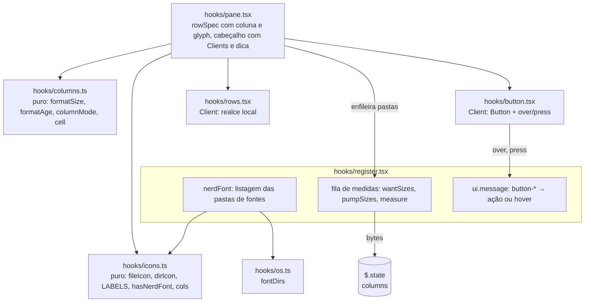

# Fatia 7: colunas e visual

**Created.** `2026-10-17`

**Depends on.**

- `spec-00-overview.md`. Esta fatia emenda a R1.9 (variáveis de ambiente permitidas) e a tabela de funcionalidades não portadas.
- `spec-01-pane-tree-navigation.md`. Usa `FileNode`, `toNodes`, `rowSpec` e a regra de largura do nome (R4.4), os botões do cabeçalho, o Client `rows` e as ações `refresh`, `hidden`, `collapse`, `unselect`, `up` e `cwd`.
- `spec-03-git-status.md`. Usa a célula do git e o `+a -d` que hoje ocupa o lugar da data (R5.4, R5.5), e `GitState.top` para o ícone de repositório.
- `spec-04-git-activity.md`. Usa os ícones do chip e da linha da branch.

**Sources.**

- `https://github.com/data-goblin/claude-code-filetree` v0.2.26. Referência de comportamento:
  - `hooks/icons.ts` (`NAMES`, `EXTS`, `fileIcon`, `CHEVRON_*`);
  - `hooks/tree.ts` (`age`, `formatSize`);
  - `hooks/register.tsx` (`walkSize`, `pumpSizes`, `wantSizes`, `staleSizes`, botões do cabeçalho, `hint`);
  - `hooks/button.tsx`;
  - `hooks/rows.tsx` (realce da linha);
  - `.claude-plugin/plugin.json` (opções `column` e `glyphs`).

## Goal

Completar a paridade visual com o original:

- **Coluna da direita.** Ela pode mostrar a data, a idade (`3h`, `5d`) ou o tamanho, com as pastas somando o que têm dentro. A opção `column` escolhe o padrão, e o botão `Σ` alterna na hora.
- **Ícones.** Com Nerd Font, cada arquivo ganha o ícone do seu tipo. A opção `glyphs` liga isso sozinha (`auto`) quando a fonte está instalada no Windows, sem executar nenhum shell.
- **Hover.** Passar o mouse num botão do cabeçalho diz o que ele faz, e a linha sob o mouse ganha um realce.

A fatia está pronta quando os critérios abaixo passam nos testes, nas superfícies `terminal` e `desktop`, e as checagens manuais confirmam a fonte e o fundo do realce.

## Current behavior

**No repositório (fim da spec-06, versão 0.6.0).**

- **`FileNode`.** Tem `mtimeMs`, mas não `size`: `toNodes` (`hooks/tree.ts`) descarta o `size` de `FsEntry`.
- **Coluna da direita (`rowSpec`, `hooks/pane.tsx`).**
  - Arquivos mostram `formatDate(mtimeMs)` (`YYYY-MM-DD HH:MM`, `DATE_WIDTH = 16`), ou o `+a -d` da spec-03 quando há diff.
  - Pastas não mostram nada.
  - A coluna some em todas as linhas quando o menor nome ficaria com menos de 12 colunas (`MIN_NAME`, spec-01 R4.4).
  - A largura é contada com `.length`, que, para um caractere fora do plano básico do Unicode, vale 2.
- **Glyphs.** `GLYPH` vale `■` para pasta, `·` para arquivo, `↪` para link e `◇` para outros. O caret é `▾`/`▸`.
- **Cabeçalho.** Seis `Button` `plain` (`up` `↑`, `cwd` `⌂`, `refresh` `↻`, `hidden` `◉`/`○`, `collapse` `⊟`, `unselect` `⊘`), com `onPress` no próprio `renderPane`.
  - O `Button` não informa entrada nem saída do mouse.
  - Os testes pressionam esses botões com `ui.press({ key })`.
- **Client `rows` (`hooks/rows.tsx`).** Guarda `{ phase, ref }`. O `onPointer` trata só cliques e o arraste da barra.
- **Linha da branch e chip.** Usam `⑂`, `●`, `⑃`, `↑`, `⇄`, `±` (spec-03, spec-04).
- **Variáveis de ambiente.** O mod lê só `OS`, `USERPROFILE` e `HOME` (spec-00 R1.9).
- **Engine.**
  - `FsEntry` tem `size`, `mtimeMs` e `isLink`.
  - `Color` aceita uma ThemeKey em `backgroundColor`.
  - `ClientPointerEvent.type` inclui `move`, `enter` e `leave`.
  - `$.ui.invalidate('ui.render')` redesenha.
  - `$.env.get` só aceita nomes literais.

## Requirements and acceptance

Neste documento:
- **coluna** é a célula de tempo ou tamanho à direita do nome, antes da célula do git;
- **modo da coluna** é `date`, `age` ou `size`, conforme R1;
- **conjunto de glyphs** é `plain` ou `nerd`, conforme R4.

### R1. Modo da coluna

- R1.1. O `plugin.json` deve declarar a opção `column` (`date` padrão, `age`, `size`) com o texto de [Manifesto](#manifesto). Um valor desconhecido vale `date`.
- R1.2. O cabeçalho deve ter um botão `size`, entre `hidden` e `collapse`, com o rótulo `Σ` (ou o glyph de [Rótulos](#rótulos) em `nerd`). Ele usa `dimColor` quando o tamanho está desligado.
- R1.3. Quando o usuário pressionar `size`, o mod deve alternar entre o tamanho e o modo de tempo da opção (`date` ou `age`; com a opção em `size`, o modo de tempo é `date`).
- R1.4. A escolha do `Σ` vale para a raiz atual. Num reroot, o modo volta ao da opção.
- R1.5. Com o modo `age`, o mod deve redesenhar o painel a cada 60 000 ms, com `$.ui.invalidate('ui.render')`, para as idades avançarem.

### R2. Conteúdo da coluna

- R2.1. No modo `date`, a coluna de um arquivo deve ser `formatDate(mtimeMs)`, como hoje. Pastas e outros nós ficam vazios.
- R2.2. No modo `age`, a coluna de um arquivo deve ser `formatAge(mtimeMs, agora)` ([Formatos](#formatos)), alinhada à direita em 6 colunas. Pastas e outros nós ficam vazios.
- R2.3. No modo `size`:
  - um arquivo deve mostrar `formatSize(size)`;
  - uma pasta medida deve mostrar `formatSize(bytes)`, ou `?` quando a medida falhou ou passou do limite;
  - uma pasta ainda não medida deve mostrar `…`.

  Tudo alinhado à direita em 8 colunas, e outros nós ficam vazios.
- R2.4. Nos modos `date` e `age`, o `+a -d` da spec-03 continua no lugar da coluna de um arquivo com diff. No modo `size`, o tamanho vence e o `+a -d` não aparece.
- R2.5. A regra de omitir a coluna da spec-01 R4.4 vale para os três modos, com a largura do modo (16, 6 ou 8) mais 1 espaço. No modo `size`, as pastas também entram no cálculo do menor nome.
- R2.6. A cor da coluna continua `subtle`.

### R3. Tamanho de pasta

- R3.1. Enquanto o modo for `size`, o mod deve medir cada pasta visível que ainda não tem medida, sem medir outra vez uma pasta já medida ou na fila.
- R3.2. A medida de uma pasta percorre em largura com `$.fs.list` e soma o `size` das entradas `file`, a qualquer profundidade.
  - Entradas com `isLink` não são seguidas nem somadas.
  - Subpastas que falham na listagem são puladas.
- R3.3. Se a medida passar de 50 000 entradas, ou se a própria pasta falhar na listagem, a medida da pasta é `-1` (desenhada `?`).
- R3.4. No máximo 2 medidas devem rodar ao mesmo tempo.
- R3.5. As medidas devem ser descartadas, e as que estão rodando ignoradas ao terminar:
  - no `↻`;
  - depois de cada escrita ou varredura tratada por `observe` (spec-02, spec-04);
  - quando a raiz mudar.

  Os tiques e os avisos do git da spec-05 não descartam medidas.
- R3.6. O render pode enfileirar pastas para medir, mas não pode gravar estado nem esperar uma medida.

### R4. Glyphs

- R4.1. O `plugin.json` deve declarar a opção `glyphs` (`auto` padrão, `nerd`, `plain`) com o texto de [Manifesto](#manifesto). Um valor desconhecido vale `auto`.
- R4.2. No `session.start`, com `glyphs` em `auto` e plataforma `windows`, o mod deve listar com `$.fs.list` as pastas de [Pastas de fontes](#pastas-de-fontes). Ele marca a Nerd Font como instalada quando algum nome de entrada contém `nerd`, sem diferenciar maiúsculas. Uma pasta que falha na listagem conta como sem a fonte. Em `posix`, a fonte conta como não instalada.
- R4.3. O conjunto de glyphs de um desenho é `nerd` quando a opção for `nerd`, ou quando for `auto`, a fonte estiver instalada e a superfície for `terminal`. Nos outros casos, é `plain`.
- R4.4. No conjunto `plain`, os desenhos devem ser idênticos aos da spec-06.
- R4.5. No conjunto `nerd`, o mod deve usar:
  - o ícone de [Ícones de arquivo](#ícones-de-arquivo) no lugar de `GLYPH`;
  - o ícone de pasta aberta, fechada ou de repositório (a pasta cujo id é o `top` do git);
  - os carets de Nerd Font;
  - os rótulos de [Rótulos](#rótulos) nos botões do cabeçalho, na navegação, na linha da branch e no chip.
- R4.6. A cor de cada glyph não muda: continua a da spec-01, e a do git não se aplica (spec-03, decisão "Glyph").
- R4.7. Toda conta de largura deve medir em pontos de código (`[...s].length`), e um glyph conta como 1 coluna. Assim um ícone fora do plano básico não desalinha a linha.

### R5. Dicas nos botões do cabeçalho

- R5.1. Cada botão do cabeçalho (`up`, `cwd`, `refresh`, `hidden`, `size`, `collapse`, `unselect`) deve ser um Client `button.tsx`, de chave `button-<id>`. Ele desenha um `Button` `plain` com o mesmo rótulo e `dimColor`, e a mesma ação de antes.
- R5.2. Quando o mouse entrar no Client de um botão, ele deve enviar `{ over: true }`. Quando sair, `{ over: false }`. Quando o botão for pressionado, `{ press: true }`. Repetições do mesmo estado não são enviadas.
- R5.3. Ao receber `press`, o mod deve executar a ação do botão. Ao receber `over`, deve guardar o botão sob o mouse numa variável de módulo e redesenhar.
- R5.4. Com um botão sob o mouse, o cabeçalho deve mostrar a dica de [Dicas](#dicas) em `subtle`, entre o título e os botões, só quando ela couber inteira sem encolher o título abaixo de 8 colunas. Sem caber, nenhuma dica.
- R5.5. A mensagem do Client de botão é dado de entrada: só `{ over: boolean }` e `{ press: true }` são aceitos, e o id vem da chave do elemento, que precisa estar na lista de botões.

### R6. Realce da linha sob o mouse

- R6.1. Quando o mouse se mover sobre uma linha do Client `rows` sem botão pressionado, o Client deve guardar o índice dela no estado local e redesenhar.
- R6.2. Quando o mouse sair do Client, ou começar um arraste, o realce deve sumir.
- R6.3. A linha realçada deve ter `backgroundColor="subtle"` na `Box` da linha. A linha do cursor (`inverse`) não recebe o realce.
- R6.4. O realce é só do Client. Ele não envia mensagem ao mod nem muda o estado do mod.

## Architecture



- **Módulos puros novos.** `hooks/columns.ts` decide o que a coluna mostra. `hooks/icons.ts` guarda as tabelas de glyphs e a medida de largura. Os dois são puros.
- **Plataforma.** `hooks/os.ts` ganha as pastas de fontes, porque só ele decide pela plataforma e lê variáveis de ambiente (spec-00 R2.6, R1.9).
- **Estado.** O estado novo fica numa chave própria, `columns`. A Nerd Font detectada e o botão sob o mouse ficam em variáveis de módulo, porque são da sessão do processo e baratos de refazer.

## Components and contracts

### `hooks/columns.ts` (novo, puro)

```ts
export type ColumnMode = 'date' | 'age' | 'size'
export const AGE_WIDTH = 6
export const SIZE_WIDTH = 8
export const SIZE_LIMIT = 50_000
export const SIZE_JOBS = 2
export const AGE_TICK_MS = 60_000

/** The `column` option; unknown is 'date' (R1.1). */
export function columnOf(options: PluginOptions): ColumnMode

/** The time mode the Σ button goes back to: the option, or 'date' when the option is 'size' (R1.3). */
export function timeModeOf(option: ColumnMode): 'date' | 'age'

/** The mode for this root: Σ's choice when it was made under this root, else the option (R1.4). */
export function modeOf(c: ColumnsState, root: string, option: ColumnMode): ColumnMode
```

#### Formatos

| Função | Entrada | Saída |
|---|---|---|
| `formatSize(bytes)` | `-1` | `?` |
| | `< 1024` | `512 B` |
| | `≥ 1024` | divide por 1024 até ficar abaixo de 1024 (no máximo `T`); com o valor abaixo de 100, uma casa decimal, senão inteiro: `1.5 K`, `12.0 M`, `340 G` |
| `formatAge(ms, now)` | `ms === 0` | `''` |
| | `|agora - ms| < 60 s` | `now` |
| | `< 1 h` | `12m` |
| | `< 1 d` | `3h` |
| | `< 7 d` | `5d` |
| | `< 365 d` | `Oct 9` (mês em inglês, abreviado, e o dia) |
| | demais | `2024` |

#### Algoritmo da célula

```ts
/** What the column shows for a row, before alignment; '' leaves it empty (R2). */
export function cellText(mode: ColumnMode, node: FileNode, bytes: number | undefined, now: number): string {
  if (mode === 'size') {
    if (node.kind === 'file') return formatSize(node.size)
    if (node.kind === 'dir') return bytes === undefined ? '…' : formatSize(bytes)
    return ''
  }
  if (node.kind !== 'file') return ''
  return mode === 'age' ? formatAge(node.mtimeMs, now) : formatDate(node.mtimeMs)
}
// widthOf(mode) = mode === 'date' ? DATE_WIDTH : mode === 'age' ? AGE_WIDTH : SIZE_WIDTH; o texto é alinhado com padStart.
```

### `hooks/icons.ts` (novo, puro)

```ts
export type GlyphSet = 'plain' | 'nerd'
export type GlyphOption = 'auto' | 'nerd' | 'plain'

/** Columns a string takes: one per code point (R4.7). */
export const cols = (s: string): number => [...s].length

export function glyphOptionOf(options: PluginOptions): GlyphOption        // unknown → 'auto' (R4.1)
export function hasNerdFont(names: readonly string[]): boolean           // some name contains 'nerd', any case (R4.2)
export function glyphSetOf(option: GlyphOption, installed: boolean, surface: string): GlyphSet  // R4.3

/** The glyph a node shows; plain is spec-01's GLYPH. */
export function nodeGlyph(set: GlyphSet, node: FileNode, open: boolean, isRepo: boolean): string
export function caret(set: GlyphSet, open: boolean): string               // plain: '▾ '/'▸ '; nerd: CHEVRON_OPEN/CLOSED + ' '
export const LABELS: Record<GlyphSet, Record<LabelId, string>>
```

#### Ícones de arquivo

São as tabelas `NAMES` (por nome, em minúsculas) e `EXTS` (pela extensão depois do último `.`, em minúsculas) do original, copiadas como dados, com os mesmos pontos de código.

| Nó | Ícone `nerd` |
|---|---|
| link | `U+F481` |
| pasta do repositório (`id === git.top`) | `U+F02A2` |
| pasta aberta / fechada | `U+E5FE` / `U+E5FF` |
| arquivo com nome em `NAMES` | o de `NAMES` (ex.: `readme.md` → `U+F0354`, `package.json` → `U+F0626`) |
| arquivo com extensão em `EXTS` | o de `EXTS` (ex.: `ts` → `U+E628`, `json` → `U+E60B`, `md` → `U+F0354`) |
| demais | `U+F0214` |

#### Rótulos

| Id | `plain` | `nerd` |
|---|---|---|
| `up` | `↑` | `U+F005D` |
| `cwd` | `⌂` | `U+F02DC` |
| `refresh` | `↻` | `U+F0450` |
| `hidden` (mostrando / ocultando) | `◉` / `○` | `U+F0208` / `U+F0209` |
| `size` | `Σ` | `U+F02CA` |
| `collapse` | `⊟` | `U+EAC5` |
| `unselect` | `⊘` | `U+F0777` |
| `nav-j`, `nav-k`, `nav-h`, `nav-l` | `↓` `↑` `←` `→` | `U+F0045` `U+F005D` `U+F004D` `U+F0054` |
| `nav-o` | `open` | `U+F03CB open` |
| `nav-s` (spec-06) | `/` | `U+F0349` |
| branch (spec-03) | `⑂` | `U+F418` |
| chip `commit` / `push` / `merge` / `pr` / `staged` / `switch` (spec-04) | `●` `↑` `⑃` `⇄` `±` `⑂` | `U+F417` `U+F0552` `U+F419` `U+F407` `U+E702` `U+F418` |

O chip guarda o ícone `plain` no estado (spec-04). No conjunto `nerd`, o render troca pelo da tabela, sem mudar o estado.

#### Dicas

| Botão | Dica |
|---|---|
| `up` | `parent folder` |
| `cwd` | `follow the cwd` |
| `refresh` | `reload tree and git` |
| `hidden` | `hide hidden files` / `show hidden files` |
| `size` | `show sizes` / `show dates` / `show ages` (o que o próximo toque mostra) |
| `collapse` | `collapse all` |
| `unselect` | `clear selection` |

### `hooks/os.ts` (alterado)

#### Pastas de fontes

```ts
/** Where installed fonts live: on Windows the machine's and the person's folders; none elsewhere (R4.2). */
export async function fontDirs($: EngineInterface, p: Paths): Promise<string[]> {
  if (p.platform !== 'windows') return []
  const windir = await $.env.get('WINDIR')
  const local = await $.env.get('LOCALAPPDATA')
  return [windir ? p.join(p.norm(windir), 'Fonts') : '', local ? p.join(p.norm(local), 'Microsoft/Windows/Fonts') : ''].filter(Boolean)
}
```

### `hooks/tree.ts` (alterado)

`FileNode` ganha `size: number`, que é o `size` do `FsEntry` para arquivos e 0 para os demais. `toNodes` o preenche.

### `hooks/register.tsx` (alterado)

Atom novo:

```ts
const columnsAtom = atom({ plugin: 'filetree-local', key: 'columns' }, emptyColumns())
// emptyColumns() = { root: '', size: null, bytes: {} }
```

Variáveis de módulo novas:
- `column: ColumnMode` e `glyphOption: GlyphOption`, das opções em `register`;
- `nerdFont: boolean`, de R4.2;
- `hovered: string`;
- `ageTicker: Timer | null`;
- a fila de medidas: `sizeQueue: string[]`, `sizing: Set<string>`, `sizeEpoch: number`, `sizeActive: number`.

| Função | Contrato | Critérios |
|---|---|---|
| `measure($, dir)` | percorre e soma por R3.2; devolve bytes, ou `-1` por R3.3 | R3.2, R3.3 |
| `wantSizes($, dirs)` | enfileira as pastas sem medida, fora da fila e fora de `sizing`, e chama `pumpSizes` | R3.1, R3.6 |
| `pumpSizes($)` | enquanto `sizeActive < 2`, tira da fila e mede. Ao terminar, grava `columns.bytes[key(dir)]` se a época e a raiz não mudaram | R3.4, R3.5 |
| `clearSizes($)` | `sizeEpoch++`, esvazia a fila e grava `bytes: {}` | R3.5 |
| `toggleSize($)` | grava `columns = { root: tree.root, size: !modoAtualÉSize, bytes }`. Com uma raiz diferente da gravada, começa de `bytes: {}` | R1.3, R1.4 |
| `detectNerdFont($)` | R4.2, com `fontDirs` e `hasNerdFont` | R4.2 |

Pontos de chamada:

| Onde | Mudança |
|---|---|
| `register` | `column = columnOf(options)`, `glyphOption = glyphOptionOf(options)` |
| `session.start` | `nerdFont = glyphOption === 'auto' && (await detectNerdFont($))`. Se `column === 'age'`, inicia `ageTicker` (cancelando o anterior) |
| ação `refresh` (↻) | `clearSizes($)` antes de `refresh($)`. Os tiques da spec-05 chamam `refresh` sem `clearSizes` |
| `observe` | `clearSizes($)` nos ramos de escrita e de varredura |
| `reroot` | `clearSizes($)` |
| `ui.render` | calcula o modo, o conjunto de glyphs e as linhas. No modo `size`, chama `wantSizes` com as pastas visíveis sem medida |
| `ui.message` | elementos `button-<id>`: valida (R5.5) e trata `press` (ação) e `over` (`hovered`, `$.ui.invalidate('ui.render')`) |

### `hooks/pane.tsx` (alterado)

- **`rowSpec`.** Recebe o modo, as medidas, o conjunto de glyphs, o `top` do git e `now`. Desenha:
  - caret e glyph por `caret` e `nodeGlyph`;
  - a coluna por `cellText`, alinhada pela largura do modo;
  - o `loc` da spec-03 só fora do modo `size` (R2.4).

  As larguras usam `cols` (R4.7).
- **`layoutPane`.** Aplica R2.5 com a largura do modo. No modo `size`, devolve também `sizeWanted`, a lista de pastas visíveis sem medida, que o `ui.render` passa a `wantSizes`.
- **`renderPane`.** O cabeçalho passa a ser:

```tsx
<Box flexDirection="row">
  <Box flexGrow={1} flexShrink={1} overflow="hidden"><Text … wrap="truncate-start">{title}</Text></Box>
  {hint !== '' && <Text color="subtle">{hint} </Text>}
  <Box flexDirection="row" flexShrink={0} gap={1}>
    {buttons.map(b => <Client key={`button-${b.id}`} module="./button.tsx" props={{ id: b.id, label: b.label, dim: b.dim }} />)}
  </Box>
</Box>
```

`hint` é a dica do botão em `hovered`, ou `''` quando ela não cabe (R5.4):

```ts
const room = bodyColumns - buttonsWidth - 8   // 8 = o mínimo do título
const hint = text !== undefined && cols(text) + 1 <= room ? text : ''
```

### `hooks/button.tsx` (novo, Client)

```tsx
export type ButtonProps = { id: string; label: string; dim: boolean }

const HeaderButton: ClientModule<ButtonProps, { over: boolean }> = (props, surface) => {
  const { Button } = surface.elements
  surface.onPointer(e => {
    const over = e.type !== 'leave'
    if (over === Boolean(surface.state?.over)) return          // R5.2: sem repetição
    surface.setState({ over })
    surface.post({ over })
  })
  return <Button key={props.id} plain {...(props.dim ? { dimColor: true } : {})} onPress={() => surface.post({ press: true })}>{props.label}</Button>
}
```

### `hooks/rows.tsx` (alterado)

`Local` ganha `hover: number` (`-1` sem realce):
- `onPointer` com `move` sem botão grava `hover = e.y`, só quando mudou;
- `leave`, ou o início de um arraste da barra, grava `-1`;
- a `Box` de cada linha recebe `backgroundColor="subtle"` quando `y === hover && !row.active` (R6).

## Data models

`types/index.d.ts` (alterado):

```ts
export type FileNode = {
  // … campos da spec-01 …
  /** Bytes for a regular file; 0 for anything else. */
  size: number
}

export type ColumnsState = {
  /** tree.root when Σ was last pressed; under another root the option rules (R1.4). */
  root: string
  /** Σ's choice for that root: true = size; null = not pressed. */
  size: boolean | null
  /** Paths.key of a folder → bytes under it; -1 = unknown or past the limit (R3). */
  bytes: Record<string, number>
}

declare module 'claude-code' {
  interface PluginState {
    'filetree-local': {
      // … chaves das spec-01 a 06 …
      columns: ColumnsState
    }
  }
}
```

`bytes` vale para `columns.root`. Uma raiz diferente da atual faz o render tratar `bytes` como vazio.

### Manifesto

`.claude-plugin/plugin.json`: versão `0.7.0` e as opções acrescentadas a `userConfig`:

```json
{
  "column": {
    "type": "string",
    "title": "Right column",
    "description": "What the right column shows by default: date (last modified), age (time since last modified: now, 12m, 3h, 5d, then Oct 9, then the year) or size (files in bytes, folders as the total under them, measured in the background). The Σ button switches between size and the date or age.",
    "default": "date",
    "options": ["date", "age", "size"]
  },
  "glyphs": {
    "type": "string",
    "title": "Icons",
    "description": "auto: Nerd Font icons in the terminal when a Nerd Font is installed on this machine; plain everywhere else. nerd: always Nerd Font icons. plain: Unicode only.",
    "default": "auto",
    "options": ["auto", "nerd", "plain"]
  }
}
```

### Emenda à spec-00

| Onde | Mudança |
|---|---|
| R1.9 e a tabela [Variáveis de ambiente permitidas] | Acrescenta `WINDIR` e `LOCALAPPDATA`, com o uso "achar as pastas de fontes (spec-07 R4.2)" |
| Tabela de funcionalidades não portadas | A linha "Detecção de Nerd Font via `sh -c`" passa a dizer que a detecção foi trocada por listagem das pastas de fontes do Windows (spec-07), sem shell |

## Workflows

### Medir as pastas visíveis

```mermaid
sequenceDiagram
  participant R as ui.render
  participant Q as fila (pumpSizes)
  participant F as $.fs.list
  participant S as $.state
  R->>R: modo size; pastas visíveis sem medida
  R->>Q: wantSizes([src, docs, node_modules])
  R-->>R: desenha "…" nessas pastas
  par até 2
    Q->>F: percorre src
    Q->>F: percorre docs
  end
  Q->>S: columns.bytes[src] = 12345 (época igual)
  S-->>R: redesenho: "12.1 K"
  Q->>F: percorre node_modules (> 50 000 entradas)
  Q->>S: columns.bytes[node_modules] = -1
  S-->>R: redesenho: "?"
```

### Modo da coluna

| Opção `column` | Σ nesta raiz | Modo | Σ aceso |
|---|---|---|---|
| `date` | não pressionado | `date` | não |
| `date` | ligado | `size` | sim |
| `age` | não pressionado | `age` | não |
| `size` | não pressionado | `size` | sim |
| `size` | desligado | `date` | não |
| qualquer | pressionado em outra raiz | a da opção | conforme a opção |

## Guarantees and invariants

### G1. Medidas velhas não sujam o estado

- **Escopo.** Medidas em andamento durante um `↻`, uma escrita ou um reroot.
- **Mecanismo.**
  - Cada medida guarda a `sizeEpoch` de quando começou e só grava se ela não mudou e a raiz é a mesma.
  - `clearSizes` incrementa a época.
- **Critérios.** R3.5.
- **Verificação.** Um teste segura a listagem de uma pasta medida, pressiona `↻`, solta e confere que a pasta continua `…` até a nova medida.

### G2. O render não espera e não grava

- **Escopo.** Todo `ui.render`.
- **Mecanismo.**
  - `wantSizes` só mexe em variáveis de módulo e dispara `pumpSizes` sem `await`.
  - A gravação acontece no fim de cada medida, fora do render.
- **Critérios.** R3.6.
- **Verificação.** Com o `fs.list` da medida pendurado, o painel desenha `…`.

### G3. `plain` é a spec-06

- **Escopo.** Todo desenho com o conjunto `plain` e a coluna em `date`.
- **Mecanismo.** `nodeGlyph`, `caret` e `LABELS.plain` devolvem os mesmos textos de hoje, e `cellText` no modo `date` é `formatDate`.
- **Critérios.** R2.1, R4.4.
- **Verificação.** Os testes das spec-01 a 06 passam, ajustados só na forma de pressionar os botões do cabeçalho (ver [Affected areas](#affected-areas)).

## Error handling

| Situação | Resposta observável | Estado resultante |
|---|---|---|
| pasta medida com mais de 50 000 entradas | `?` | `bytes = -1` |
| a pasta medida não lista | `?` | `bytes = -1` |
| subpasta ilegível durante a medida | soma sem ela | parcial |
| `WINDIR` ou `LOCALAPPDATA` ausentes, ou a pasta de fontes não lista | o `auto` usa `plain` | — |
| Nerd Font instalada mas o terminal usa outra fonte | ícones aparecem como quadrados; a pessoa escolhe `plain` | — |
| mensagem malformada de um Client de botão | ignorada | inalterado |

## Key decisions

| Decision | Chosen | Rejected alternative | Why, and what it costs |
|---|---|---|---|
| Recorte | Colunas, glyphs e hover nesta fatia; busca na `spec-06` | Uma spec só | Apresentação separada de estado e índice |
| Tamanho de pasta | `fs.list` recursivo, sem links, até 50 000 entradas, 2 em paralelo, cache limpo no ↻, nas escritas e no reroot | Só arquivos; limite de 10 000 | Paridade. `du` não é permitido (spec-00 R1.2) |
| Colunas | Paridade: `column` com `date`/`age`/`size`; o `Σ` alterna e volta à opção no reroot; o tamanho vence o `+a -d` | `Σ` persistente entre raízes | Paridade com o original |
| Detecção da fonte | `auto` por listagem de `%WINDIR%\Fonts` e `%LOCALAPPDATA%\Microsoft\Windows\Fonts` | `sh -c` como o original; sem `auto` | O original não detecta nada no Windows, e o shell violaria a R1.1. Custa ler duas variáveis de ambiente a mais (emenda à R1.9) |
| Padrão de `glyphs` | `auto` | `plain` | Escolha do autor, com o limite "instalada ≠ em uso" documentado |
| Hover | Dicas por Client em cada botão e realce de linha com fundo `subtle` | Só realce; nenhum | Paridade. O `Button` não informa hover, por isso o Client |

## Affected areas

| Area | Responsibility |
|---|---|
| `hooks/columns.ts` (novo) | modos, formatos, `cellText`, constantes |
| `hooks/icons.ts` (novo) | `cols`, opções, `hasNerdFont`, `glyphSetOf`, `nodeGlyph`, `caret`, `LABELS`, tabelas `NAMES`/`EXTS` |
| `hooks/button.tsx` (novo) | Client do botão do cabeçalho |
| `hooks/os.ts` | `fontDirs`, com `WINDIR` e `LOCALAPPDATA` |
| `hooks/tree.ts` | `FileNode.size` em `toNodes` |
| `hooks/register.tsx` | `columnsAtom`, opções, `nerdFont`, `hovered`, `ageTicker`, fila de medidas, `toggleSize`, `clearSizes`, `ui.message` dos botões; chamadas em `session.start`, `refresh`, `observe` e `reroot` |
| `hooks/pane.tsx` | `rowSpec` e `layoutPane` com modo, medidas, glyphs e `cols`; cabeçalho com Clients e dica; rótulos por conjunto na navegação, na linha da branch e no chip |
| `hooks/rows.tsx` | realce local |
| `types/index.d.ts` | `FileNode.size`, `ColumnsState`, `PluginState.columns` |
| `.claude-plugin/plugin.json` | opções `column` e `glyphs`; versão `0.7.0` |
| `tests/columns.test.ts`, `tests/icons.test.ts` (novos) | funções puras |
| `tests/pane.test.tsx` | modos, `Σ`, medidas, glyphs, dicas, realce. Os testes que pressionam botões do cabeçalho passam a pressionar o `Button` dentro do Client `button-<id>` (um helper `header(ui, id)`); os de navegação não mudam |
| `spec-00-overview.md` | emenda de R1.9 e da tabela de não portados |

## Implementation constraints

- **Emenda à spec-01 (render).** O render pode enfileirar medidas (R3.6), sem gravar estado e sem esperar.
- **Emenda à spec-00 R1.9.** Ver [Emenda à spec-00](#emenda-à-spec-00).
- A Nerd Font é detectada uma vez por carga do módulo, no `session.start`. Instalar uma fonte depois exige um novo início de sessão ou um hot reload.
- Nenhuma cor hex. O fundo do realce é a ThemeKey `subtle`.

## Verification

Comandos da spec-00. Nos testes:
- o fundo `fs.list` do mundo devolve `size` por arquivo e pode atrasar uma pasta;
- `mock.env` ganha `WINDIR` e `LOCALAPPDATA`, e o mundo ganha as pastas de fontes;
- o Client `button-<id>` é acionado com `ui.post` (`over`) e com o `Button` interno (`press`).

| Critérios | Teste |
|---|---|
| R1.1–R1.5 | `columnOf` e `timeModeOf`; `Σ` alterna, acende e volta à opção no reroot; com `age`, um avanço de 60 s redesenha a idade |
| R2.1–R2.6 | `cellText` em cada modo; alinhamentos de 16, 6 e 8; o tamanho vence o `+a -d`; a coluna some em painel estreito, com as pastas contando no modo `size` |
| R3.1–R3.6, G1, G2 | `…` e depois o valor; links ignorados; 50 001 entradas dão `?`; no máximo 2 medidas simultâneas; `↻` e um `Write` descartam; um tique da spec-05 não descarta; medida velha não grava; render com medida pendurada |
| R4.1–R4.7, G3 | `hasNerdFont`, `glyphSetOf` e `nodeGlyph` por nome, extensão, pasta, repositório e link; `auto` com fonte em `LOCALAPPDATA`; sem fonte; desktop sempre `plain`; largura de linha com glyphs fora do plano básico igual a `width - bar` em pontos de código; `plain` idêntico ao de antes |
| R5.1–R5.5 | `over` mostra a dica que cabe e esconde a que não cabe; `press` executa a ação; mensagens malformadas e ids fora da lista ignorados |
| R6.1–R6.4 | `ui.pointer` com `move` realça a linha, `leave` limpa, a linha do cursor não realça, nenhuma mensagem enviada ao mod |

Verificação manual, com o mod na versão 0.7.0:

1. Com uma Nerd Font instalada e em uso no Windows Terminal, abrir o painel. Os ícones devem aparecer por tipo de arquivo, alinhados. Com `glyphs: plain`, devem voltar `■` e `·`. Confirma a premissa A1.
2. Passar o mouse pelos botões do cabeçalho. A dica deve aparecer ao lado. Passar o mouse pelas linhas: o realce deve ser legível com o texto e o cursor. Confirma a premissa A2.
3. Pressionar `Σ` com `node_modules` visível. As pastas devem ir de `…` ao tamanho, e `node_modules` deve chegar a um valor ou a `?`, sem travar o painel.

## Assumptions

- **A1.** O terminal desenha um glyph de Nerd Font em 1 coluna. Se desenhar em 2, as linhas com ícone ficam 1 coluna mais largas que o resto. A correção seria contar esses pontos de código como 2 em `cols`.
- **A2.** A ThemeKey `subtle` como fundo deixa o texto da linha legível no tema padrão. Se não deixar, a correção é trocar a ThemeKey do realce.
- **A3.** Ter a Nerd Font instalada indica que ela está em uso. É o mesmo limite do original. Quando falhar, a pessoa escolhe `plain`.

## Out of scope

- Ícones coloridos por tipo de arquivo.
- Ler o `settings.json` do terminal para saber a fonte em uso (`$.fs.read` fora da raiz é proibido).
- Detectar Nerd Font no Linux e no macOS.
- Medir pastas com `du` ou qualquer processo.
