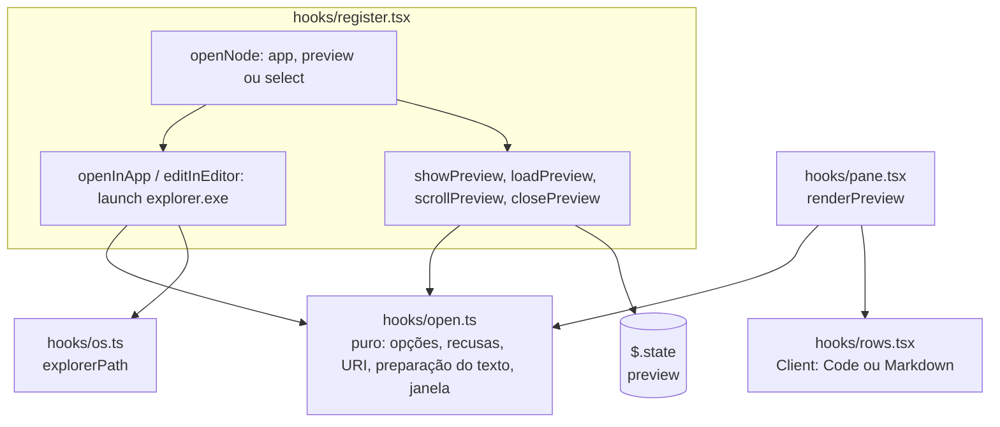
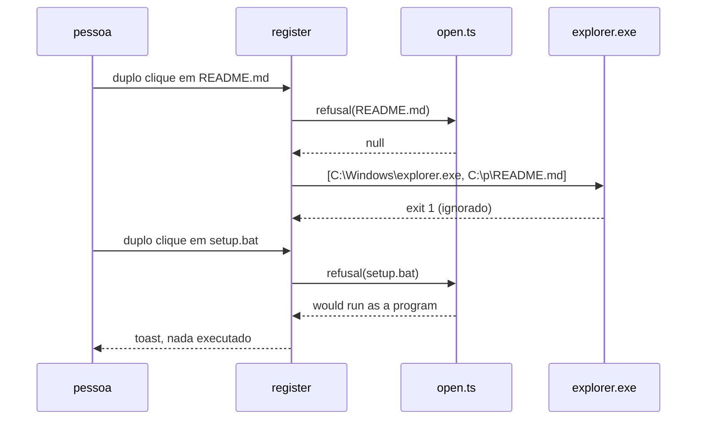
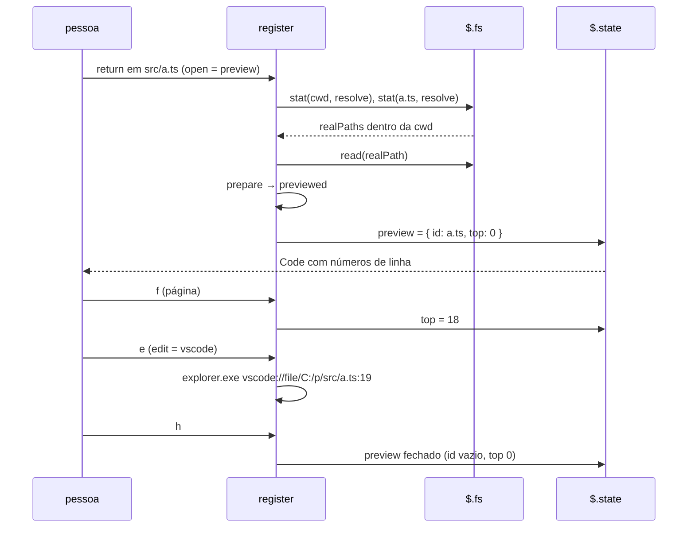

# Fatia 8: abrir, preview e edição

**Created.** `2026-10-19`

**Depends on.**

- `spec-00-overview.md`. Esta fatia define a raiz permitida de R1.5 e a lista de R1.6, e emenda a tabela de executáveis permitidos (R1.2).
- `spec-01-pane-tree-navigation.md`. Usa `navigate`, o duplo clique (R9.4), o Client `rows`, `RowsMessage`, os botões de navegação e o `ui.scroll`. Emenda R9.4 e a tabela de teclas: duplo clique e `return` num arquivo passam a abrir.
- `spec-02-claude-activity.md`. Usa `observe` e o toque de escrita, que passa a recarregar o preview.
- `spec-07-columns-and-look.md`. Usa o Client `button.tsx`, as dicas (R5), `LABELS`, `cols` e `formatSize`.

**Sources.**

- `https://github.com/data-goblin/claude-code-filetree` v0.2.26. Referência de comportamento:
  - `hooks/register.tsx` (`loadPreview`, `showPreview`, `closePreview`, `scrollPreview`, `previewLines`, `openFile`, `editPreview`, o ramo `t.preview` do `ui.render` e do `ui.message`);
  - `hooks/open.ts` (`openCommand`, `openWithCommand`);
  - `hooks/rows.tsx` (o preview desenhado no mesmo Client das linhas);
  - `.claude-plugin/plugin.json` (opções `open` e `edit`).

## Goal

Fechar a paridade de "abrir" com o original, sem nenhum shell:

- **Abrir com o app padrão.** Duplo clique ou `return` num arquivo o abrem no programa associado do Windows.
- **Preview.** Com a opção `open` em `preview`, o arquivo aparece no próprio painel: Markdown desenhado, código com cores e números de linha, rolagem por teclado e roda do mouse, `←` volta à árvore e `↗` abre no app padrão.
- **Edição.** No preview, `e` abre o arquivo no editor escolhido, na linha do topo da janela. A opção vem desligada e só aceita editores de uma lista fechada.

A fatia está pronta quando os critérios abaixo passam nos testes, nas superfícies `terminal` e `desktop`, e as checagens manuais confirmam o `explorer.exe` e o URI do editor.

## Current behavior

**No repositório (fim da spec-07, versão 0.7.0).**

- **Duplo clique e `return`.** Num arquivo, só marcam `selected` (spec-01 R9.3, R9.4 e tabela de teclas). `navigate` não devolve efeito para `return` em arquivo.
- **Processos.** O único executável é `git.exe` (`EXECUTABLES` em `hooks/os.ts`), chamado só por `runGit`.
- **Leitura de arquivos.** O mod não chama `$.fs.read`. A spec-00 R1.5 exige que o caminho real de toda leitura esteja dentro do caminho real da raiz permitida, que esta fatia define.
- **Client `rows`.** Desenha só linhas (`RowsProps.rows`) e posta `key`, `press` e `scrollTo`.
- **Engine.**
  - `$.fs.read(path)` devolve o texto UTF-8 e rejeita acima de 4 MiB.
  - `$.fs.stat(path, { resolve: true })` devolve `realPath`, com todos os links seguidos, ou nada quando o caminho não leva a lugar nenhum.
  - `$.process.run(argv, { timeoutMs })` executa sem shell, espera o fim e rejeita quando não inicia ou estoura o tempo.
  - `surface.elements` de um Client tem `Code` (`source`, `path`, `startLine`, `wrap`) e `Markdown` (`text`). Cada desenho aceita até 100 000 caracteres.

## Requirements and acceptance

Neste documento:
- **abrir** é a ação de duplo clique, `return` ou clique com `ctrl`/`shift` num nó que não é pasta;
- **app padrão** é o programa que o Windows associa ao arquivo, alcançado por `explorer.exe <caminho>`;
- **raiz permitida** é a cwd da sessão (`$.session.cwd()`, na forma `Paths.norm`) no momento da leitura;
- **janela** é o trecho de linhas do preview que o painel mostra.

### R1. Opções

- R1.1. O `plugin.json` deve declarar a opção `open` (`app` padrão, `preview`, `select`) com o texto de [Manifesto](#manifesto). Um valor desconhecido vale `app`.
- R1.2. O `plugin.json` deve declarar a opção `edit` (`off` padrão, `vscode`, `vscode-insiders`, `cursor`) com o texto de [Manifesto](#manifesto). Um valor desconhecido vale `off`. Esta é a lista limitada da spec-00 R1.6.

### R2. Abrir

- R2.1. Abrir um arquivo deve, conforme `open`:
  - `app`: abrir no app padrão (R3);
  - `preview`: mostrar o preview (R4);
  - `select`: só marcar `selected`, como na spec-07.

  Em todos os casos, o nó fica com `cursor` e `selected`.
- R2.2. Na árvore, `return` sobre um nó que não é pasta deve abrir. `space` continua só marcando `selected`.
- R2.3. Um segundo `press` esquerdo no mesmo nó que não é pasta, em até 450 ms, deve abrir. Um `press` esquerdo com `ctrl` ou `shift` num nó que não é pasta também deve abrir.
- R2.4. Nós `other` (nem arquivo, nem pasta, nem link) não abrem: só são selecionados.

### R3. App padrão

- R3.1. O mod deve abrir no app padrão com um único `$.process.run`, cujo `argv` é `[<WINDIR>\explorer.exe, <caminho nativo absoluto>]`, com `timeoutMs` de 10 000. O `<WINDIR>` vem de `$.env.get('WINDIR')`, e o executável nunca é procurado no `PATH`.
- R3.2. O código de saída do `explorer.exe` deve ser ignorado, porque ele devolve 1 mesmo quando abre. Só uma rejeição do `$.process.run` mostra o toast `could not open <pretty>: <motivo>`.
- R3.3. O mod deve recusar, com um toast e sem executar nada:
  - fora do Windows, ou sem `WINDIR`: `opening files needs Windows`;
  - um caminho de rede: `network paths are not opened: <pretty>`;
  - um caminho com `,`, que o `explorer.exe` lê como separador: `not opened: <nome> has a comma`;
  - um arquivo cuja extensão, ou a do caminho real de um link, esteja em [Extensões que executam](#extensões-que-executam): `not opened: <nome> would run as a program`;
  - um link que não leva a lugar nenhum: `not opened: <nome> leads nowhere`;
  - um link para uma pasta: `not opened: <nome> is a folder link`;
  - um caminho que, no `stat`, não é um arquivo: `not opened: <nome> is not a file`.

  As recusas por nome (rede, vírgula, extensão) vêm antes do `stat`; as de link e de tipo, depois dele, com `{ resolve: true }`.
- R3.4. O botão `↗` do preview (R5.4) abre no app padrão com as regras desta seção, qualquer que seja a opção `open`.

### R4. Preview: leitura

- R4.1. Antes de ler, o mod deve obter o `realPath` do arquivo e o da raiz permitida com `$.fs.stat(…, { resolve: true })`. Só lê quando os dois existem e `Paths.inside(norm(realRaiz), norm(realArquivo))`. É a regra R1.5 da spec-00.
- R4.2. A leitura deve usar o `realPath` verificado, não o caminho do nó.
- R4.3. O mod não deve ler, e deve mostrar no lugar do texto uma nota, quando:
  - o arquivo está fora da raiz permitida: `outside the project folder (<pretty da cwd>); ↗ opens it`;
  - o caminho não leva a um arquivo: `not a file`;
  - o tamanho passa de 4 194 304 bytes: `<formatSize>, too large to preview`;
  - o `stat` ou a leitura falham: `could not read: <motivo>`.
- R4.4. Um texto cujos primeiros 8 000 caracteres contêm `\0` é binário: o preview mostra só a nota `binary file, <formatSize>`.
- R4.5. O texto lido deve ser preparado assim, nesta ordem:
  1. `\r\n` e `\r` viram `\n`;
  2. caracteres de controle, exceto `\t` e `\n`, são removidos;
  3. o texto é cortado em 90 000 caracteres e, se foi cortado, a última linha (incompleta) sai; um texto inteiro que termina em `\n` não ganha uma linha vazia no fim;
  4. cada linha com mais de 2 000 caracteres é cortada em 2 000 seguidos de `…`;
  5. as linhas são mantidas enquanto a soma do `JSON.stringify` de cada uma couber em 90 000.

  Se o passo 3 ou o 5 cortaram algo, a nota é `first <N> lines of <M> characters`, com os números em `en`.
- R4.6. O texto preparado fica numa variável de módulo, nunca em `$.state`. Quando o render encontra um preview sem texto preparado (depois de um hot reload), ele dispara a leitura sem esperar, desenha `loading…` e a leitura termina com `$.ui.invalidate('ui.render')`.

### R5. Preview: desenho

- R5.1. Com um preview aberto, o painel deve desenhar, de cima para baixo:
  - o cabeçalho: botão `back` (rótulo `← files`), o nome do arquivo relativo à raiz da árvore (ou `Paths.pretty`, fora dela) em negrito e cortado no início, a dica do botão sob o mouse e o botão `↗`;
  - a linha de botões: `pv-j` `↓`, `pv-k` `↑`, `pv-f` `page ↓`, `pv-b` `page ↑` e, com `edit` ligado, `edit :<linha>`;
  - a nota, em `subtle`, quando houver;
  - o Client `rows` com `RowsProps.preview`.
- R5.2. O Client `rows` deve desenhar `preview.markdown ? <Markdown text> : <Code source path startLine wrap="truncate-end">`. São Markdown os arquivos `.md`, `.markdown` e `.mdx`, sem diferenciar maiúsculas.
- R5.3. No `terminal`, a janela tem `max(4, bodyRows - fixas)` linhas, onde `fixas` é 2, mais 1 com a nota. No `desktop`, a janela é o texto inteiro e o engine rola o corpo.
- R5.4. O `↗` é um Client `button.tsx` de chave `button-external`, com a dica `open in default app` (spec-07 R5). A mensagem dele segue a spec-07 R5.5, com `external` na lista de ids aceitos só enquanto há preview.
- R5.5. Num Markdown, quando a janela começa dentro de um bloco de código cercado (` ``` ` ou `~~~`), a linha que abriu o bloco é repetida no topo da janela, para o resto não ser lido como texto.
- R5.6. No conjunto `nerd`, os rótulos do preview vêm de [Rótulos](#rótulos).

### R6. Preview: navegação

- R6.1. Com um preview aberto, as teclas que o Client `rows` posta devem:
  - `down`/`j` e `up`/`k`: mover a janela 1 linha;
  - `pagedown`/`f` e `pageup`/`b`: mover uma página, `max(1, linhas da janela - 2)`;
  - `home` e `end`: ir ao início e ao fim;
  - `left`/`h`: fechar o preview;
  - `e`, com `edit` ligado: editar (R7).

  As outras teclas não fazem nada.
- R6.2. O topo da janela fica entre 0 e `linhas - linhas da janela`.
- R6.3. No `terminal`, `ui.scroll` deve mover a janela como a roda (`sign(by) * max(3, |by|)`), em vez de rolar a árvore.
- R6.4. Fechar o preview volta à árvore com o mesmo cursor e foca o botão `nav-o`. Abrir o preview foca `edit`, com `edit` ligado, ou `back`. O foco é verificação manual, porque o kit de testes resolve `$.ui.focus` sem expor o anel de foco.
- R6.5. O preview deve ser fechado num reroot. Ele deve ser recarregado, mantendo o topo dentro do novo limite, no `↻` e quando `observe` tratar uma escrita que toque o arquivo.
- R6.6. Os botões `pv-*` fazem o mesmo que as teclas correspondentes.

### R7. Edição

- R7.1. Com `edit` ligado e um preview aberto, `e` e o botão `edit` devem abrir o arquivo no editor com um único `$.process.run` de `argv` `[<WINDIR>\explorer.exe, <uri>]`, `timeoutMs` 10 000, onde `<uri>` é `<esquema>://file/<caminho>:<linha>`:
  - `<esquema>` é o valor da opção (`vscode`, `vscode-insiders` ou `cursor`);
  - `<caminho>` é o `Paths.norm` do arquivo, com cada segmento passado por `encodeURIComponent`, exceto o do drive (`C:`);
  - `<linha>` é o topo da janela mais 1.
- R7.2. A edição segue R3.2 e, de R3.3, só as recusas de plataforma (`opening files needs Windows`) e de caminho de rede. As de extensão, vírgula, link e tipo não valem, porque o URI não executa o arquivo, codifica a vírgula e o preview já leu um arquivo.
- R7.3. Com `edit` em `off`, o botão `edit` não aparece e `e` não faz nada.

## Architecture



- **Módulo puro novo.** `hooks/open.ts` decide as opções, as recusas, o URI do editor, a preparação do texto e a janela. Ele não chama `$`.
- **Plataforma.** `hooks/os.ts` ganha `explorerPath`, porque só ele decide pela plataforma e lê variáveis de ambiente (spec-00 R2.6, R1.9).
- **Estado.** O preview aberto e o topo da janela ficam numa chave própria, `preview`. O texto fica numa variável de módulo (R4.6), para o estado não carregar até 90 000 caracteres.

## Components and contracts

### `hooks/open.ts` (novo, puro)

```ts
export type OpenMode = 'app' | 'preview' | 'select'
export type EditScheme = 'off' | 'vscode' | 'vscode-insiders' | 'cursor'
export const OPEN_TIMEOUT_MS = 10_000
export const PREVIEW_MAX_BYTES = 4_194_304
export const PREVIEW_CHARS = 90_000
export const PREVIEW_LINE = 2_000

export function openModeOf(options: PluginOptions): OpenMode          // R1.1
export function editSchemeOf(options: PluginOptions): EditScheme      // R1.2

/** Why a path must not go to the default app, or null (R3.3): rede, vírgula, extensão. `real` is a link's realPath. */
export function refusal(paths: Paths, id: string, home: string, real?: string): string | null

/** The extension Windows goes by: lower-cased, trailing dots and spaces dropped; '.bat' alone is 'bat'. */
export function extensionOf(name: string): string

/** A NUL in the first 8 000 characters (R4.4). */
export function isBinary(text: string): boolean

/** The top kept between 0 and the last full window (R6.2). */
export function clampTop(top: number, total: number, rows: number): number

/** `<scheme>://file/<encoded path>:<line>` (R7.1). */
export function editorUri(scheme: Exclude<EditScheme, 'off'>, paths: Paths, id: string, line: number): string

/** R4.4, R4.5: the lines to show and the note. */
export function prepare(text: string): { lines: string[]; note: string }

export function isMarkdown(id: string): boolean                        // R5.2

/** The window: from `top`, `rows` lines, the fence reopened for Markdown (R5.5, R6.2). */
export function windowLines(lines: readonly string[], top: number, rows: number, markdown: boolean): { text: string; top: number }

/** The top after a key; null for a key that does not scroll (R6.1, R6.2). */
export function scrollBy(key: string, top: number, total: number, rows: number): number | null
```

#### Extensões que executam

`exe`, `com`, `bat`, `cmd`, `ps1`, `psm1`, `psd1`, `vbs`, `vbe`, `js`, `jse`, `wsf`, `wsh`, `msc`, `msi`, `msp`, `mst`, `scr`, `pif`, `cpl`, `hta`, `lnk`, `url`, `reg`, `jar`, `inf`, `scf`, `appref-ms`, `application`, `gadget`, `settingcontent-ms`, `chm`, `diagcab`, `appx`, `msix`, `appinstaller`. A comparação não diferencia maiúsculas.

#### Rótulos

| Id | `plain` | `nerd` |
|---|---|---|
| `back` | `← files` | `U+F004D files` |
| `external` | `↗` | `U+F08E` |
| `pv-j`, `pv-k` | `↓`, `↑` | `U+F0045`, `U+F005D` |
| `pv-f`, `pv-b` | `page ↓`, `page ↑` | `U+F0045 page`, `U+F005D page` |
| `edit` | `edit` | `U+F03EB edit` |

### `hooks/os.ts` (alterado)

```ts
/** The default-app launcher by its absolute path; null off Windows or without WINDIR (spec-08 R3.1, R3.3). */
export async function explorerPath($: EngineInterface, p: Paths): Promise<string | null>
// windows: native(join(norm(WINDIR), 'explorer.exe'))
```

`EXECUTABLES` ganha `explorer: { windows: 'explorer.exe', posix: '' }`, para que a tabela do código siga a da spec-00.

### `hooks/register.tsx` (alterado)

Atom novo:

```ts
const previewAtom = atom({ plugin: 'filetree-local', key: 'preview' }, { id: '', top: 0 } as PreviewState)
```

Variáveis de módulo novas: `openMode`, `editScheme` (das opções), `previewed: { id, lines, note } | null`, `previewLoading: string`, `previewRows: number`.

| Função | Contrato | Critérios |
|---|---|---|
| `openNode($, node)` | `cursor`/`selected` no nó; `app` → `openInApp`, `preview` → `showPreview`, `select` → nada | R2 |
| `openInApp($, id)` | recusas de R3.3 (com `stat` resolvido para links), depois `launch` com o caminho | R3 |
| `editInEditor($, id, line)` | recusas de R7.2, depois `launch` com o URI | R7 |
| `launch($, target, shown)` | o único `$.process.run` além do git: `[explorer, target]`; ignora a saída e avisa a rejeição | R3.1, R3.2 |
| `loadPreview($, id)` | R4.1–R4.5; grava `previewed` | R4 |
| `showPreview($, id)` | `loadPreview`, grava `preview = { id, top: 0 }`, foca `back` (ou `edit`) | R2.1, R5 |
| `scrollPreview($, key)` | `scrollBy` e grava `top` | R6.1, R6.2 |
| `closePreview($)` | grava `preview = { id: '', top: 0 }` e foca `nav-o` | R6.4 |

Pontos de chamada:

| Onde | Mudança |
|---|---|
| `register` | `openMode = openModeOf(options)`, `editScheme = editSchemeOf(options)` |
| `key` (tecla na árvore) | o efeito `{ open: id }` de `navigate` chama `openNode` |
| `press` | duplo `press` ou `ctrl`/`shift` num nó que não é pasta chama `openNode` |
| `ui.message` (`rows`) | com preview aberto, `key` vai a `scrollPreview`, `closePreview` ou `editInEditor`; `press` e `scrollTo` são ignorados |
| `ui.message` (`button-external`) | `press` chama `openInApp` do arquivo do preview |
| `ui.scroll` | com preview aberto no terminal, `scrollPreview` |
| `ui.render` | com preview aberto, `renderPreview`; sem texto preparado, dispara `loadPreview` (R4.6) |
| `reroot` | fecha o preview |
| ação `refresh` e `observe` (escrita que toca o arquivo) | `previewed = null` e `loadPreview` |

### `hooks/tree.ts` (alterado)

`Effect` ganha `{ open: string }`. Em `navigate`, `return` sobre um nó que não é pasta devolve `{ tree: { …, selected }, effect: { open: id } }`. `space` continua sem efeito.

### `hooks/pane.tsx` (alterado)

`renderPreview(...)` desenha R5.1 e usa o mesmo cálculo de dica da spec-07 (`hintOf`). `previewRowsOf(...)` calcula o tamanho da janela (R5.3), que o `ui.render` guarda em `previewRows` para as teclas.

### `hooks/rows.tsx` (alterado)

Com `props.preview`, desenha `Markdown` ou `Code` (R5.2) e não trata ponteiro. As teclas continuam postadas como antes.

## Data models

`types/index.d.ts` (alterado):

```ts
export type PreviewState = {
  /** Paths.norm of the file previewed; '' when the tree shows. */
  id: string
  /** First line of the window, from 0. */
  top: number
}

export type RowsProps = {
  // … campos da spec-01 …
  /** The preview's window instead of rows (spec-08 R5.2). */
  preview?: { text: string; path: string; startLine: number; markdown: boolean }
}

declare module 'claude-code' {
  interface PluginState {
    'filetree-local': {
      // … chaves das spec-01 a 07 …
      preview: PreviewState
    }
  }
}
```

### Manifesto

`.claude-plugin/plugin.json`: versão `0.8.0` e as opções acrescentadas a `userConfig`:

```json
{
  "open": {
    "type": "string",
    "title": "Open with",
    "description": "What a double-click or Enter does with a file. app: the default Windows app (programs and scripts are never run). preview: show it in the pane (← goes back; ↗ opens the default app). select: only select it.",
    "default": "app",
    "options": ["app", "preview", "select"]
  },
  "edit": {
    "type": "string",
    "title": "Edit with",
    "description": "What e does in the preview: open the file in this editor at the top line shown, through its vscode://-style link. off: the edit button is hidden.",
    "default": "off",
    "options": ["off", "vscode", "vscode-insiders", "cursor"]
  }
}
```

### Emenda à spec-00

| Onde | Mudança |
|---|---|
| Tabela [Executáveis permitidos], linha `explorer.exe` | Passa a dizer: `%WINDIR%\explorer.exe` por caminho absoluto, nunca pelo `PATH`; um único argumento, que é o caminho nativo absoluto de um arquivo (spec-08 R3) ou um URI `vscode://file/…`, `vscode-insiders://file/…` ou `cursor://file/…` (spec-08 R7) |
| R1.5 | A raiz permitida é a cwd da sessão no momento da leitura (spec-08 R4.1) |
| R1.6 | A opção é `edit`, desligada por padrão, com a lista `vscode`, `vscode-insiders`, `cursor` (spec-08 R1.2) |
| Tabela [Variáveis de ambiente permitidas], linha `WINDIR` | Acrescenta o uso "achar o `explorer.exe` (spec-08 R3.1)" |

### Emenda à spec-01

| Onde | Mudança |
|---|---|
| R9.4 | Num nó que não é pasta, o duplo `press` abre (spec-08 R2.3) |
| Tabela de teclas, `return` | Num arquivo, abre (spec-08 R2.2). `space` continua só selecionando |

## Workflows

### Abrir com o app padrão



### Preview



## Guarantees and invariants

### G1. Nenhum shell e nenhum programa do projeto

- **Escopo.** Toda abertura e edição.
- **Mecanismo.**
  - O `argv[0]` é sempre o caminho absoluto do `explorer.exe`, e o `argv` tem exatamente 2 itens.
  - Programas e scripts são recusados pela extensão do nome e do destino do link antes de chamar o `explorer.exe`.
- **Critérios.** R3.1, R3.3, R7.1.
- **Verificação.** Testes conferem o `argv` de cada `process.run` e que um `.bat`, um `.ps1` e um link para `.exe` não geram nenhuma chamada.

### G2. Nenhuma leitura fora da cwd

- **Escopo.** Todo `$.fs.read`.
- **Mecanismo.** `loadPreview` é o único ponto que chama `$.fs.read`, e só lê o `realPath` verificado por `Paths.inside` contra o `realPath` da cwd.
- **Critérios.** R4.1, R4.2.
- **Verificação.** Testes com um arquivo fora da cwd, com um link de dentro da cwd para fora, e sem `realPath` conferem que nenhum `fs.read` acontece.

### G3. Sem preview, a árvore é a da spec-07

- **Escopo.** Todo desenho com `preview.id` vazio.
- **Mecanismo.** `renderPane` só é trocado por `renderPreview` quando há preview.
- **Critérios.** R5.1.
- **Verificação.** Os testes das spec-01 a 07 passam, ajustados só onde `return` num arquivo agora também abre.

## Error handling

| Situação | Resposta observável | Estado resultante |
|---|---|---|
| `explorer.exe` devolve código diferente de 0 | nada (é o normal dele) | — |
| `explorer.exe` não inicia ou estoura 10 s | toast `could not open <pretty>: <motivo>` | — |
| arquivo que executa | toast `not opened: <nome> would run as a program` | — |
| arquivo fora da cwd no preview | nota com a cwd e `↗` | preview aberto, sem texto |
| arquivo grande, binário ou ilegível | nota | preview aberto, sem texto |
| arquivo apagado com o preview aberto | nota `could not read: …` na recarga | preview aberto |
| mensagem malformada do botão `↗` | ignorada | inalterado |
| editor sem o esquema registrado no Windows | o Windows mostra o próprio aviso | — |

## Key decisions

| Decision | Chosen | Rejected alternative | Why, and what it costs |
|---|---|---|---|
| Como abrir no app padrão | `%WINDIR%\explorer.exe <caminho>` | PowerShell com `Start-Process` (original); `cmd /c start` | Sem shell (R1.1). Custa ignorar o código de saída, que o `explorer.exe` não usa |
| Executável por caminho absoluto | `WINDIR` + `explorer.exe` | `explorer.exe` pelo `PATH` | Um `explorer.exe` plantado na cwd ou no `PATH` não roda |
| Programas e scripts | Recusados por extensão | Abrir tudo, como o Explorer | Um duplo clique numa árvore de código alheio não deve executar nada. Custa não abrir um `.lnk` ou `.url` legítimo |
| Vírgula no caminho | Recusar | Confiar no `explorer.exe` | O `explorer.exe` separa argumentos por vírgula, e o `argv` sem aspas não a protege. Custa não abrir esses arquivos pelo app padrão; o preview e o editor continuam |
| Editor | URI `<esquema>://file/…` pelo `explorer.exe`, lista fechada | Rodar `Code.exe` ou `code.cmd`; comando livre (original) | `code.cmd` passa pelo `cmd`, e um `Code.exe` filho morreria no fim do `timeoutMs`. O URI é entregue ao editor já aberto, ou o abre fora da árvore de processos do mod. Custa só aceitar editores com esquema de URI |
| Raiz permitida do preview | A cwd da sessão | A raiz da árvore | A árvore pode ser enraizada em `C:\`. Custa não ver o preview de arquivos fora do projeto; o `↗` continua |
| Padrão de `open` | `app` | `preview` | Paridade com o original |
| Onde o preview desenha | No mesmo Client `rows` | Um Client novo | As teclas e o foco já estão nele, como no original |
| Texto do preview | Variável de módulo | `$.state` | Até 90 000 caracteres não vão para o estado; um hot reload relê |

## Affected areas

| Area | Responsibility |
|---|---|
| `hooks/open.ts` (novo) | opções, recusas, URI, `prepare`, janela, `scrollBy` |
| `hooks/os.ts` | `explorerPath`, `EXECUTABLES.explorer` |
| `hooks/tree.ts` | efeito `{ open }` em `navigate` |
| `hooks/register.tsx` | `previewAtom`, opções, `openNode`, `openInApp`, `editInEditor`, `launch`, `loadPreview`, `showPreview`, `scrollPreview`, `closePreview`; chamadas em `key`, `press`, `ui.message`, `ui.scroll`, `ui.render`, `reroot`, `refresh` e `observe` |
| `hooks/pane.tsx` | `renderPreview`, `previewRowsOf` |
| `hooks/rows.tsx` | `Code` e `Markdown` |
| `hooks/icons.ts` | rótulos do preview |
| `types/index.d.ts` | `PreviewState`, `RowsProps.preview`, `PluginState.preview` |
| `.claude-plugin/plugin.json` | opções `open` e `edit`; versão `0.8.0` |
| `tests/open.test.ts` (novo) | funções puras |
| `tests/preview.test.tsx` (novo) | abrir, recusas, preview, rolagem, edição, segurança de leitura |
| `tests/world.ts` (novo) | o mundo Windows simulado das spec-08 e 09: pastas, textos, links com destino, `explorer.exe`, caixa do prompt |
| `tests/tree.test.ts` | efeito `{ open }` de `return` |
| `spec-00-overview.md`, `spec-01-pane-tree-navigation.md` | emendas |

## Implementation constraints

- `$.fs.read` só pode aparecer em `loadPreview`.
- `$.process.run` só pode aparecer em `runGit` e em `launch`.
- Nenhuma cor hex.

## Verification

Comandos da spec-00. Nos testes:
- o mundo ganha `fs.read` (texto por caminho), `realPath` no `fs.stat` com `resolve` e links com destino;
- `process.run` responde `git.exe` como antes e registra os `explorer.exe`.

| Critérios | Teste |
|---|---|
| R1.1, R1.2 | `openModeOf` e `editSchemeOf` com valores válidos e desconhecidos |
| R2.1–R2.4 | `return`, duplo clique e `ctrl`+clique em cada modo; `space` só seleciona; `other` não abre |
| R3.1–R3.4, G1 | `argv` exato; código 1 sem toast; rejeição com toast; cada recusa sem `process.run`; `↗` com `open: preview` |
| R4.1–R4.6, G2 | fora da cwd, link para fora, sem `realPath`, grande, binário, falha; `prepare` com cortes; reload desenha `loading…` e depois o texto |
| R5.1–R5.6 | cabeçalho, botões, nota; `Code` com `startLine`; `Markdown` para `.md`; janela no terminal e texto inteiro no desktop; cerca reaberta |
| R6.1–R6.6 | cada tecla; limites; `ui.scroll`; fechar volta à árvore; reroot fecha; escrita recarrega |
| R7.1–R7.3 | URI com espaço e vírgula codificados e a linha do topo; `edit: off` esconde o botão |

Verificação manual, com o mod na versão 0.8.0:

1. Duplo clique num `.md` e num `.png`: devem abrir nos apps padrão. Duplo clique num `.bat`: só o toast. Confirma A1.
2. Com `open: preview`, abrir um `.ts` grande e um `README.md`: cores, números de linha, rolagem com `j`/`k`/`f`/`b` e roda.
3. Com `edit: vscode`, `e` no preview: o VS Code deve abrir o arquivo na linha mostrada no botão. Confirma A2.
4. Abrir e fechar o preview pelo teclado: o foco deve ir a `back` (ou `edit`) e voltar a `open` (R6.4).

## Assumptions

- **A1.** `explorer.exe <caminho>` abre o arquivo no app padrão e termina logo, entregando o trabalho ao Explorer que já roda. Se não terminar em 10 s, o `$.process.run` o mata e a pessoa vê o toast.
- **A2.** O VS Code, o VS Code Insiders e o Cursor registram os esquemas `vscode://`, `vscode-insiders://` e `cursor://` no Windows e aceitam `file/<caminho>:<linha>`. O editor pode pedir confirmação antes de abrir um link externo.
- **A3.** A lista de extensões que executam cobre os tipos que o Windows executa num duplo clique por padrão. É uma lista de negação, portanto de melhor esforço.

## Out of scope

- Editores de terminal (`$VISUAL`, `$EDITOR`), tmux e herdr.
- Comando livre em "Open with" (original).
- Abrir pastas no Explorer.
- Preview de imagens.
- Quick Look.
