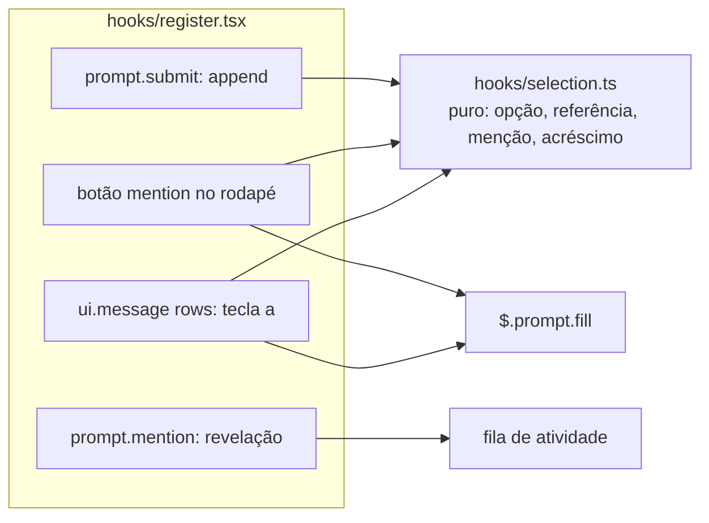
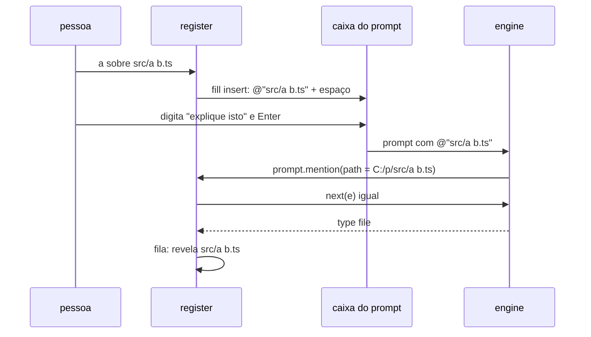

# Fatia 9: contexto da seleção

**Created.** `2026-10-19`

**Depends on.**

- `spec-00-overview.md`. Esta fatia define o mecanismo visível do contexto de seleção que a R1.4 deixou para cá.
- `spec-01-pane-tree-navigation.md`. Usa `selected`, `cursor`, o rodapé de seleção, o Client `rows` e `RowsMessage`.
- `spec-02-claude-activity.md`. Usa `uncover`, `ancestorsOf` e a fila `queue`.
- `spec-07-columns-and-look.md`. Usa `LABELS`.
- `spec-08-open-preview-edit.md`. A tecla `a` e o botão do rodapé convivem com as teclas e o preview desta fatia.

**Sources.**

- `https://github.com/data-goblin/claude-code-filetree` v0.2.26. Referência de comportamento:
  - `hooks/register.tsx` (o hook de `prompt.submit`, que acrescenta a seleção a `e.context` e revela as `@menções`);
  - `README.md` ("Selection-aware").

## Goal

Dar ao Claude a seleção da árvore como contexto e revelar na árvore os arquivos que o prompt menciona com `@`, sem nada que a pessoa não veja:

- **Menção explícita.** A tecla `a` na árvore, ou o botão `@` no rodapé, põe `@caminho` na caixa do prompt, onde a pessoa vê, edita ou apaga antes de enviar. O engine trata a menção como trata uma digitada.
- **Acréscimo visível, opcional.** Com a opção `selection` em `append`, um prompt digitado com um arquivo selecionado ganha, no fim do próprio texto, a linha `(selected in the file tree: <caminho>)`, que aparece na mensagem da pessoa na transcrição.
- **Revelação.** Cada arquivo mencionado com `@` que o engine anexou abre as pastas até ele na árvore e recebe o cursor.

A fatia está pronta quando os critérios abaixo passam nos testes e as checagens manuais confirmam a caixa do prompt e a linha acrescentada na transcrição.

## Current behavior

**No repositório (fim da spec-08, versão 0.8.0).**

- **Seleção.** `TreeState.selected` guarda o arquivo selecionado, e o rodapé mostra `selected: <relativo>` (spec-01). Nada dele chega ao Claude.
- **Hooks de prompt.** O mod não registra `prompt.submit`, `prompt.mention`, `prompt.attachment` nem `prompt.compose`. A spec-00 R1.4 proíbe acrescentar texto ou contexto que a pessoa não veja.
- **Original.** Em `prompt.submit`, acrescenta a `e.context`, que a pessoa nunca vê, `The user has this file selected in the file tree; "this" or "it" in the prompt likely refers to it: <caminho>`. Também procura `@caminho` no texto com uma expressão regular e revela os que existem.
- **Engine.**
  - `$.prompt.fill({ text, mode: 'insert' })` põe o texto na caixa do prompt, no cursor, e devolve `{ isFilled }`.
  - Em `prompt.submit`, `next({ ...e, text })` reescreve o prompt, e a mensagem na tela segue o texto reescrito. `e.context` é o que o modelo lê e a pessoa nunca vê. `e.origin.kind` é `composer` para o Enter da pessoa; `e.command` existe quando o prompt é um comando, e então uma reescrita de `text` não vale; `e.isMeta` marca um prompt que a pessoa não vê.
  - `prompt.mention` dispara uma vez por arquivo que o prompt nomeia depois de `@` (pastas não), com o `path` absoluto que o engine resolveu. `next(e)` lê o arquivo e devolve `{ type }`, que é `null` quando nada foi anexado. `e.agentId` existe quando a menção vem de um subagente.

## Requirements and acceptance

Neste documento:
- **referência** de um nó é o caminho que vai depois do `@`: relativo à cwd da sessão quando o nó está dentro dela, senão absoluto, sempre na forma `Paths.norm` (com `/`);
- **menção** de um nó é `@<referência>`, ou `@"<referência>"` quando a referência tem espaço em branco.

### R1. Opção

- R1.1. O `plugin.json` deve declarar a opção `selection` (`mention` padrão, `append`, `off`) com o texto de [Manifesto](#manifesto). Um valor desconhecido vale `mention`.

### R2. Menção explícita

- R2.1. Com `selection` diferente de `off`, a tecla `a` que o Client `rows` posta deve pôr a menção do nó do cursor, seguida de um espaço, na caixa do prompt, com `$.prompt.fill({ text, mode: 'insert' })`. Vale para arquivos e pastas. Sem cursor, nada acontece.
- R2.2. Com `selection` diferente de `off` e um arquivo selecionado, o rodapé deve mostrar, à esquerda de `selected:`, o botão `mention` com o rótulo `@`, que faz o mesmo que R2.1 com o arquivo selecionado.
- R2.3. Quando `$.prompt.fill` devolver `isFilled: false` ou rejeitar, o mod deve mostrar o toast `could not put <menção> in the prompt box`.
- R2.4. Com `selection` em `off`, `a` não faz nada e o botão não aparece.
- R2.5. Com um preview aberto (spec-08), `a` não faz nada.

### R3. Acréscimo visível

- R3.1. Com `selection` em `append`, um `prompt.submit` deve ser passado como `next({ ...e, text: e.text + "\n\n(selected in the file tree: <referência>)" })` quando todas valem:
  - `e.origin.kind` é `composer`;
  - `e.command` e `e.isMeta` não existem;
  - há um arquivo selecionado e `$.fs.stat` confirma que ele ainda é um arquivo;
  - o texto não contém a referência, sem diferenciar maiúsculas.
- R3.2. Em todos os outros casos, e com `selection` em `mention` ou `off`, o hook deve passar o mesmo `e` recebido.
- R3.3. O hook nunca deve criar, alterar ou remover `e.context`.
- R3.4. O resultado de `next` deve ser devolvido como veio.

### R4. Revelação das menções

- R4.1. O hook de `prompt.mention` deve passar o mesmo `e` a `next` e devolver o resultado como veio, sem `context` e sem `deny`.
- R4.2. Depois de `next`, quando o resultado tiver `type` diferente de `null`, `e.agentId` não existir e `e.path` estiver dentro da raiz da árvore (`Paths.inside`), o mod deve revelar o arquivo: listar as pastas que faltam até ele (como `uncover`), abrir os ancestrais, pôr o cursor nele e voltar a janela ao modo automático (`scroll = null`). Não há brilho.
- R4.3. A revelação roda na fila de atividade da spec-02, sem segurar o hook. Várias menções de um prompt são reveladas na ordem em que chegaram, e o cursor fica na última.
- R4.4. Uma revelação que encontrar a raiz trocada (outra `generation`) para sem mudar a árvore.
- R4.5. A revelação não depende da opção `selection` nem das opções `activity` e `follow`, porque é a pessoa que menciona.

### R5. Regras globais

- R5.1. O mod não deve registrar hooks de `prompt.attachment` nem de `prompt.compose`.
- R5.2. Os hooks desta fatia são o mecanismo visível da spec-00 R1.4: a única mudança que fazem num evento é o acréscimo de R3.1, que aparece na mensagem da pessoa.

## Architecture



- **Módulo puro novo.** `hooks/selection.ts` decide a opção, a referência, a menção e o texto acrescentado. Ele não chama `$`.
- **Estado.** Nenhuma chave nova. A fatia lê `tree`.

## Components and contracts

### `hooks/selection.ts` (novo, puro)

```ts
export type SelectionMode = 'mention' | 'append' | 'off'

export function selectionOf(options: PluginOptions): SelectionMode                 // R1.1

/** The path after the @: relative to the cwd inside it, else absolute; '/' separators. */
export function referenceOf(paths: Paths, cwd: string, id: string): string

/** @ref, or @"ref" when ref has white space (R2.1). */
export function mentionOf(ref: string): string

/** The prompt with the selection line, or null when R3.1 does not apply to the text. */
export function appended(text: string, ref: string): string | null
```

`appended` só confere a regra do texto (a referência ausente, sem diferenciar maiúsculas). As regras de origem, comando, `isMeta` e existência ficam no hook, que tem o `e` e o `$`.

### `hooks/register.tsx` (alterado)

Variável de módulo nova: `selection: SelectionMode`, das opções em `register`.

| Função | Contrato | Critérios |
|---|---|---|
| `mention($, id)` | `$.prompt.fill` com a menção e um espaço; toast em R2.3 | R2.1–R2.3 |
| `revealMention($, id)` | `uncover`, ancestrais abertos, cursor, `scroll = null`; para se a `generation` mudou | R4.2, R4.4 |

Pontos de chamada:

| Onde | Mudança |
|---|---|
| `register` | `selection = selectionOf(options)` |
| `ui.message` (`rows`) | sem preview, a tecla `a` chama `mention` com o cursor quando `selection !== 'off'` |
| `renderPane` (via ação) | o botão `mention` chama `mention` com o selecionado |
| hook novo `prompt.submit` | R3 |
| hook novo `prompt.mention` | R4: `const r = await next(e)`, enfileira `revealMention`, devolve `r` |

### `hooks/pane.tsx` (alterado)

`PaneActions` ganha `mention: () => Promise<unknown>`, e `HeaderLook` ganha `mention: boolean`. O rodapé desenha `<Button key="mention" plain dimColor>@</Button>` antes de `selected:` quando `mention` é verdadeiro e há seleção.

## Data models

Nenhuma chave nova em `PluginState`.

### Manifesto

`.claude-plugin/plugin.json`: versão `0.9.0` e a opção acrescentada a `userConfig`:

```json
{
  "selection": {
    "type": "string",
    "title": "Selection in prompt",
    "description": "How Claude learns what you picked in the tree, always in plain sight. mention: a puts @path of the row under the cursor in the prompt box, and @ in the footer does it for the selected file. append: also adds a line (selected in the file tree: path) to the end of each prompt you type while a file is selected. off: neither. @mentions you type reveal the file in the tree either way.",
    "default": "mention",
    "options": ["mention", "append", "off"]
  }
}
```

### Emenda à spec-00

| Onde | Mudança |
|---|---|
| R1.4 | O mecanismo visível é o da spec-09: a menção posta na caixa do prompt, que a pessoa vê antes de enviar, e o acréscimo opcional ao texto, que aparece na mensagem da pessoa. `e.context` nunca é usado |

### Emenda à spec-01

| Onde | Mudança |
|---|---|
| Tabela de teclas | `a`: põe a menção do nó do cursor na caixa do prompt (spec-09 R2.1) |
| Rodapé de seleção | Ganha o botão `@` à esquerda (spec-09 R2.2) |

## Workflows

### Menção explícita



### Acréscimo visível

| `selection` | Origem | Selecionado | Texto já cita | Resultado |
|---|---|---|---|---|
| `append` | `composer` | `src/a.ts`, existe | não | `texto` + `\n\n(selected in the file tree: src/a.ts)` |
| `append` | `composer` | `src/a.ts`, existe | sim | `e` igual |
| `append` | `composer` | apagado | — | `e` igual |
| `append` | `task-notification`, `peer`… | qualquer | — | `e` igual |
| `append` | `composer` com `command` | qualquer | — | `e` igual |
| `mention`, `off` | qualquer | qualquer | — | `e` igual |

## Guarantees and invariants

### G1. Nada invisível

- **Escopo.** Todo `prompt.submit` e `prompt.mention`.
- **Mecanismo.**
  - `e.context` nunca é tocado, e `prompt.mention` não acrescenta `context`.
  - A única reescrita é a de `text` em R3.1, que o engine mostra na mensagem da pessoa.
- **Critérios.** R3.2, R3.3, R4.1, R5.
- **Verificação.** Os testes comparam o `e` que o hook de baixo recebe com o enviado: igual em todos os casos, menos o `text` de R3.1, e sem `context` novo.

### G2. A revelação não segura o prompt

- **Escopo.** Todo `prompt.mention`.
- **Mecanismo.** A revelação entra na fila de atividade depois de `next`; o hook devolve logo o resultado.
- **Critérios.** R4.3.
- **Verificação.** Com a listagem de uma pasta atrasada, o hook resolve antes da listagem, e a árvore mostra o arquivo depois.

## Error handling

| Situação | Resposta observável | Estado resultante |
|---|---|---|
| caixa do prompt indisponível (diálogo, sem terminal) | toast `could not put <menção> in the prompt box` | — |
| selecionado apagado antes do Enter (append) | nada acrescentado | — |
| menção a arquivo fora da raiz da árvore | nada revelado | — |
| menção que o engine não anexou (`type: null`) ou negou | nada revelado | — |
| raiz trocada durante a revelação | a revelação para | árvore da nova raiz |

## Key decisions

| Decision | Chosen | Rejected alternative | Why, and what it costs |
|---|---|---|---|
| Mecanismo visível | Menção posta na caixa do prompt | `e.context` oculto (original) | Regra R1.4. A pessoa vê e decide antes de enviar. Custa uma tecla por prompt |
| Acréscimo automático | Opcional (`append`), no texto da mensagem | Sempre ligado; ausente | Dá a paridade de "sempre saber a seleção" a quem quiser, ainda visível. Custa a linha a mais na transcrição |
| Texto do acréscimo | Caminho sem `@` | `@caminho` | Não se sabe se o engine expande uma menção acrescentada por hook; o caminho simples basta para o Claude ler o arquivo |
| Revelação | Pelo `prompt.mention` do engine | Expressão regular sobre o texto (original) | Usa o caminho que o engine resolveu e só o que ele anexou, sem parser próprio |
| Referência | Relativa à cwd, com `/` | Caminho nativo com `\` | É como menções são digitadas e como o engine as resolve |
| Opção padrão | `mention` | `append` | O mínimo de mudança no texto da pessoa, com o recurso à mão |

## Affected areas

| Area | Responsibility |
|---|---|
| `hooks/selection.ts` (novo) | `selectionOf`, `referenceOf`, `mentionOf`, `appended` |
| `hooks/register.tsx` | `selection`, `mention`, `revealMention`, tecla `a`, hooks `prompt.submit` e `prompt.mention` |
| `hooks/pane.tsx` | botão `mention` no rodapé |
| `.claude-plugin/plugin.json` | opção `selection`; versão `0.9.0` |
| `tests/selection.test.ts` (novo) | funções puras |
| `tests/prompt.test.tsx` (novo) | tecla `a`, botão, `prompt.submit`, `prompt.mention`, com o mundo de `tests/world.ts` (spec-08) |
| `spec-00-overview.md`, `spec-01-pane-tree-navigation.md` | emendas |

## Implementation constraints

- `$.prompt.fill` só pode aparecer em `mention`.
- Nenhum hook de `prompt.attachment` ou `prompt.compose` (R5.1), o que a saída de `claude plugin validate` confirma.

## Verification

Comandos da spec-00. Nos testes, o hook de baixo de `prompt.submit` devolve `{ text: e.text, context: e.context }` e guarda o `e`; o de `prompt.mention` devolve um `type` escolhido pelo teste; o de `prompt.fill` guarda o texto e devolve `isFilled` escolhido pelo teste.

| Critérios | Teste |
|---|---|
| R1.1 | `selectionOf` com valores válidos e desconhecidos |
| R2.1–R2.5 | `a` em arquivo, pasta, nome com espaço, fora da cwd; sem cursor; botão `@` com e sem seleção; `isFilled: false`; `off`; com preview |
| R3.1–R3.4, G1 | cada linha da tabela de [Acréscimo visível](#acréscimo-visível); `context` igual ao enviado |
| R4.1–R4.5, G2 | arquivo numa pasta fechada é revelado com o cursor; `type: null`, subagente e fora da raiz não revelam; duas menções deixam o cursor na última; raiz trocada para; o hook não espera a listagem |
| R5.1 | `claude plugin validate` não lista `prompt.attachment` nem `prompt.compose` |

Verificação manual, com o mod na versão 0.9.0:

1. Selecionar um arquivo, focar o painel e pressionar `a`: `@caminho ` deve aparecer na caixa do prompt, no cursor. Confirma A1.
2. Enviar um prompt com `@src/arquivo` numa pasta fechada: a pasta deve abrir e o cursor ir ao arquivo.
3. Com `selection: append`, enviar um prompt com um arquivo selecionado: a mensagem na transcrição deve terminar com `(selected in the file tree: …)`. Confirma A2.

## Assumptions

- **A1.** O engine trata `@"caminho com espaço"` como uma menção, como trata `@caminho`.
- **A2.** A reescrita do `text` num `prompt.submit` aparece na mensagem da pessoa, como diz o contrato do evento.

## Out of scope

- Menções de pastas reveladas (o engine não dispara `prompt.mention` para pastas).
- Mais de um arquivo selecionado.
- Sugestões de caminho na digitação (`prompt.autocomplete`).
