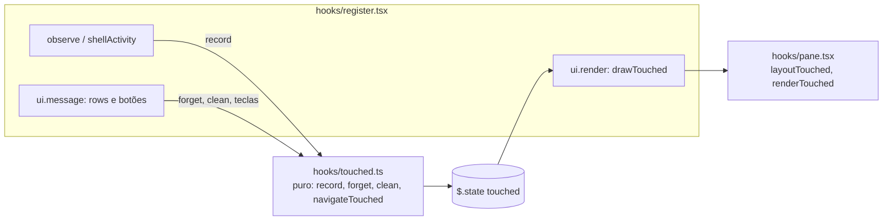
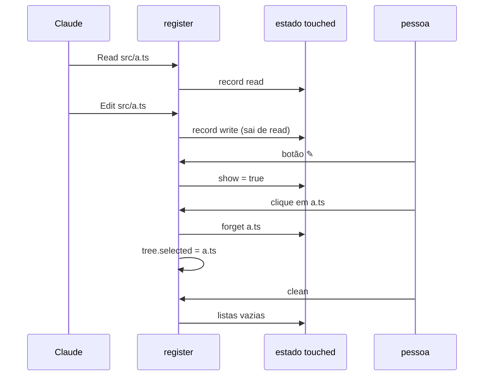

# Fatia 10: arquivos tocados pelo Claude

**Created.** `2026-10-20`

**Depends on.**

- `spec-00-overview.md`. Acrescenta a chave `touched` ao contrato de estado.
- `spec-01-pane-tree-navigation.md`. Usa o cabeçalho, a linha de navegação, o Client `rows`, `RowsMessage`, `windowOf`, `copyPath`, o rodapé de seleção e o `ui.scroll`.
- `spec-02-claude-activity.md`. Usa `touchOf`, `observe`, a fila `queue`, a varredura de shell e o brilho.
- `spec-07-columns-and-look.md`. Usa o Client `button.tsx`, as dicas (R5), `LABELS`, `nodeGlyph`, `cols` e `take`. Emenda a lista de botões do cabeçalho.
- `spec-08-open-preview-edit.md`. Usa a opção `open`, `openInApp`, `showPreview` e o botão de voltar.
- `spec-09-selection-context.md`. Usa `mention` e a tecla `a`.

**Sources.** Nenhuma. Não existe no original: nasceu do uso do mod em projetos grandes.

## Goal

Em projetos com uma quantidade enorme de arquivos, a árvore fica pesada e nunca mostra tudo: o que o Claude leu ou alterou se perde entre milhares de linhas, ou em pastas que a árvore nem chegou a listar. Esta fatia acrescenta uma segunda visão do painel, que mostra **apenas os arquivos que o Claude leu e alterou**:

- **Um botão no cabeçalho** (`✎`) troca a árvore por essa visão, e de volta.
- **Duas listas:** alterados no topo, lidos logo abaixo, cada uma sob o seu título com a contagem, o mais recente primeiro.
- **`clean`** esvazia as duas listas, só para deixar a visão limpa. Não faz commit, não toca em arquivo nem no git.
- **Clicar num arquivo** o seleciona, como na árvore, e o tira da sua lista.

A visão não depende da árvore: as listas se enchem com o que o Claude toca, esteja a árvore carregada ou não, e se desenham sem listar pasta nenhuma.

A fatia está pronta quando os critérios abaixo passam nos testes, nas superfícies `terminal` e `desktop`, e a checagem manual confirma a visão num projeto grande.

## Current behavior

**No repositório (fim da spec-09, versão 0.9.0).**

- **Atividade.** `observe` (spec-02) calcula com `touchOf` o que cada tool call leu ou escreveu dentro da raiz da árvore e acende essas linhas por `FLASH_MS`. Depois do brilho, nada guarda o que foi tocado.
- **Árvore grande.** A árvore só mostra o que foi listado. A revelação de um arquivo lista as pastas até ele, mas o brilho some e o arquivo fica perdido entre os outros.
- **Cabeçalho.** Botões `↑ ⌂ ↻ ◉ Σ ⊟ ⊘` (spec-07 R5), cada um um Client `button.tsx` que posta `{ over }` ou `{ press: true }`.

## Requirements and acceptance

Neste documento:
- **visão** é a visão dos arquivos tocados, desenhada no lugar da árvore;
- **listas** são `written` (alterados) e `read` (lidos) da chave `touched`;
- **arquivo listado** é um id de uma das listas.

### R1. A visão

- R1.1. O cabeçalho da árvore deve ter o botão `touched` (rótulo `✎`; Nerd Font `U+EA82`), à esquerda de `⊘`, esmaecido enquanto a árvore aparece, com a dica `files Claude touched`.
- R1.2. Pressionar `touched`, ou a tecla `t` no Client `rows`, deve trocar a árvore pela visão, e a visão pela árvore. Na visão, o cabeçalho mostra o rótulo da raiz, ` · touched by Claude` e os botões `touched` (aceso, dica `back to the tree`) e `clean` (dica `clear the lists`). Os demais botões da árvore e a busca não aparecem; a linha de navegação tem `↓`, `↑` e `open`.
- R1.3. Com um preview aberto, o botão não aparece e `t` não troca a visão; `←` volta à visão de onde o preview saiu. Uma troca que chegue com o preview aberto o fecha antes.
- R1.4. A escolha da visão e as listas ficam em `$.state` e sobrevivem a um reload do mod.

### R2. O que é listado

- R2.1. Depois de cada tool call, na fila de atividade da spec-02:
  - `Read` e `Grep` (os `filenames` do resultado, até `SEARCH_LIMIT`) listam como lidos; `Glob` não, porque só lista nomes;
  - `Edit`, `Write` e `NotebookEdit` listam como alterados;
  - um comando de shell lista como alterados os arquivos que a varredura da spec-02 R6 e da spec-04 R2 encontrou; pastas novas não entram;
  - só entram arquivos dentro da cwd da sessão ou da raiz da árvore, e só de chamadas sem `deny` e sem `isError` (como em `touchOf`).
- R2.2. Um arquivo entra no topo da sua lista; se já estava, sobe para o topo. Cada arquivo aparece uma vez, comparado por `Paths.key`.
- R2.3. Um arquivo alterado sai da lista de lidos.
- R2.4. Ler um arquivo que está na lista de alterados não muda nada.
- R2.5. Cada lista guarda no máximo `TOUCHED_LIMIT` (200) arquivos; o mais antigo sai primeiro.
- R2.6. As listas se enchem com a árvore ou a visão na tela e qualquer valor das opções `activity` e `follow`.

### R3. Desenho

- R3.1. A visão mostra os alterados no topo e os lidos logo abaixo. Cada lista com arquivos tem uma linha de título (`changed N` na cor de escrita, `read N` na cor de leitura, o título em negrito); uma lista vazia não tem título. Sem nenhum arquivo, o Client mostra `nothing read or changed yet`.
- R3.2. Os títulos têm ids `#written` e `#read`, que nunca são um arquivo.
- R3.3. A linha de um arquivo mostra o glyph do arquivo, o nome na cor da sua lista (negrito quando é o selecionado) e a pasta onde ele está: relativa à raiz da árvore, vazia na raiz, abreviada com `~` fora dela. Sem espaço, a pasta é cortada pelo começo (`…`) e some antes do nome; o nome é cortado com `…`. Um arquivo aceso pela spec-02 brilha na visão como brilha na árvore.
- R3.4. No terminal, a visão recebe uma janela que segue o cursor (ou, com `follow`, o que o Claude acabou de tocar), com barra de rolagem; a roda e o arraste da barra a movem. No desktop, recebe todas as linhas.
- R3.5. O rodapé da visão é o da árvore: `@`, `selected: <caminho>` e o chip de git.

### R4. Clicar e teclas

- R4.1. Um clique num arquivo listado deve selecioná-lo (`tree.selected`) e tirá-lo da sua lista. Nada abre. O cursor que estava nele vai para a linha seguinte, ou a anterior.
- R4.2. `Enter`, ou um clique com `Ctrl`/`Shift`, deve tirá-lo da lista, selecioná-lo e abri-lo como a opção `open` diz (spec-08 R2).
- R4.3. As teclas da visão são as da árvore que fazem sentido numa lista: `j`/`↓`, `k`/`↑`, `PageDown`/`PageUp`, `Home`/`End` movem o cursor pelos arquivos (os títulos ficam de fora); `y`/`Y` e o clique direito copiam o caminho (absoluto para um arquivo fora da raiz) sem tirá-lo da lista; `a` põe a menção do cursor na caixa do prompt (spec-09 R2.1), sem tirá-lo.
- R4.4. Um clique num título, ou com um id que não está listado, não faz nada.

### R5. Clean

- R5.1. `clean` deve esvaziar as duas listas e manter a visão na tela. Ele fica esmaecido quando as listas já estão vazias.
- R5.2. `clean` não chama `$.process.run`, `$.fs` nem o git, e não muda a árvore, a seleção nem o status do git.
- R5.3. `clean` só existe na visão: uma mensagem dele com a árvore ou o preview na tela é ignorada.

## Architecture



- **Módulo puro novo.** `hooks/touched.ts` decide o que as listas guardam e como as teclas se movem nelas. Ele não chama `$`.
- **Desenho.** `hooks/pane.tsx` ganha `layoutTouched` e `renderTouched`, e o rodapé vira uma função que a árvore e a visão compartilham.
- **Estado.** Uma chave nova, `touched`. As listas guardam ids absolutos, então valem para qualquer raiz.

## Components and contracts

### `hooks/touched.ts` (novo, puro)

```ts
export const TOUCHED_LIMIT = 200
export const WRITTEN_ID = '#written'
export const READ_ID = '#read'
export type TouchedEffect = { open: string } | { copy: 'relative' | 'absolute'; id: string }

export function emptyTouched(): TouchedState
export function countsAsRead(tool: string): boolean                                          // R2.1
export function listedIds(s: TouchedState): string[]                                         // alterados, depois lidos
export function record(s, paths, kind: 'read' | 'write', ids): TouchedState                  // R2.2–R2.5; `s` quando nada muda
export function forget(s, paths, id): TouchedState                                           // R4.1
export function clean(s): TouchedState                                                       // R5.1
export function navigateTouched(s, input): { touched: TouchedState; effect?: TouchedEffect } // R4.3
```

### `hooks/pane.tsx` (alterado)

| Mudança | Critérios |
|---|---|
| `HEADER_IDS` ganha `touched`; `TOUCHED_IDS = ['touched', 'clean']` | R1.1, R1.2, R5.3 |
| `layoutTouched(s, view, paths, look, footerShows)` devolve `{ from, max, room, props }` | R3 |
| `renderTouched($, e, paths, root, layout, below, look, actions)` | R1.2, R3.5 |
| `footer(...)`, compartilhado com `renderPane` | R3.5 |

### `hooks/register.tsx` (alterado)

| Função | Contrato | Critérios |
|---|---|---|
| `noteTool` | `touchOf` com a cwd e com a raiz da árvore como limite, depois `record` | R2.1, R2.6 |
| `noteFiles` | `record` em `touched` | R2 |
| `toggleTouched` | fecha o preview, troca `show`, janela automática | R1.2, R1.3 |
| `takeTouched` | `forget`, `tree.selected` e, com `open`, a opção `open` | R4.1, R4.2 |
| `touchedKey`, `touchedMessage` | teclas, cliques e barra da visão | R3.4, R4 |
| `drawTouched` | `layoutTouched` e `renderTouched` | R3 |

Pontos de chamada:

| Onde | Mudança |
|---|---|
| `observe` | `noteTool` antes do brilho, para toda tool call |
| `shellActivity` | `noteFiles` com os ids da varredura, menos as pastas |
| `headerAction` | `touched` e `clean` |
| `parseButton` | na visão, só `TOUCHED_IDS` |
| `ui.render` | com `touched.show` e sem preview, `drawTouched` |
| `ui.message` (`rows`) | na visão, os ids válidos são os listados; `t` troca a visão |
| `ui.scroll` | na visão, move a janela dela |
| `copyPath` | fora da raiz, o caminho absoluto |
| `flash`, `endGlow` | a janela da visão segue e congela como a da árvore |

## Data models

```ts
export type TouchedState = {
  show: boolean          // a visão no lugar da árvore
  written: string[]      // alterados, o mais recente primeiro; Paths.norm
  read: string[]         // lidos e não alterados, o mais recente primeiro
  cursor: string         // id listado ou ''
  scroll: number | null  // null = janela automática
}
```

Chave `touched` em `PluginState['filetree-local']`. O `plugin.json` passa à versão `0.10.0`; nenhuma opção nova.

### Emenda à spec-07

| Onde | Mudança |
|---|---|
| R5.1, botões do cabeçalho | `touched` entre `⊟` e `⊘` |
| Rótulos | `touched`: `✎` (plain), `U+EA82` (nerd); `clean`: `clean` (plain), `U+F00E2 clean` (nerd) |

## Workflows



## Guarantees and invariants

### G1. A visão não pesa num projeto grande

- **Escopo.** Desenhar a visão e pressionar seus botões.
- **Mecanismo.** A visão desenha só as listas guardadas em `$.state`; não chama `$.fs.list`, `$.fs.stat` nem o git. Cada lista tem no máximo 200 arquivos.
- **Critérios.** R2.5, R3, R5.2.
- **Verificação.** Os testes contam as leituras e os processos antes e depois de `clean` e dos cliques.

### G2. Clean só limpa a visão

- **Escopo.** `clean`.
- **Mecanismo.** `clean` é uma escrita em `touched`, e nada mais.
- **Critérios.** R5.1, R5.2.
- **Verificação.** Nenhum processo nem leitura depois de `clean`, e a visão continua na tela.

## Error handling

| Situação | Resposta observável | Estado resultante |
|---|---|---|
| arquivo listado que foi apagado, aberto | o toast de `openInApp` (spec-08) | fora da lista, selecionado |
| clique num título ou id desconhecido | nada | — |
| `clean` com a árvore ou o preview na tela | ignorado | — |

## Key decisions

| Decision | Chosen | Rejected alternative | Why, and what it costs |
|---|---|---|---|
| Onde fica a visão | No mesmo painel, trocada por um botão do cabeçalho | Um segundo painel | O pedido é um botão junto do menu da árvore; um painel a mais disputa a largura. Custa um botão a mais no cabeçalho |
| `Glob` | Não conta como leitura | Contar como na spec-02 | `Glob` só lista nomes; num projeto grande encheria a lista de arquivos que o Claude nunca abriu |
| Arquivo lido e depois alterado | Só em alterados | Nas duas listas | Cada arquivo numa categoria, a mais forte. Custa não ver que ele também foi lido |
| Clique | Seleciona e tira da lista; `Enter` e `Ctrl`+clique abrem | Clique abre | Mantém o gesto da árvore (spec-08 R2.3): o clique simples só seleciona |
| Limite | 200 por lista | Sem limite | `$.state` e o desenho ficam pequenos |
| Opções | Nenhuma nova; as listas ignoram `activity` | Obedecer `activity` | A visão é o que a pessoa abre de propósito; o brilho é outra coisa |

## Affected areas

| Area | Responsibility |
|---|---|
| `hooks/touched.ts` (novo) | listas e teclas |
| `hooks/pane.tsx` | botão, `layoutTouched`, `renderTouched`, rodapé compartilhado |
| `hooks/register.tsx` | estado, registro, mensagens, desenho, rolagem |
| `hooks/icons.ts` | rótulos `touched` e `clean` |
| `types/index.d.ts` | `TouchedState` e a chave `touched` |
| `.claude-plugin/plugin.json` | versão `0.10.0` |
| `tests/touched.test.ts` (novo) | funções puras e layout |
| `tests/touchedview.test.tsx` (novo) | a visão pelo engine, com o mundo de `tests/world.ts` |
| `tests/pane.test.tsx` | o teste de dicas a 30 colunas passa a 32, pelo botão a mais |

## Verification

Comandos da spec-00.

| Critérios | Teste |
|---|---|
| R1.1–R1.4 | botão esmaecido e aceso, troca pelo botão e por `t`, dicas, `t` e o botão ausentes no preview, volta do preview à visão, reload |
| R2.1–R2.6 | ordem e categorias; `Glob`, erros, `deny`, fora da cwd e da raiz; `activity: none`; raiz fora da cwd; shell sem pastas; limite |
| R3.1–R3.5 | títulos e contagens, cores, pasta relativa e abreviada, cortes, negrito do selecionado, brilho, janela e barra, desktop |
| R4.1–R4.4 | clique seleciona e tira; `Ctrl`+clique e `Enter` abrem; preview e volta; cursor; `a`; clique direito; títulos |
| R5.1–R5.3, G1, G2 | `clean` esvazia, esmaece, sem processo nem leitura; ausente na árvore e no preview |

Verificação manual, com o mod na versão 0.10.0:

1. Num projeto grande, pedir ao Claude que leia e altere alguns arquivos e pressionar `✎`: os alterados aparecem no topo e os lidos abaixo, sem esperar a árvore.
2. Clicar num arquivo: ele some da lista e aparece em `selected:` no rodapé.
3. Pressionar `clean`: a visão fica vazia, e `git status` não muda.

## Out of scope

- Guardar as listas entre sessões (`$.store`, proibido pela spec-00 R1.7).
- Desfazer `clean` ou um clique.
- Filtrar ou buscar dentro das listas.
